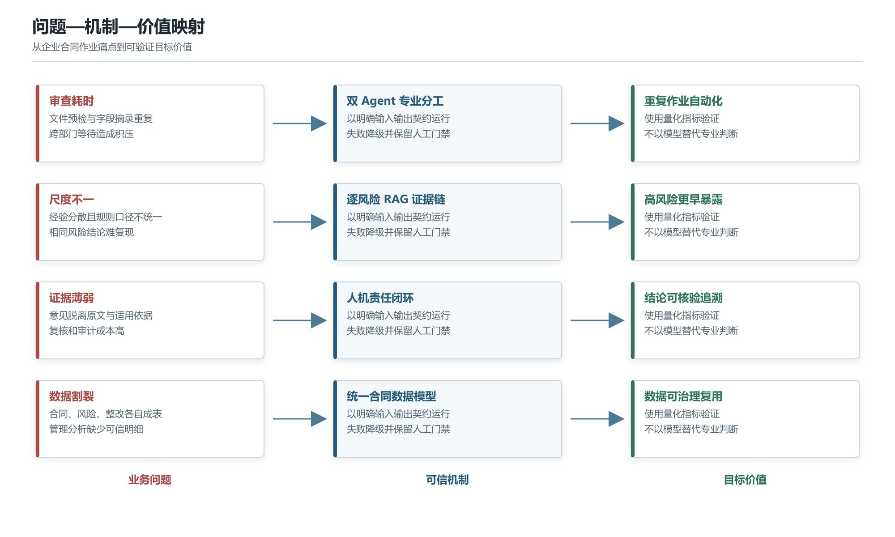
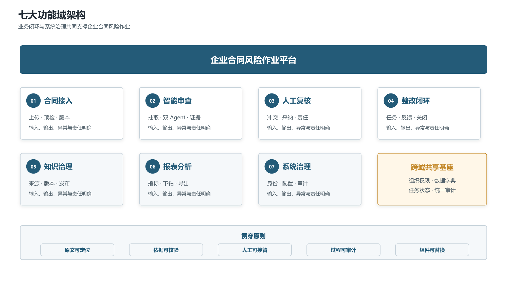

# 第一章 项目概述

## 1.1 建设背景

合同并不是签字后才需要管理的文件。交易条件在起草、谈判和审批阶段逐步形成，签署后的付款、验收、开票、履约和争议处理又持续引用这些条件。因此，合同审查既要回答“这份文本有什么风险”，也要保证结论能够回到原文、交给责任人并在后续处理中被复查。

企业常见的审查方式仍以文件传递和人工阅读为主。业务人员通过邮件或即时通信工具提交合同，法务和财务分别批注意见，修改后的文件再次流转。这个过程能依靠经验完成单份合同审查，却容易在合同数量增加、版本频繁变化或多人协同时暴露问题：原件与修改稿混在一起，意见无法稳定定位到原文，法务与财务判断缺少统一交接，整改结果没有闭环，管理报表也难以从原始记录直接汇总。

“契鉴”面向上述业务过程，建设企业级合同合规审查与多维报表生成系统。系统把文件接入、文本解析、要素提取、专业审查、人工复核、整改跟踪和统计分析组织为一条连续的业务链。智能模型用于发现线索、归纳事实和生成辅助意见；合同是否接受、风险如何处置以及重大事项是否升级，仍由具有相应权限的人员决定。

## 1.2 业务问题

合同审查的困难不只来自文本篇幅，更来自信息在不同角色和不同阶段之间失去联系。

第一，输入质量不稳定。DOCX、文本型 PDF、扫描 PDF 的可读性不同，复杂表格、页眉页脚、盖章和低清图像会影响文本提取。若系统没有在审查前识别解析质量，后续模型可能基于缺页或乱码内容作出判断。

第二，专业关注点不同。法务关注主体资格、权利义务、违约责任、争议解决和合规依据；财务关注金额、税率、发票、付款节点、结算条件及其与验收条款的一致性。两类意见可能互补，也可能对同一条款给出不同等级。将它们压缩成一个不说明来源的结论，会掩盖真正需要人工判断的分歧。

第三，审查结果不易执行。单纯生成一份报告不能保证风险得到处理。有效的系统需要明确风险原文、依据、建议、责任人、处理理由、复审结果和关闭条件，使审查意见能够转化为可跟踪任务。

第四，管理口径难统一。合同数量、金额、类型、部门、风险等级和整改时效来自不同数据对象。若报表靠人工维护台账，指标容易与原合同、原风险或权限范围脱节，也难以解释数字形成过程。

第五，系统性风险需要工程控制。合同通常含有商业秘密、个人信息和交易条件。文件、模型上下文、导出结果、操作日志和备份副本都需要被纳入访问控制、加密、留存和审计范围，而不能只保护登录入口。

## 1.3 建设目标

项目的总体目标是形成一个可追溯、可复核、可扩展的合同审查工作平台。该目标分为五个方面。

其一，建立统一入口。系统接收单份或批量合同，对文件类型、大小、完整性和重复内容进行预检，保存原始文件及版本标识，并向用户展示明确的处理状态。

其二，形成结构化审查。系统从合同中提取主体、金额、期限、付款、发票、验收等要素；法务与财务审查分别输出结构化意见，并把风险关联到原文位置、适用依据和修改建议。

其三，保留人工责任。用户可以确认、调整、补充或不采纳辅助意见。高风险处置、意见冲突和证据不足等情形必须进入人工复核，并记录操作者、理由和时间。

其四，打通整改与分析。审查结论可以转为整改项，关联责任人、期限和复审记录。报表从已授权的合同、风险和处置记录中聚合，不另建无法核对的统计口径。

其五，具备企业交付条件。系统支持内网部署、角色与部门隔离、日志审计、配置管理、备份恢复、故障降级和版本升级，并为测试验收提供稳定的指标、样本和证据规范。

## 1.4 项目定位

契鉴的定位是“合同审查工作平台”，而不是自动出具法律结论的工具。它连接业务经办人、法务、财务、部门负责人、管理者和系统管理员，把机器擅长的批量读取、规则比对、信息检索和结构化整理，与专业人员擅长的事实确认、适用性判断和风险决策结合起来。

系统围绕四类核心对象组织能力：合同及其版本保存业务输入；审查任务保存处理过程；风险与证据保存专业意见；整改与处置事件保存执行结果。知识资料为审查提供可核对的法规、制度和条款依据，报表则在权限范围内汇总这些业务对象。

项目不以替代企业现有合同审批制度为目标。已有 OA、统一身份、电子签章、档案或财务系统可以通过标准接口与契鉴衔接；具体审批层级、印章规则和付款控制仍由企业制度及其权威系统负责。

## 1.5 建设范围

本期建设范围包括：用户认证与角色授权；合同文件上传、批量接入、版本识别和状态查询；DOCX、文本型 PDF、扫描 PDF 的解析及质量判断；合同要素抽取；法务与财务辅助审查；规则检查、知识检索和证据关联；风险人工复核；整改分派、反馈、复审和关闭；审查报告、台账导出和多维报表；知识资料、用户、角色、部门及日志管理；任务调度、运行监控和备份恢复所需的基础能力。

范围之外的事项包括：代替律师或企业授权人员作出最终法律判断；自动完成合同签署或付款；在未获得授权时采集外部业务数据；对所有行业、地区和合同类型承诺统一准确率；把演示环境的容量或性能直接等同于生产结论。若后续接入电子签章、采购、财务或档案系统，应在接口、安全和数据责任明确后分阶段实施。

## 1.6 建设原则

**原文优先。** 每一条风险都应尽可能回到合同原文或明确标记“无法定位”。摘要不能替代原文，模型生成的解释不能被伪装成合同事实。

**证据分级。** 法律法规、企业制度、示范文本和历史案例具有不同效力与适用范围。系统分别保存来源类型、版本、有效期和适用说明，不以相似度分数代替适用性判断。

**专业分工。** 法务与财务审查保持独立结构，共享必要上下文但不相互覆盖。冲突由合并规则识别并交给人工处理。

**人工可控。** 低置信度解析、无可靠依据、意见冲突、高影响操作和越权请求均有明确出口。系统不得在这些情形下静默生成确定性结论。

**最小权限。** 用户只能访问其角色和部门范围内的合同、风险、报表与导出结果。后台任务执行与接口访问使用一致的授权边界。

**全过程留痕。** 文件版本、解析结果、模型配置、知识版本、人工修改、状态迁移和导出操作均形成可审计记录。业务数据与审计事件各自保存，避免后续修改覆盖历史。

**可验证交付。** 需求、设计和实现均对应可重复的验收方法。尚未在目标环境验证的能力只描述验证条件，不提前写成结论。

## 1.7 总体业务路径

一份合同进入系统后，先完成身份校验、文件预检和版本登记。解析服务提取正文、表格及位置映射，并根据质量状态决定是否进入 OCR 或人工补件。要素抽取服务形成标准字段，法务与财务审查在各自上下文中运行。规则结果、知识依据和模型意见经结构校验后形成风险记录；重复风险可以合并，冲突意见并列保留。审查人员复核后生成报告或整改任务，整改完成后再由相应角色复审。管理报表根据授权范围聚合合同、风险和处置数据。

这条路径的关键不是“一键输出”，而是每一步都能说明输入、处理、输出、责任和失败方式。后续章节将分别从需求、总体设计、功能、技术、数据安全、部署运维和测试验收角度展开。

## 1.8 项目边界与责任

系统输出由合同文本、配置规则、知识资料和模型能力共同决定。文本缺失、交易背景未录入、知识来源失效或模型服务不可用，都会影响结果。系统通过质量状态、置信标识、来源标识和人工复核降低误用风险，但不能消除专业判断本身的不确定性。

业务经办人对合同版本和交易事实负责；法务、财务对各自专业意见负责；部门负责人对风险接受和整改安排负责；管理者对授权与管理口径负责；系统管理员对账号、配置、运行和日志管理负责。技术平台提供一致的流程、数据和证据，不改变这些职责归属。
