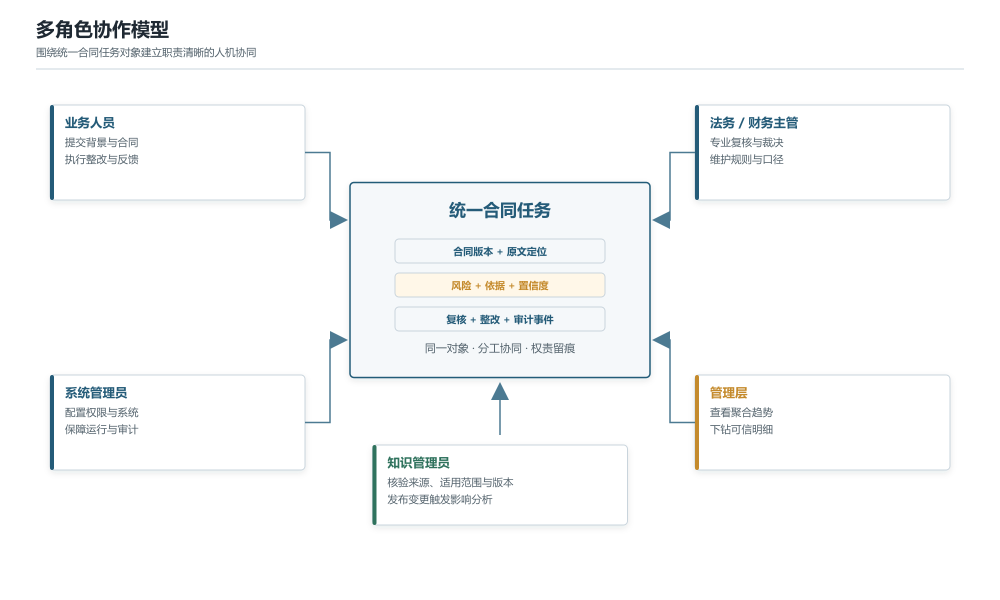

# 第二章 需求分析

## 2.1 需求分析方法

需求分析以合同从提交到关闭的业务过程为主线，不从页面菜单反推需求。分析对象包括参与角色、业务场景、输入资料、判断任务、交接关系、异常情况和验收证据。对每项需求同时明确“系统做什么”和“人员负责什么”，避免把辅助功能误写为自动决策。

需求来源主要包括企业合同管理的一般流程、项目既有功能边界、适用法规与信息安全要求，以及部署和运维所需的工程约束。需求进入设计前，需要确认术语、数据对象、优先级和验收方式。涉及具体组织制度、审批权限或外部接口的内容，由实施阶段与目标单位共同确认，不在通用方案中虚构。

## 2.2 业务角色与职责

| 角色 | 主要任务 | 关注信息 | 系统支持 | 责任边界 |
|---|---|---|---|---|
| 业务经办人 | 提交合同、补充交易背景、接收意见并反馈整改 | 文件版本、交易对象、履约条件、处理进度 | 上传预检、版本登记、状态查询、整改反馈 | 对提交版本、业务事实和整改沟通负责 |
| 法务审查人员 | 审查权利义务、责任分配、争议解决与合规性 | 原文、法律依据、风险等级、修改建议 | 法务辅助审查、原文定位、依据关联和人工复核 | 对法律适用和重大事项升级负责 |
| 财务审查人员 | 核对价税、付款、发票、结算与验收关系 | 金额、税率、付款节点、发票条件、资金风险 | 财务辅助审查、要素抽取和一致性检查 | 对财务口径和结算条件确认负责 |
| 部门负责人 | 分派整改、确认风险接受或关闭 | 风险影响、责任人、期限和复审意见 | 整改任务、期限提醒、状态与理由留痕 | 对本部门处置决定和资源安排负责 |
| 管理者 | 了解合同与风险分布，识别积压和重点问题 | 部门、类型、金额、等级、趋势、处置时效 | 权限范围内的报表、排行、趋势和导出 | 对管理口径、授权和资源决策负责 |
| 系统管理员 | 管理账号、角色、部门、知识和运行配置 | 权限关系、资料版本、任务健康、审计事件 | RBAC、部门隔离、知识版本和运行管理 | 不参与合同专业判断，不越权查看业务内容 |

## 2.3 现状流程与主要矛盾

典型现状流程是业务人员提交文件，法务和财务分别下载审阅，再通过批注、邮件或消息返回意见。经办人修改后重新发送，直到各方认为可以签署。签署后的整改、履约提醒和统计常由另一套台账承担。

该流程存在四类主要矛盾。文件在不同工具间流转，导致版本难确认；意见以自然语言分散保存，无法稳定关联风险和原文；专业意见缺少统一状态，不能区分机器建议、人工确认与部门决定；统计结果脱离业务过程，更新成本高且难以追溯。

目标流程要求原文件只登记一次，每次变更形成新版本；解析、审查和复核围绕同一审查任务进行；每条风险具有来源、状态和处置事件；整改不覆盖原风险；报表直接聚合权限范围内的正式记录。流程可以与现有审批系统衔接，但契鉴内部的数据关系和状态语义保持一致。

## 2.4 核心业务场景

**单份合同审查。** 经办人上传合同并补充必要元数据，系统完成解析和要素提取，法务与财务分别审查。审查人员核对原文、依据和建议，确认后生成报告或整改项。

**批量合同处理。** 用户一次提交多份合同，系统创建批次并为每个文件建立独立任务。批次显示总量、处理中、成功和失败状态；单个文件失败不应导致其他文件回滚，失败项可以在修正后单独重试。

**扫描件处理。** 系统判断 PDF 是否存在可用文本层。扫描件进入 OCR，保存页级文本和置信信息。低质量页面不进入确定性审查，用户可补充清晰文件或转人工核录。

**专业意见协同。** 法务和财务意见分别保存。当两者指向同一事实且建议一致时可以关联展示；当风险等级、事实判断或建议冲突时并列展示，等待具有权限的人员处理。

**整改闭环。** 已确认风险可创建整改任务，明确责任人、期限和要求。责任人提交说明或新版本，复审人员对照原风险决定通过、退回或接受残余风险，全部动作形成事件记录。

**管理分析。** 管理者按部门、合同类型、风险等级、金额区间和时间范围查询统计。点击汇总结果可回到授权范围内的明细，导出任务记录筛选条件、生成者和文件有效期。

## 2.5 功能需求

### 2.5.1 身份与工作入口

用户通过账号或企业统一身份进入系统。登录成功后，系统根据角色、部门和授权范围生成菜单与数据权限；登录失败、账号停用或会话过期时给出明确提示。前端隐藏无权入口只是交互优化，后端仍需对每次请求独立鉴权。

### 2.5.2 文件接入与版本管理

系统支持规定格式的单份和批量上传，对扩展名、文件头、MIME、大小、空内容、损坏、重复和恶意文件进行校验。上传成功后保存原始文件、哈希、提交人、时间和业务元数据。相同合同的新稿形成新版本，并保留与前一版本的关系；系统不得用新稿覆盖旧稿。

### 2.5.3 解析与要素管理

系统提取正文、段落、表格、页码或段落位置，并输出质量状态。扫描件触发 OCR。要素字段包括但不限于合同名称、合同类型、主体、金额、币种、税率、期限、付款节点、发票、验收、违约和争议解决。字段同时保存原始值、标准化值、来源位置和修正记录。

### 2.5.4 风险审查与复核

法务和财务审查分别执行。风险至少包含专业维度、风险类别、等级、事实描述、原文引用、依据状态、修改建议、生成来源和置信状态。结构不完整的模型结果不得直接入库。人工复核支持确认、调整、补充、不采纳和升级，并要求对高影响动作填写理由。

### 2.5.5 知识与规则管理

管理员可以维护法律法规、企业制度、示范文本和审查规则。资料具有来源、版本、有效期、适用范围和启停状态。历史审查保留当时引用的版本，新任务只检索处于可用状态且范围匹配的资料。规则变更需记录发布人和版本。

### 2.5.6 整改与报告

复核后的风险可以进入整改。系统记录责任人、期限、要求、反馈、附件、复审和关闭理由。报告基于已授权且达到规定状态的数据生成，明确合同版本和生成时间。导出失败可重试，但重试不能生成重复业务记录。

### 2.5.7 报表与管理

系统提供合同数量、金额、风险分布、部门对比、类型分布、趋势和整改时效等视图。指标需定义分母、时间字段、状态范围和权限边界。页面应区分无数据、加载失败和无权限，不得用零值掩盖接口错误。

## 2.6 非功能需求

**安全性。** 传输链路使用 TLS；敏感文件和关键字段按部署条件加密存储；密钥与业务配置分离；日志不记录明文合同正文、口令或完整令牌；导出文件具有访问控制和有效期。

**可靠性。** 长任务异步执行并持久化状态。任务支持超时、有限重试、失败隔离、幂等和恢复；服务重启后能够识别未完成任务，避免重复审查或丢失结果。

**可用性。** 主要页面应提供加载、空、错误、无权限和处理中状态。用户能看到任务处于哪个阶段、失败原因以及可采取的操作。关键写操作防止重复提交。

**性能与容量。** 系统应在目标环境中按约定并发、文件大小、页数和批次规模进行验证。方案规定测量方法和资源边界，但不以开发环境数据替代生产结论。

**可维护性。** 前后端、任务执行器、数据库、缓存和模型适配层边界明确；运行配置通过环境变量或受控配置文件提供；数据库结构变更使用可回滚迁移；日志、指标和健康检查支持定位故障。

**可扩展性。** 文件解析器、模型供应方、Embedding、知识源和报告模板采用可替换接口。新增合同类型或审查规则尽量通过配置和版本化规则实现，避免修改核心状态语义。

## 2.7 输入、输出与接口约束

输入包括合同文件、合同元数据、交易背景、用户与组织信息、知识资料、规则配置和外部系统标识。所有输入均需校验格式、长度、编码、权限和业务一致性。合同正文传入模型前按任务裁剪，只提供完成当前判断所需内容。

输出包括解析文本、要素字段、专业意见、统一风险、整改记录、审查报告、台账和统计结果。每类输出应包含来源版本、生成方式和状态；用户下载的文件应能追溯到生成请求及筛选条件。

外部接口使用明确的请求和响应 Schema，错误响应区分参数错误、未认证、无权限、对象不存在、状态冲突、任务失败和服务不可用。写接口支持幂等标识；分页、时间和枚举字段使用统一约定。

## 2.8 需求优先级与验收重点

| 优先级 | 需求范围 | 验收重点 |
|---|---|---|
| P1 | 身份鉴权、文件接入、解析质量、要素提取、双专业审查、原文定位、人工复核、权限隔离和审计 | 主流程可闭环；失败有明确出口；越权请求被后端拒绝；风险可回到合同版本和原文 |
| P2 | 批量任务、整改闭环、知识版本、报告导出、多维报表、备份恢复和运行监控 | 部分失败可隔离；状态可恢复；指标可回溯；导出和整改不破坏原始记录 |
| P3 | 外部审批、签章、档案或财务系统集成，更多模板和行业规则 | 接口责任、数据映射、异常补偿和安全评审清楚，并在目标环境单独验收 |

P1 是系统投入受控试用的基本条件。P2 决定系统能否承担持续运行和规模化管理。P3 取决于目标单位现有系统和制度，不应在接口与责任尚未确认时提前耦合。

## 2.9 需求变更控制

需求变更应说明业务原因、影响角色、数据对象、权限、接口、迁移和验收用例。涉及风险状态、权限边界或指标口径的变更，需要同步检查历史数据解释和报表兼容性。变更通过评审后进入版本计划，方案、接口说明、数据字典和测试用例保持一致，避免文档与系统各自演进。
