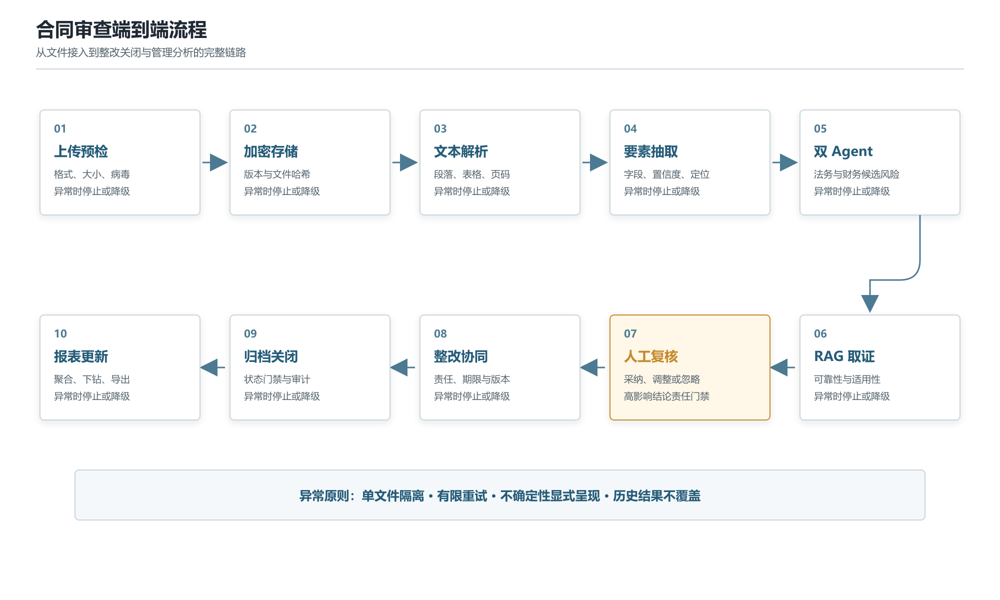
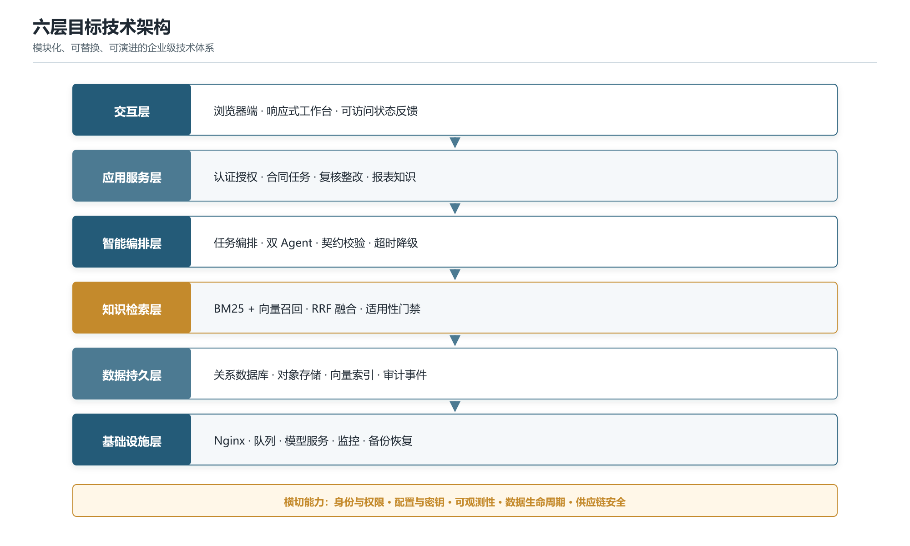
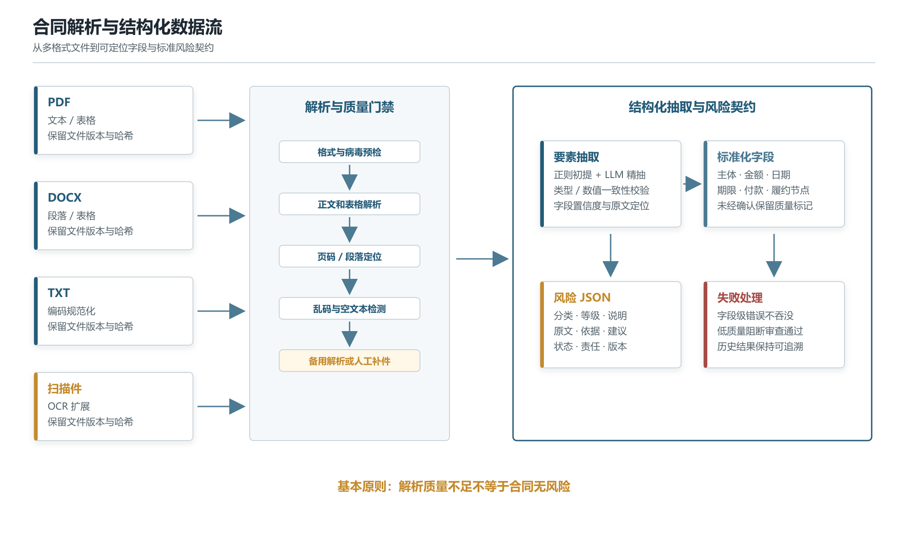
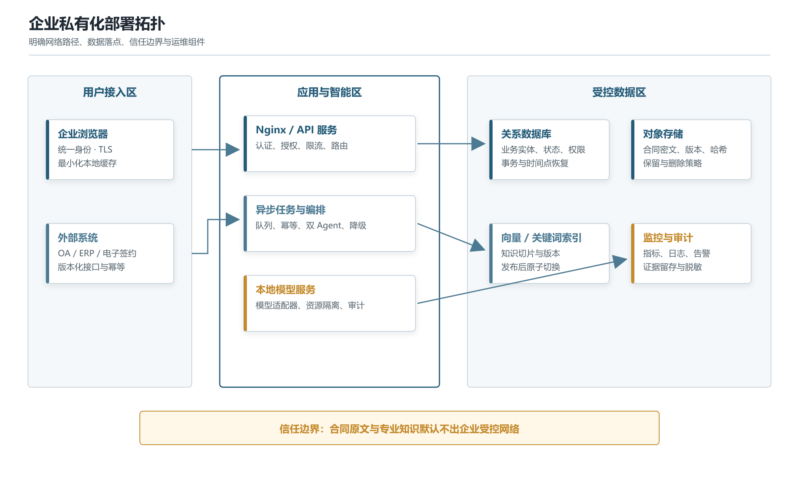

# 第三章 总体方案设计

## 3.1 设计思路

总体方案围绕“合同版本、审查任务、风险证据、人工处置”四个核心概念展开。合同版本是所有审查活动的事实起点；审查任务描述一次具体处理；风险记录承载发现的问题、原文和依据；处置事件记录人员对风险作出的决定。四者分开建模，可以避免重新上传文件后历史意见失去对象，也能防止人工修改覆盖机器原始输出。

系统采用分层、异步和可降级设计。页面请求负责提交任务和读取状态，长时间运行的解析、审查与导出交给后台任务。规则、知识检索和模型输出分别保留来源，某一智能能力不可用时，系统可以保留已完成结果并转人工，而不是返回一份看似完整但来源不明的报告。

总体设计遵循三个约束：业务状态必须由服务端控制；权限判断必须覆盖接口、任务和报表；任何自动结果都必须带有可核对的输入和生成上下文。

## 3.2 业务架构

图 3-1 的重点在三个交接点：解析结果不合格时停在审查之前；机器意见形成后先进入复核，不直接进入整改；整改关闭前必须有复审结论。流程图中的回路对应补件、重试和退回，说明异常处理属于正常业务路径，而不是另行补救。

业务架构分为接入、解析、审查、复核、整改和分析六个连续环节。

接入环节确认提交人、合同基本信息和文件版本；解析环节生成统一文本、表格、位置映射和质量状态；审查环节执行要素抽取、规则检查、专业 Agent 与知识检索；复核环节由授权人员确认风险事实、等级、依据和建议；整改环节把已确认风险转为责任明确的任务；分析环节从合同、风险和处置记录形成报告与管理指标。

每个环节有独立的进入条件和异常出口。例如，解析质量不合格时不能直接进入确定性审查；风险缺少可靠依据时可以保留线索，但必须标为待核对；整改关闭必须引用复审结论。系统通过状态机控制这些约束，而不是依靠页面操作顺序。

## 3.3 功能架构

系统功能划分为六个领域。

合同接入域负责上传、批量、元数据、版本、文件安全检查和状态查询。解析与要素域负责多格式文本提取、OCR、位置映射、质量评估、字段抽取与标准化。审查与证据域负责规则、法务审查、财务审查、知识检索、风险合并和证据分级。复核与整改域负责人工处置、冲突处理、任务分派、反馈、复审和关闭。报告与分析域负责审查报告、台账、指标聚合、筛选、钻取和导出。平台管理域负责用户、角色、部门、知识版本、系统配置、任务监控和审计查询。

这些领域共享合同标识、版本标识、组织范围和操作身份，但不共享未定义的页面状态。前端可以把多个领域组合成工作台，后端仍保持清晰的业务边界，使权限、测试和后续扩展更容易控制。

## 3.4 技术架构

| 层级 | 核心职责 | 主要输入 | 主要输出 | 失败处理 |
|---|---|---|---|---|
| 交互层 | 登录、上传、任务跟踪、风险复核、整改、报表和管理 | 用户动作、文件、筛选条件 | API 请求、页面状态、下载请求 | 展示加载、空、错、无权限状态，防止重复提交 |
| 应用接口层 | 认证授权、参数校验、事务边界和业务编排 | JWT、请求 Schema、文件流 | 统一响应、业务对象、任务标识 | 明确错误类型，冲突写入拒绝或幂等返回 |
| 领域服务层 | 合同、版本、风险、复核、整改、报表和知识规则 | 业务命令、领域对象、权限上下文 | 状态迁移、处置事件、聚合结果 | 校验进入条件，非法状态迁移不落库 |
| 任务执行层 | 解析、OCR、审查、检索、报告和批量调度 | 持久化任务、租约、执行配置 | 阶段结果、进度、错误与重试信息 | 超时、有限重试、失败隔离、补投和人工接管 |
| 智能计算层 | 要素抽取、双 Agent、Embedding、召回与排序 | 最小化上下文、候选知识、结构约束 | 结构化字段、专业意见、检索分数 | 结构错误拒收，服务不可用时降级或转人工 |
| 数据基础层 | 关系数据、对象文件、缓存、索引和审计 | 事务写入、文件流、查询条件 | 可追溯记录、恢复点、检索候选 | 回滚、哈希校验、备份恢复和过期清理 |

图 3-2 将网页请求与长任务分开：接口层负责接收、鉴权和返回任务标识，任务执行层负责解析、模型调用和报告生成。这样设计后，浏览器中断不会决定任务是否继续，重试也可以从已保存的阶段结果开始。

前端采用 Vue 3、TypeScript、Element Plus、Pinia 和 ECharts，负责业务交互与状态展示。后端采用 FastAPI、Pydantic 和 SQLAlchemy，提供鉴权、业务接口、状态机和数据访问。开发环境可使用 SQLite，生产目标采用 PostgreSQL；Redis 与 Celery 承担任务队列、租约和异步执行。模型能力通过适配层接入，使云端或本地推理能够在统一输入输出约束下替换。

## 3.5 数据流设计

图 3-3 中，原始文件、统一文本、标准化字段和风险记录是四类不同数据。后者可以修正和重跑，原始文件及其哈希不随审查意见变化；风险引用的是带位置的文本快照，因此能够在版本更新后仍回到当时的输入。

原始文件进入系统后先计算哈希并写入受控存储，数据库只保存对象位置、版本和必要元数据。解析服务读取文件，按照类型提取段落、表格和页级信息；扫描页进入 OCR。解析结果经过编码清理、段落重建和质量判断，形成统一文本及原文位置映射。

要素抽取先使用确定性规则处理日期、金额、税率等格式明确的字段，再由模型补充需要上下文理解的字段。原始值、标准化值和来源位置同时保存。审查服务按专业维度裁剪上下文，执行规则和模型任务；知识检索以具体风险事实为查询，返回带来源与版本的候选依据。合并器只处理结构、重复和冲突标识，不替代人工判断适用性。

复核后，状态和人工意见写入业务库，原始机器结果保持不变。报告和报表从达到相应状态的数据读取，并应用部门与角色过滤。导出文件进入临时受控存储，到期后清理，生成请求和下载操作写入审计事件。

## 3.6 状态与一致性设计

合同版本的处理状态可概括为“已接收、解析中、待审查、审查中、待复核、已复核、处理中、已关闭”，同时允许“解析失败、审查失败、已取消”等异常状态。状态名称服务于业务解释，具体实现应使用稳定枚举并通过迁移维护。

状态迁移由后端服务校验。只有解析质量达到进入条件的版本才能启动审查；只有待复核风险可执行确认或调整；已关闭整改如需重开必须新增事件并说明原因。页面刷新、重复点击或任务重投不能绕过这些限制。

跨任务的一致性采用“短事务加幂等”的方式。创建任务、写入阶段结果和更新最终状态分别使用明确事务；耗时模型调用不占用长数据库事务。任务以业务对象和操作类型生成幂等键，Worker 获取有期限租约，租约失效后可由补偿任务重新投递。重复执行时先检查已有结果和版本，避免生成两组风险。

## 3.7 接口设计原则

接口围绕资源和业务动作组织。查询接口返回稳定字段、分页信息和权限过滤后的结果；写接口通过请求 Schema 校验，并返回新状态或任务标识。对于“确认风险、关闭整改”等具有业务含义的动作，使用专门端点表达，而不是允许客户端任意改写状态字段。

接口错误使用一致的状态码和错误结构。400 表示输入无效，401 表示未认证，403 表示无权访问，404 表示授权范围内对象不存在，409 表示状态冲突或重复操作，422 表示结构校验失败，503 表示依赖服务暂不可用。错误信息不泄露其他部门合同是否存在。

上传和导出采用流式处理及大小限制。长任务立即返回任务标识，客户端按规定间隔查询或接收受控通知。所有时间使用统一时区和可交换格式，金额与比率避免二进制浮点误差，枚举值在接口说明中版本化。

## 3.8 部署架构与信任边界

图 3-4 把用户入口、业务服务、数据存储和模型计算放在不同网络边界。合同正文只沿受控链路流转；即使采用外部模型，出口也应位于服务端并执行最小化、白名单和审计，浏览器不直接持有模型凭据。

推荐部署由反向代理、前端静态资源、API 服务、任务 Worker、调度器、PostgreSQL、Redis、对象存储或受控文件目录、模型服务和监控组件组成。互联网访问不是系统运行的默认前提；如需调用外部模型或法规来源，应通过明确的网络出口、域名白名单和数据策略控制。

系统划分用户访问区、应用服务区、数据区和运维管理区。浏览器只访问网关；API 不能直接暴露数据库和 Redis；Worker 使用专用账号访问任务与文件；模型服务只接收最小化上下文；备份存储与生产凭据隔离。管理员的系统管理权限不自动包含所有合同内容查看权限。

## 3.9 外部集成边界

统一身份系统提供用户身份、组织和可选的角色映射，契鉴负责把外部身份转换为内部授权上下文。OA 或合同管理系统可以提交合同、查询任务和接收审查结果，但双方需要约定合同唯一标识、版本规则、回调重试和失败补偿。电子签章系统负责签署有效性，财务系统负责付款与记账，档案系统负责正式归档。

集成采用“明确所有者、最少字段、可重放”的原则。每个接口定义数据提供方、权威字段、幂等键、超时、重试、签名和审计要求。外部系统不可用时，契鉴保留待同步状态，不擅自改变已完成的专业审查结果。

## 3.10 关键设计取舍

系统不把所有步骤合并为一次模型请求，因为长上下文会降低定位能力，也无法区分解析、专业判断和知识适用性错误。分阶段处理虽然增加状态管理，但能提供更清楚的失败位置和人工接管点。

系统不把相似度最高的知识片段直接视为法律依据。检索负责缩小查找范围，来源有效性和适用范围仍需要规则过滤及人工核对。系统也不自动消除法务与财务冲突，因为冲突往往代表真实的交易取舍。

系统采用异步批处理而非延长网页请求。这样可以保存进度、隔离单文件失败并控制资源，但要求任务租约、幂等和恢复机制同步落地。生产数据库采用 PostgreSQL 作为目标，SQLite 仅用于开发与轻量演示，二者不能共享未经验证的性能结论。
