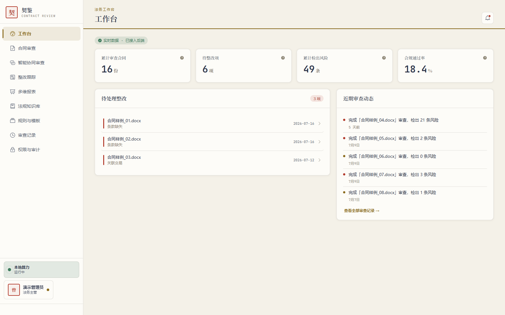
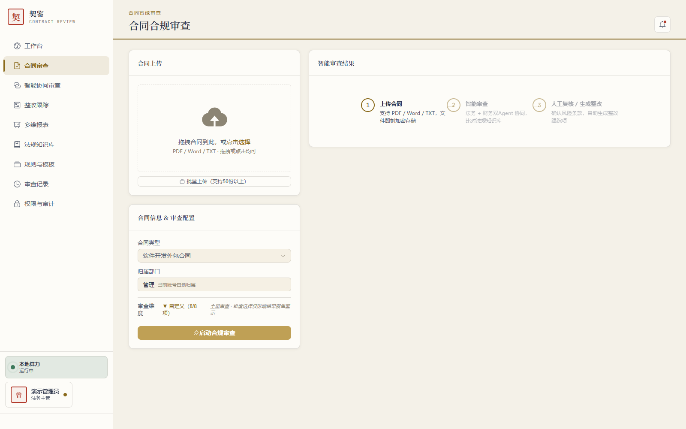
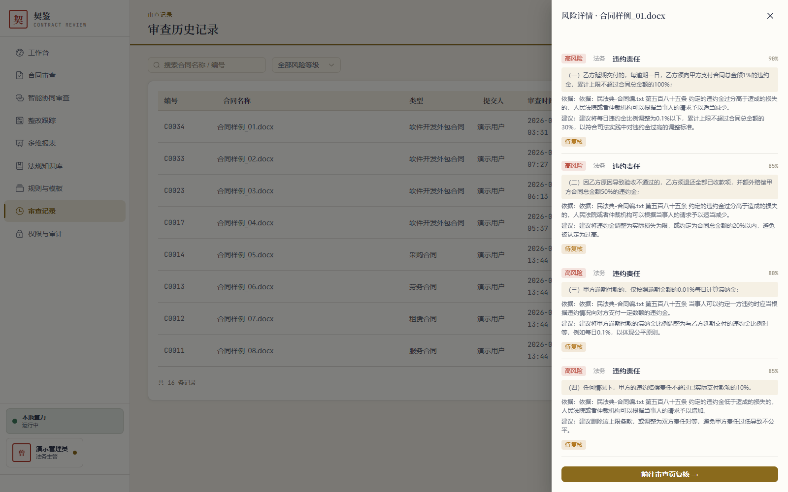
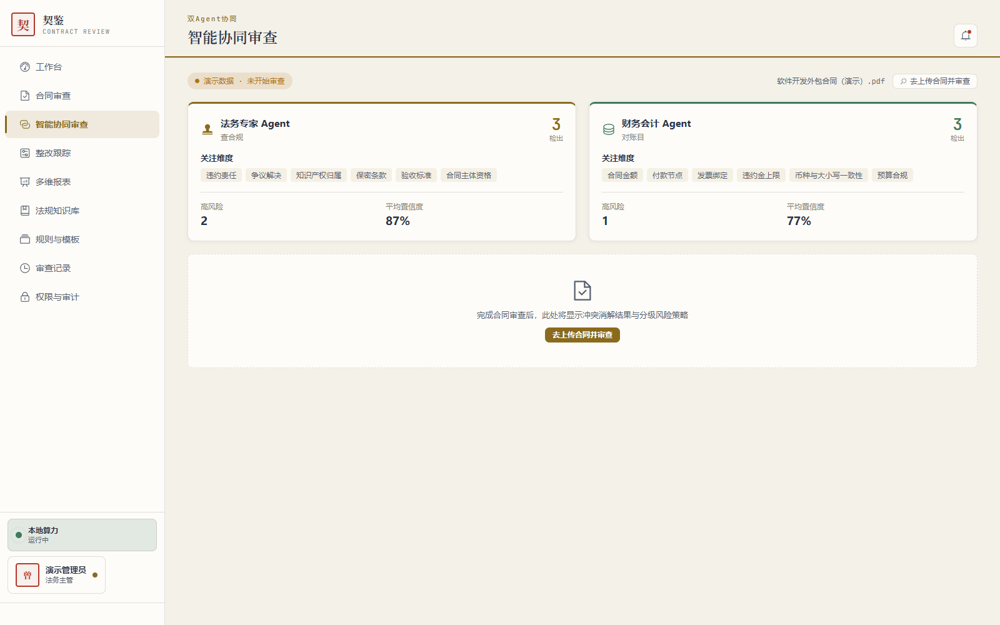
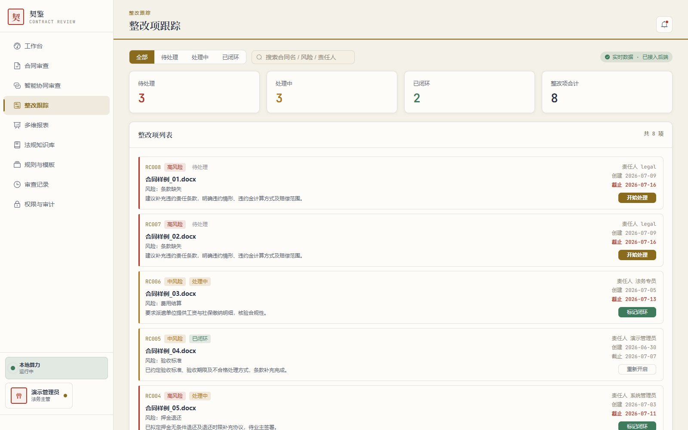
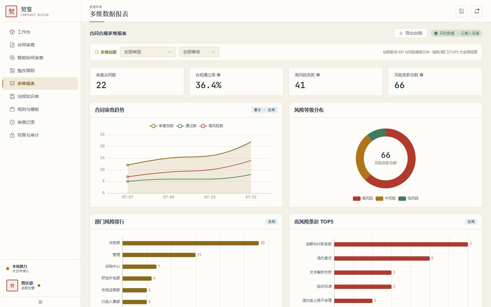

# 第四章 核心功能详细设计

## 4.1 工作台与任务入口

用户登录后进入与角色匹配的工作台。工作台展示待处理合同、待复核风险、临期整改和权限范围内的统计摘要。每个数字都可以进入对应明细；加载失败显示重试入口，无数据展示空状态，无权限的模块不发起数据请求。

图 4-1 所示工作台把“待处理事项”放在统计数字之前。风险总量用于判断工作负荷，真正驱动操作的是待复核、待整改和临期列表；用户从数字进入明细后，筛选条件和部门范围应保持不变。

系统以“我需要处理什么”为入口，而不是要求用户理解后台技术阶段。经办人优先看到上传、补件和整改反馈；审查人员看到待复核任务；负责人看到待分派和临期事项；管理者看到风险分布与趋势；管理员看到账号、知识和任务健康。用户切换部门范围或筛选条件后，所有卡片和列表使用同一权限与时间口径。

| 处理阶段 | 用户动作 | 系统处理 | 可见结果 | 异常出口 |
|---|---|---|---|---|
| 上传 | 选择合同、审查维度并填写必要信息 | 校验身份、权限、文件格式、大小、哈希和安全状态 | 显示文件名、版本和接收状态 | 拒绝不支持、损坏、空或超限文件 |
| 解析 | 查看进度或补充文件 | 提取正文与表格，必要时执行 OCR，计算质量状态 | 展示处理阶段、可读文本和要素来源 | 低质量、缺页或超时转补件与人工核录 |
| 审查 | 发起单份或批量任务 | 执行规则、法务与财务审查、知识检索 | 生成分级风险、摘要和冲突标识 | 依赖失败时保留有效阶段结果并允许重试 |
| 复核 | 确认、调整、补充、不采纳或升级 | 校验角色、状态和理由，追加处置事件 | 更新风险状态并保留前后值 | 越权返回 403，状态冲突返回 409 |
| 整改 | 分派责任人、反馈结果、提交复审 | 建立整改项，记录期限、附件和复审关系 | 展示责任、进度、反馈和关闭条件 | 逾期提醒，退回时保留原反馈 |
| 报告与分析 | 生成报告、筛选报表或导出台账 | 按合同版本、状态和权限聚合 | 返回下载任务、图表和可钻取明细 | 生成失败可重试，接口失败不显示伪造零值 |

## 4.2 合同上传与预检

图 4-2 的上传区只负责提交和反馈，不承担最终校验。前端显示的文件类型、大小和审查维度用于及时纠错，服务端仍要重新核对权限、文件内容和容量限制；两端校验不一致时，以服务端结果为准。

上传区支持拖放和文件选择。用户在提交前可以查看文件名、类型、大小和待审查维度，并移除误选文件。批次创建采用整批预检：任一文件在格式、空内容或容量检查中不合格时，服务端不创建半个批次，并返回对应文件的原因。批次建立后，各文件独立解析和审查，单文件处理失败不影响其他文件。提交按钮在上传过程中保持稳定尺寸并禁用重复点击。

服务端首先核对用户是否有权在目标部门创建合同，再检查扩展名与文件头是否一致、文件是否为空或损坏、大小是否超过配置、哈希是否与已有版本重复。可疑文件进入隔离或拒绝流程，不交给解析器。预检通过后保存原始文件，创建合同版本和处理任务。

重复文件并不简单删除。若同一业务合同已有相同哈希，系统提示用户引用已有版本；若文件内容不同，则创建新版本并要求确认版本说明。所有后续审查、报告和整改均关联具体版本。

## 4.3 文档解析与质量确认

解析任务根据文件类型选择处理器。DOCX 读取段落、表格和结构关系；文本型 PDF 提取字符与页码；无可用文本层的 PDF 进入 OCR。输出统一为段落、页码或结构位置、表格内容和质量信息。

系统对空文本、乱码比例、页数差异、重复页、OCR 低置信度和位置缺失进行检查。质量达到进入条件时任务转为待审查；可部分使用时标记问题页面并等待人员确认；无法可靠读取时停止自动审查，要求补充清晰文件或人工核录。用户能够看到失败原因，而不是只收到“处理失败”。

本章以下四个案例均为机制说明示例，不代表实测记录。假设一份扫描合同的印章遮住了金额或否定词，受影响页面的 OCR 置信度低于当前基线 0.75。系统不会继续给出确定性审查结论，而是记录问题页和置信信息，保留已识别文本供核对，并要求补件或人工核录。

解析文本仅是可检索副本，不能替代原始合同。风险详情同时提供原文引用和文件位置；当位置映射不可用时，系统明确标识，避免把模型摘要误认为原句。

## 4.4 要素提取与人工修正

系统在审查前提取合同名称、类型、主体、金额、币种、期限、签订日期、付款节点、税率、发票、验收、违约和争议解决等字段。格式明确的字段优先由规则提取，需要跨段理解的字段由模型补充。字段输出必须满足 Schema，金额、日期和枚举经过标准化校验。

用户可在要素区查看原始值、标准化值、来源位置和置信状态。人工修正生成新值与修正事件，不覆盖首次抽取值。若金额与大写金额冲突、付款比例不闭合或期限前后矛盾，系统形成一致性提示并进入复核。

例如，假设合同正文写明分三期付款，但付款节点表只列出两期，比例合计为 70%。系统分别保存正文约定和表格节点，不推测缺失的 30% 应在何时支付；一致性规则生成“付款比例未闭合”提示，并把两处原文同时交给复核人员。

报表只使用满足规定状态的标准化字段。未提取到的字段保持为空并记录原因，不用默认值替代。这样可以区分合同本身未约定、解析失败和字段尚未确认。

## 4.5 风险审查与原文核对

图 4-3 将风险事实、合同原文、候选依据和处理动作放在同一核对路径中。页面不能只展示模型摘要；当原文定位或依据状态不足时，相应位置应显示待确认状态，并限制确认、导出等后续动作。

风险列表按专业维度、等级、类别和状态筛选。选择一条风险后，详情区展示风险事实、合同原文及上下文、原文位置、适用依据、分析说明和修改建议。用户可以在同一界面核对“文本写了什么”“系统为什么提示”和“建议如何处理”。

风险等级使用受控枚举，并由规则或模型给出初始建议。最终等级由有权限的审查人员确认。没有可靠依据的风险仍可作为线索保存，但在界面和报告中使用“待核对”状态，不应显示为已经证实的违法结论。

人工处置包括确认、调整、补充、不采纳和升级。调整风险事实、等级或建议时记录前后值；不采纳和高风险降级必须填写理由；升级可指定联合复核人。系统通过乐观锁或版本号避免两名用户同时编辑时相互覆盖。

## 4.6 双专业协同

图 4-4 采用并列而不是覆盖式展示。相同原文可能产生两种专业判断，页面先保留差异，再由联合复核形成处置意见；这比提前合成一段“综合结论”更便于说明取舍。

法务与财务审查各自读取完成任务所需的最小上下文，并按独立 Schema 输出。法务意见重点描述权利义务、责任失衡、效力与争议；财务意见重点描述金额、税费、付款、发票、结算和资金安排。系统保留专业来源，避免将两类意见压缩成无法解释的统一文本。

合并器依据原文位置、风险类别和语义相似度识别重复或关联意见。两条意见事实一致且建议互补时可形成关联组；等级、事实或建议不一致时标记冲突。用户在协同页面并列查看双方意见，选择保留、合并、补充背景或发起联合复核。

系统不允许合并器自动关闭冲突，也不以某一 Agent 的分数覆盖另一方。人工决定形成单独处置事件，原始意见继续保留，便于后续解释和模型评估。

例如，假设法务意见认为“验收后付款”能够约束对方履约，财务意见则发现合同没有定义验收材料、确认人和完成时限，因此付款条件在执行时缺少凭据。系统把两条意见标为关联且存在处置差异，交由复核人员决定补充验收标准、调整付款触发条件，或接受现有安排并记录理由。

## 4.7 整改、复审与关闭

图 4-5 中的状态变化由复审动作驱动，不由责任人自行勾选完成。页面上的期限和附件用于说明处理过程，关闭依据仍是复审意见；退回后原反馈继续可查，避免整改记录被新一轮提交覆盖。

复核确认后的风险可以创建整改项。创建时选择责任部门和责任人，填写要求、期限和优先级，并关联风险、合同版本及必要附件。系统通知责任人并在工作台展示临期状态。

责任人可以提交处理说明、证据附件或新合同版本。提交后整改进入待复审，原责任人不能自行关闭。复审人员核对原风险和新内容，选择通过、退回或接受残余风险。退回时保留已提交材料和理由；接受残余风险需要具有相应权限并记录决定依据。

整改关闭不删除风险。合同版本、风险、整改项和处置事件共同形成完整链路。若后续发现新情况，可以重开整改或在新合同版本下创建关联风险，但不得修改历史关闭记录。

## 4.8 报告、批量任务与多维报表

审查报告以指定合同版本和已达到报告状态的风险为输入，包含合同要素、风险摘要、逐项原文与依据、人工处置和必要说明。报告标记生成时间、数据范围和版本，避免与后来修改的审查记录混淆。

批量任务为每个文件创建独立子任务，列表展示批次总量、各状态数量和失败原因。调度器控制并发，单文件失败不影响其他任务。用户可以下载失败清单并只重试失败项；重复请求通过幂等键返回已有批次或既有结果。

例如，假设一批文件均通过上传级格式与容量校验，其中一份在解析阶段发现内部结构损坏。该文件项记录为解析失败，其余文件继续处理；用户修复文件后只重试失败项。重试沿用原批次和配置，先检查已有阶段结果，不再次生成已完成文件的风险记录。

图 4-6 展示的是报表正常状态。正式实现还要为同一位置提供加载、空数据、错误和无权限状态；接口失败时保留筛选条件并显示错误，不把空响应绘制成“风险为零”。

报表支持按部门、合同类型、风险等级、风险类别、金额区间和时间范围筛选。KPI、趋势和排行使用同一筛选条件，点击图表进入授权明细。对于尚未确认的字段或风险，报表按指标定义决定是否纳入，并在口径说明中明确。

导出采用异步任务。生成前再次校验权限并固化筛选条件，生成后提供有期限的下载地址。下载行为记录在审计日志中，过期文件由清理任务删除。导出的数据范围不得超过发起人在线查询范围。

## 4.9 知识与系统管理

知识管理支持资料上传、解析、分类、版本、适用范围、生效与停用。新版本发布后，新任务只检索有效版本；历史风险仍保留曾引用的内容和版本信息。删除操作优先采用停用或归档，避免破坏已有证据链。

用户、角色和部门管理分开处理。用户可以归属部门并绑定角色，角色定义操作权限，部门范围定义数据权限。授权变更立即影响新请求，历史操作仍显示当时身份。系统管理员能够查看任务健康和审计事件，但业务内容访问仍受单独权限控制。

## 4.10 页面状态与异常处理

| 异常场景 | 系统反应 | 用户可采取的动作 | 保留记录 |
|---|---|---|---|
| 文件格式不符、损坏或空内容 | 拒绝进入解析并显示文件级原因 | 移除文件或重新上传有效版本 | 文件名、哈希、校验类别和时间 |
| 扫描质量过低或 OCR 超时 | 标记解析质量不足，不形成确定性审查 | 补充清晰文件或申请人工核录 | 页面、置信信息、超时和复核状态 |
| 模型超时或输出结构错误 | 有限重试，保留规则和另一专业的有效结果 | 重试失败维度或转人工审查 | 模型配置、任务阶段和结构错误 |
| 无可靠知识依据 | 风险保留为待核对并限制结论强度 | 补充正式来源或不采纳意见 | 检索候选、过滤原因和人工意见 |
| 专业意见冲突 | 并列保存意见，禁止自动关闭 | 选择、合并或发起联合复核 | 双方输出、冲突类型和处置理由 |
| 批量部分失败 | 成功与失败文件分开统计 | 修正后只重试失败项 | 批次、文件状态、重试和幂等键 |
| 报表接口不可用 | 显示加载失败，不用零值替代 | 保留筛选条件并重新加载 | 请求标识、错误类型和时间 |
| 权限不足 | 后端返回 403，不透露对象细节 | 返回工作台或申请授权 | 用户、角色、部门、目标和结果 |

## 4.11 审计与可追溯性

审计事件覆盖登录、上传、下载、任务创建、状态迁移、人工复核、授权变更、知识发布和配置变更。每条事件至少包含操作者、动作、目标对象、结果、时间、请求标识和必要的前后值。合同正文、口令、令牌和密钥不得写入普通日志。

用户在风险详情中可以沿“风险—审查任务—合同版本—原始文件”向前追溯，也可以沿“风险—处置事件—整改—复审”向后追溯。报表指标能够进入组成明细，导出文件能够回到生成请求。该链路既服务于日常协作，也为争议复盘、系统测试和合规检查提供证据。
