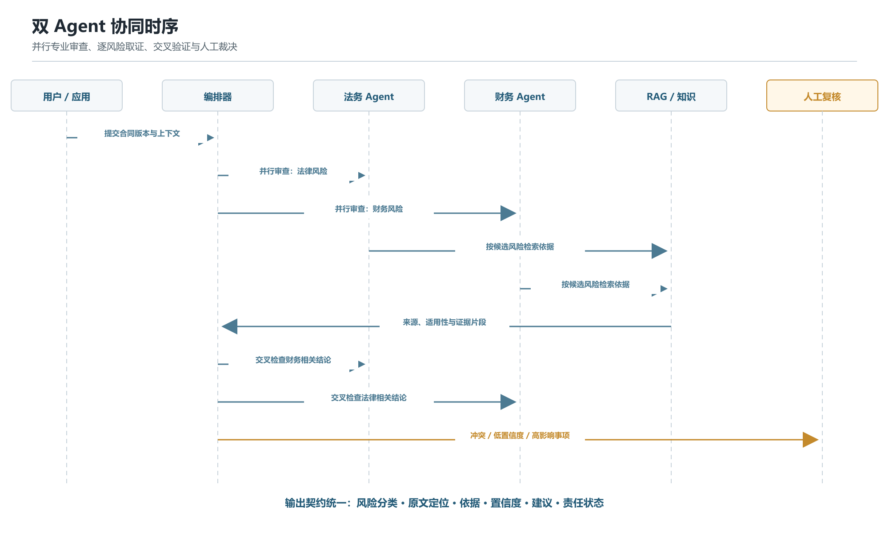
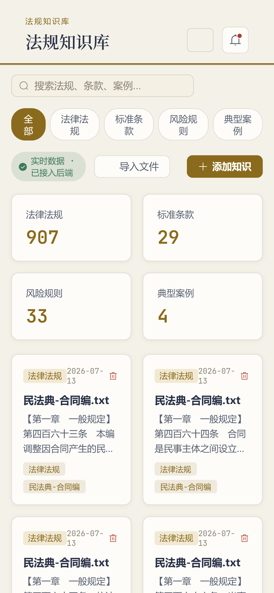
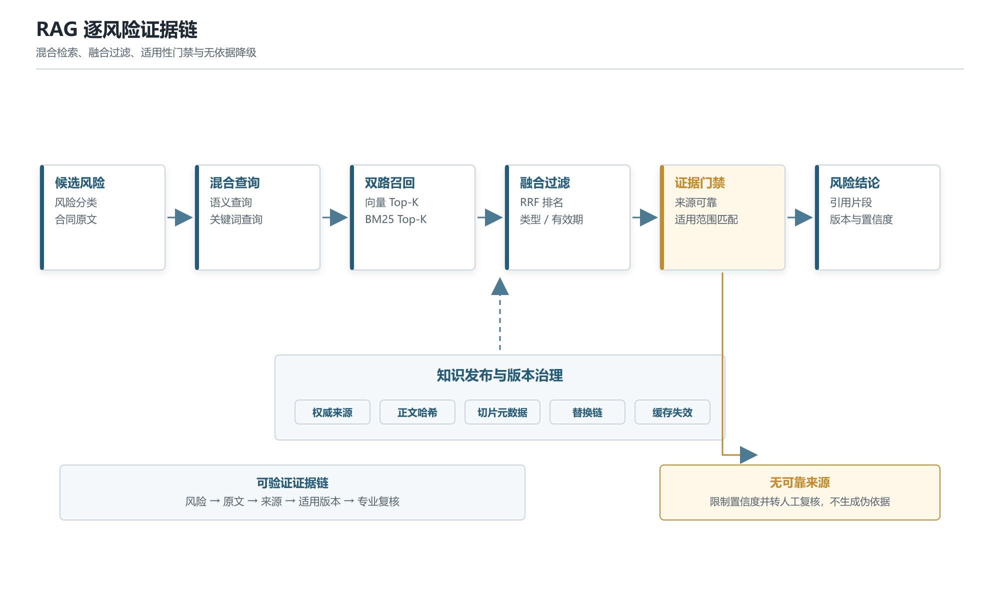

# 第五章 关键技术实现方案

## 5.1 技术实现总则

合同审查同时包含确定性处理和开放性判断。文件格式、金额写法、日期顺序、权限范围可以用程序明确校验；条款是否失衡、多个段落是否矛盾、某项依据是否适用，则需要结合上下文。系统不把全部工作交给一次模型调用，而是组合文件解析、确定性规则、法务与财务 Agent、知识检索和人工复核。

技术链路以合同版本和风险项为基本单位。解析器先说明机器实际读取的内容，抽取器保存字段及来源，规则和 Agent 生成风险候选，检索服务为具体风险查找依据，人工决定是否采纳。各环节保留自己的原始输出，后续处理通过关联记录追加信息，不覆盖上游事实。

| 技术环节 | 选择依据 | 处理方式 | 输出 | 限制 |
|---|---|---|---|---|
| 文件预检与解析 | 输入格式、版面和质量差异大，错误文本会污染后续判断 | 校验文件头、MIME、大小和哈希，按 DOCX、文本 PDF、扫描 PDF 分流 | 原文件、统一文本、表格、位置映射和质量状态 | 密码文件、损坏文件和复杂版面需要补件或人工处理 |
| 要素抽取 | 报表与规则需要稳定字段，部分字段依赖上下文 | 规则先提取明确字段，模型补充语义字段，再做结构与一致性校验 | 原始值、标准化值、来源位置和置信状态 | 字段性能必须基于冻结金标准评估 |
| 双专业审查 | 法务与财务关注点不同，专业差异需要保留 | 分别构造最小上下文并校验结构化输出，识别重复、关联和冲突 | 法务意见、财务意见、关联风险和冲突标识 | 不能替代授权人员作最终决定 |
| 规则、知识与模型融合 | 明确规则、正式依据和语义解释具有不同可靠性 | 规则先行，按风险检索知识，模型负责解释，来源分别保存 | 风险事实、证据、建议及生成来源 | 无可靠来源时不能生成确定性法律结论 |
| 批量调度 | 多文件任务不能依赖单个浏览器请求 | 持久化批次和文件项，使用租约、幂等、补投、失败隔离和重试 | 批次进度、逐文件状态与失败原因 | 容量和吞吐需在目标环境按约定规模验证 |
| 报告生成 | 输出需与版本、权限和正式状态一致 | 固化数据范围，异步生成，临时存储并限制下载期限 | 审查报告、台账、下载记录 | 生成文件不能扩大用户在线访问范围 |

### 5.1.1 当前实现参数基线

下表记录当前代码与示例配置中的设计取值，便于部署、测试和故障分析使用。它们是资源保护和任务协调的基线，不代表吞吐、准确率、响应时间或服务等级已经达标。生产部署应在目标硬件、模型和样本上验证后调整，并记录配置版本。

| 参数域 | 当前基线值 | 设计作用 | 调整要求 |
|---|---|---|---|
| 文件与批次 | 单文件不超过 50 MB；单批 1～200 份；单批合计不超过 500 MB | 防止一次请求占满内存、网络或存储 | 根据网关、内存和并发测试调整，三处限制保持一致 |
| OCR | 最多 100 页；单页不超过 1600 万像素；180 DPI；总超时 120 秒；最低置信度 0.75 | 控制扫描件资源消耗，并为转人工提供明确门槛 | 按版面类型和识别模型校准，调整后重跑固定样本 |
| 模型与检索 | LLM 调用超时 120 秒；默认模型示例为 qwen2.5:14b；本地 Embedding 为 BAAI/bge-small-zh-v1.5 | 统一适配层的超时和默认接入方式 | 模型标识属于部署配置，替换时保留版本并验证结构输出与检索效果 |
| 身份会话 | 访问令牌有效期 480 分钟 | 限制令牌长期有效造成的暴露窗口 | 结合单点登录、终端环境和组织安全制度评估，生产可缩短 |
| 异步任务 | 单任务时间上限 1800 秒；任务租约 30 分钟；失败重试等待 10 秒；孤儿任务单次恢复查询最多 500 项 | 防止任务无限占用、重复执行和恢复扫描失控 | 任务上限与租约必须联动，不能小于正常执行所需时间 |
| 前端协调 | 批次状态轮询间隔 1500 毫秒；知识文件导入请求超时 180 秒 | 平衡状态及时性与接口压力 | 多用户环境需结合并发和通知方式调整，前端数值不决定后端生命周期 |
| 数据环境 | 开发默认 SQLite；生产要求 PostgreSQL、Redis 与异步任务 | 区分本地调试和正式运行条件 | 不把 SQLite 或同步模式下的数据外推为生产结论 |

## 5.2 文件预检与安全接入

上传接口不能只相信扩展名。服务端结合文件头、MIME、文件大小和可解析性确认类型，计算内容哈希，并核对用户对目标部门的创建权限。空文件、格式不符、超过限制、无法解密或损坏的文件在进入解析前被拒绝。批次创建前逐文件校验，任何一项不合格时整批不落库；批次建立后的解析和审查按文件隔离失败，二者不能混为同一处理阶段。

通过预检的原件写入受控文件存储，数据库保存对象标识、哈希、大小、类型、提交人和合同版本。若文件存储成功而数据库事务失败，系统执行补偿清理；若数据库记录已建立但文件写入失败，则任务保持失败状态且不可进入解析。解析器通过受控文件服务获得数据流，不在公共临时目录长期保存明文副本。

相同哈希用于发现重复提交，但不能代替业务版本判断。用户确认同一业务合同的新稿后，系统建立版本关系并继承必要元数据；审查任务始终绑定一个明确版本。恶意文件检测、超大压缩包防护和临时文件清理均配置资源上限，避免解析进程被单个输入占用。

## 5.3 多格式解析与 OCR

DOCX 解析器读取正文段落、表格、标题和必要的结构顺序。文本型 PDF 以页为单位提取字符并保留页码；扫描或混合 PDF 将缺少有效文本层的页面渲染为图像，再交给 OCR。长合同按页和语义块处理，既控制内存与上下文，也保留风险定位需要的块标识。

OCR 服务可以采用 RapidOCR 与 ONNX Runtime 的本地组合。服务配置单份最大页数、单页像素上限、并行度与总超时，输出页码、文本、文本框及置信信息。印章遮挡、倾斜、低对比度、表格和中英文数字混排可能影响识别，因此 OCR 输出必须进入质量判断，不能直接视为合同原文。

当前基线按 180 DPI 渲染，单份最多处理 100 页，单页像素不超过 1600 万，总超时为 120 秒。页面置信度低于 0.75 时进入人工确认路径。页数、像素和时间限制解决资源占用问题，置信度门槛解决结论可靠性问题，二者不能互相替代。

质量评估检查可见字符数量、乱码比例、页覆盖、重复内容、空白页、表格完整性和置信分布。轻微问题以警告状态继续，严重缺页、异常乱码或低质量页面停止确定性审查。质量状态、问题页面和建议动作返回界面，用户可以补充清晰文件或申请人工核录。

位置映射保存页码、段落索引、表格单元格或字符区间。审查产生风险时引用块标识和必要的文本快照，界面打开详情再读取前后文。若映射无法建立，系统明确标记“位置待确认”，不通过字符串模糊搜索假装完成精确定位。

## 5.4 要素抽取与标准化

核心字段从使用场景反推：只有会被审查规则、报表、报告或外部接口使用，并且可以定义真值的字段，才进入正式 Schema。字段包括合同名称、类型、主体、标的、金额、币种、签订日期、履行期限、付款节点、验收条件、税率、发票、违约责任和争议解决等。

抽取流程先运行规则和正则，识别日期、金额、比例、税号及显式标签；再根据缺失字段和上下文调用模型补充语义字段。模型响应经过 JSON Schema、类型、长度、枚举和必填项校验，非法结构不写入正式字段。服务对金额大小写、币种、日期先后、付款比例及主体名称进行一致性检查，发现矛盾时形成提示而不擅自选择。

每个字段保存原始值、标准化值、来源位置、抽取方法、模型或规则版本和置信状态。人工修正另存修正值、人员与理由，业务查询可以优先使用已确认值，但评测仍使用初始预测。通过这种双值结构，日常使用、质量分析和审计复盘不会相互污染。

字段扩展需要同步 Schema、接口、数据字典、报表口径和评测样本。自由文本不应因为“以后可能用到”而全部结构化；否则字段含义不清、真值无法定义，还会扩大敏感数据处理范围。

## 5.5 法务与财务双 Agent

法务 Agent 负责主体资格、效力、权利义务、违约、解除、保密、知识产权和争议解决等维度；财务 Agent 负责金额、币种、税率、发票、付款、结算、担保和资金责任等维度。两者共享合同标识、解析文本和必要要素，但提示任务、规则范围和输出专业不同。

图 5-1 中，两类 Agent 可以并行执行，但风险归并必须等待各自结构校验完成。某一路失败时，编排器保存另一路和规则结果，只标记缺失维度；恢复后重跑失败阶段，不重新解析文件。

编排器根据合同类型、专业维度、条款结构、关键词和初步风险选择文本块。上下文包含块标识，不能只截取全文开头。对于付款条款这类交叉事项，两类 Agent 可以读取相同原文，但分别给出法律责任与财务执行角度的意见。

输出至少包含风险类别、建议等级、事实说明、原文引用、修改建议和置信状态。适配层要求模型返回结构化数据，未知字段被忽略或拒绝，必填项缺失触发有限重试。提示模板、模型提供方、模型标识、参数和调用状态作为运行元数据保存，但普通日志不记录完整合同上下文。

合并器依据原文位置、分类和语义相似度识别重复风险。事实一致、建议互补时建立关联；事实不同但位置相近时保持独立；等级或建议不一致时标记冲突。合并后的记录保存对原候选的引用。系统不按模型置信度自动消除冲突，处理权交给人工复核。

一个 Agent 超时或结构错误时，任务保留规则结果和另一专业的有效输出，明确缺失维度。恢复时只重跑失败阶段。模型服务整体不可用时，系统可以按配置执行规则审查并转人工，不能生成伪装成完整双专业审查的报告。

## 5.6 规则引擎与风险归并

确定性规则处理能够明确表达的问题，例如必填条款缺失、日期倒置、金额大小写不一致、付款比例异常和特定表述命中。规则包含适用合同类型、风险类别、建议等级、说明、版本、生效范围和启停状态。命中记录直接引用规则标识，不要求模型重新虚构解释来源。

规则执行分为预审规则和复核规则。预审规则基于解析文本与要素产生候选；复核规则检查不同字段和专业意见之间的一致性。规则可以提高稳定性，但不能把高度依赖交易背景的判断硬编码为绝对结论。规则发布需要专业人员评审，并在固定回归样本上验证误报与漏报变化。

风险归并使用确定性键与相似度共同判断。相同合同版本、专业维度、原文区间和规则标识可以直接去重；模型意见需要比较事实、位置和分类。归并动作保留来源集合，人工拆分或合并另写处置记录。任何重跑都先检查任务版本和幂等键，避免同一输出重复落库。

## 5.7 知识库与 RAG 证据关联

图 5-2 所示管理界面承担的是知识发布控制，不是普通文件夹。只有来源、版本、适用范围和状态完整的资料才能进入正式检索；停用旧版本不会删除历史风险中的引用。

知识库保存法律法规、司法解释、企业制度、示范文本和审查规则等资料。资料具有来源、类别、版本、发布日期或生效日期、有效期、法域、合同类型、适用范围和发布状态。导入文件经过解析、切片、审核后才可发布；草稿不进入正式检索，停用版本不再支持新任务，但历史引用继续保留。

检索以具体风险为单位。查询由风险事实、原文片段、合同类型和专业维度组成。系统使用本地 Embedding 生成向量候选，同时通过 BM25 获取关键词候选，再以 RRF 融合排序。随后按来源等级、法域、有效期和适用范围过滤及重排。向量服务不可用时可以降级为关键词检索，并显式记录检索模式。

图 5-3 把召回、过滤和专业核对分成连续步骤。向量与关键词检索负责找候选，来源和适用范围过滤负责排除明显无效内容，模型只解释候选与风险事实的关系；最后是否采纳仍由专业人员确认。

检索片段与模型解释分别保存。模型可以说明候选依据与风险事实的关系，但不能创建不存在的来源编号。用户从风险详情打开依据时，可查看来源名称、版本、原文上下文和适用说明。相似度只表示文本相关，不能代替法律效力和事实适用性。

| 证据状态 | 触发条件 | 系统处置 | 人工动作 |
|---|---|---|---|
| 可靠依据 | 来源受控、版本有效、适用范围匹配且与风险事实相关 | 展示原文、来源、版本和适用说明 | 核对完整上下文并决定是否采纳 |
| 候选依据 | 文本相关，但适用范围或事实关系需要确认 | 标记待核对，不作为自动关闭条件 | 补充交易背景或查阅正式文本 |
| 无可靠来源 | 候选为空、来源失效或全部被过滤 | 保留风险线索，限制结论强度 | 补充依据、降级为关注项或不采纳 |
| 专业意见冲突 | 两类意见的事实、等级或建议不一致 | 并列保存并阻止自动关闭 | 选择、合并或发起联合复核 |
| 解析证据不足 | 原文缺页、乱码、位置不明或 OCR 质量低 | 暂停确定性审查并标记输入问题 | 提供清晰版本或人工核录 |
| 知识版本失效 | 风险引用资料已被替换或停止适用 | 历史引用保留，新任务不再使用 | 判断既有结论是否需要重新审查 |

知识更新与模型切换不会自动改写历史意见。如需影响分析，应根据知识版本、规则版本或模型配置查找相关任务，建立新的复审任务，并保留原结论与新结论的关系。

## 5.8 批量任务与异步调度

批量服务在关系数据库中保存批次、文件项、审查范围、阶段状态、错误类别和尝试次数。提交请求先校验数量、文件和权限，再以幂等键创建批次。Worker 获取有期限租约后处理文件项，租约防止多个 Worker 同时写入同一任务；调度器负责发现租约过期或符合补投条件的任务。

每个文件项独立执行预检、解析、审查和结果写入。失败项记录失败阶段和可重试性，批次继续处理其他文件。重试复用原文件和原配置，不重复创建合同；若用户更换规则、模型或审查范围，则创建新任务并保存配置差异。

阶段结果在事务中保存，耗时外部调用不占用长事务。Worker 写入成功前完成要素和风险的一致性检查；异常退出后，接管者先检查已保存阶段再继续。批次总量与各状态数量由文件项聚合，前端轮询只负责显示，不决定任务生命周期。

系统限制单批数量、单文件大小、OCR 页数、并发和重试次数。队列不可用时，生产配置应拒绝接受无法持久化的长任务或执行明确的受控降级。容量上限、吞吐和恢复时间须在目标硬件、模型和样本上测量。

当前接入基线为单文件 50 MB、单批最多 200 份且总量不超过 500 MB。Celery 单任务时间上限为 1800 秒，文件项租约为 30 分钟；失败重试等待 10 秒，孤儿任务单次恢复查询最多 500 项。前端每 1500 毫秒查询一次批次状态，但后端状态、租约和幂等记录才是任务事实来源。

## 5.9 报告与导出生成

报告服务读取指定合同版本、已确认要素、达到报告状态的风险、依据和处置事件。模板渲染前固化数据快照，报告标识合同版本、生成时间和范围。报告生成失败只改变导出任务状态，不影响审查业务记录。

Excel 台账和页面报表使用同一查询服务与部门过滤。大数据量导出进入异步队列，记录申请人、筛选条件、字段范围和生成状态。文件写入临时受控存储并设置有效期；下载时再次鉴权，下载操作写入审计事件。

模板和字段变化采用版本管理。历史报告保留生成时模板标识；新模板发布前检查分页、字体、字段缺失和公式。导出内容默认不含模型原始提示、内部调试字段和超出用户权限的数据。

## 5.10 降级与故障处理

技术链路中的失败按输入、处理、依赖和权限四类处理。输入问题由用户补件；解析或模型阶段可在有限次数内重试；知识检索不可用时可降级为关键词或无依据待核对；权限错误不重试并记录审计。所有降级都改变可见状态，不能静默发生。

依赖服务超时使用明确上限和熔断策略，避免请求无限等待。数据库或对象存储不可用时停止新增业务写入；Redis 故障时不接受无法可靠执行的批量任务；模型故障不影响用户查看既有合同和人工处置。恢复后先检查积压任务、租约和幂等记录，再逐步恢复并发。

## 5.11 质量反馈与模型治理

解析、规则、知识和模型用于辅助阅读、整理和发现风险。交易背景由经办人提供，依据适用性由专业人员确认，重大交易和争议事项由授权人员决定。OCR、检索和模型都可能出错，系统通过质量门槛、来源、版本、结构校验和人工复核降低误用风险，但不承诺消除所有漏判与误判。

人工处置不会立即改写通用规则或模型。缺陷先按解析、规则、知识、检索或模型分类，经专业评审后修改相应配置，并使用固定回归集验证。新版本发布时记录适用范围和回退条件，旧任务继续保留原配置。
