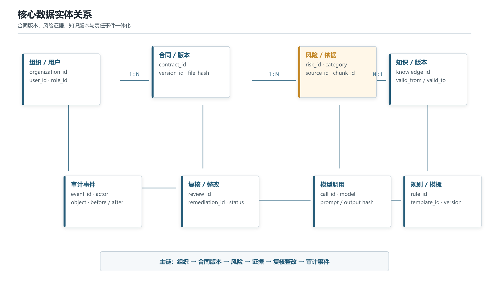
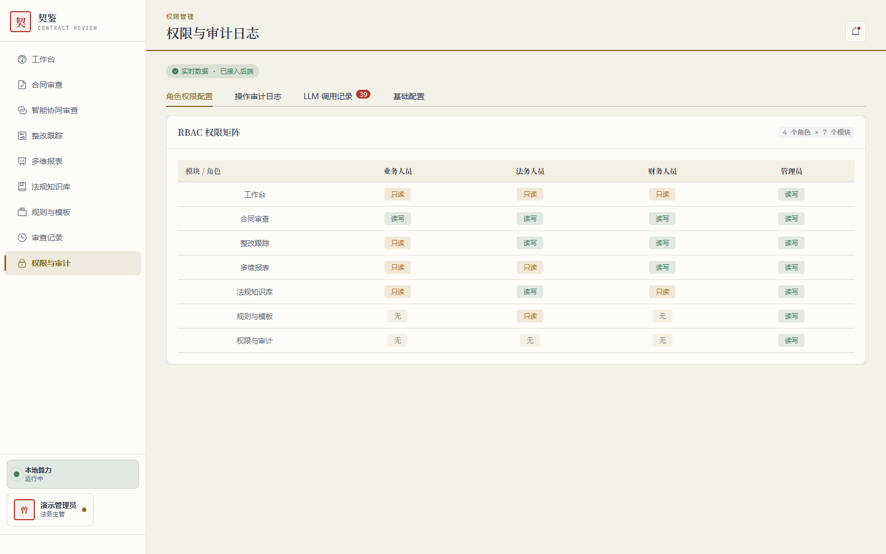
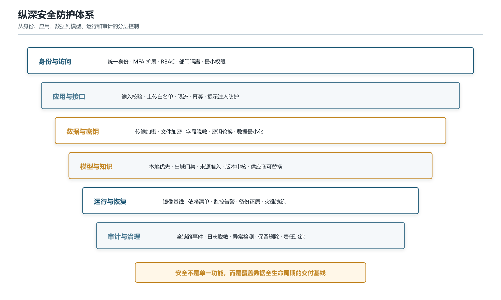

# 第六章 数据、安全与权限设计

## 6.1 数据设计目标

数据设计既要支撑页面查询，也要保证合同版本、机器意见、人工决定和管理指标能够相互追溯。系统采用“业务对象保存现态、事件记录保存过程、版本对象保存历史”的组合。任何需要解释的结果都能找到输入版本、处理任务、配置和操作者。

合同数据具有商业敏感性，数据模型同时承担安全边界。合同、风险、整改、报告和审计记录均带组织或部门范围；查询服务默认注入权限条件；文件对象与数据库记录使用不可猜测标识关联。模型上下文、索引和导出副本也被视为合同数据的派生物，纳入相同生命周期。

## 6.2 核心数据对象

| 数据对象 | 关键内容 | 主要关系 | 保护要求 | 保留策略 |
|---|---|---|---|---|
| 用户与组织 | 用户标识、部门、状态、身份来源 | 用户绑定角色与部门范围 | 最小字段、身份同步校验、停用控制 | 离职或停用后保留必要操作归属 |
| 合同与版本 | 合同元数据、原件标识、哈希、版本说明 | 合同包含多个不可覆盖版本 | 文件加密、部门隔离、下载审计 | 按业务与法规要求归档或删除 |
| 解析与要素 | 文本块、位置、质量、原始值和标准化值 | 关联一个合同版本和处理任务 | 访问范围继承合同，日志脱敏 | 随合同版本管理，保留修正历史 |
| 审查任务 | 范围、配置、阶段、租约、错误和幂等键 | 关联版本、批次、模型调用和风险 | 防止越权重试，限制调试信息 | 依据审计和故障分析周期保留 |
| 风险与证据 | 事实、等级、原文、依据、建议、状态 | 关联专业意见、知识版本和处置事件 | 原始意见不可覆盖，高影响操作留痕 | 随合同与争议处理要求保留 |
| 整改与复审 | 责任人、期限、反馈、附件和关闭理由 | 引用已确认风险和后续合同版本 | 责任人范围、附件访问、状态校验 | 关闭后保留完整过程，不物理覆盖 |
| 知识与规则 | 来源、版本、有效期、适用范围和内容 | 被检索记录、风险或规则命中引用 | 发布审核、版本不可变、来源校验 | 停用后保留历史引用 |
| 报告与导出 | 模板、筛选快照、文件标识和有效期 | 来源于合同、风险或统计查询 | 生成与下载双重鉴权、到期清理 | 业务报告按制度留存，临时导出短期保存 |
| 审计事件 | 操作者、动作、对象、结果、时间和前后值 | 关联用户、请求和业务对象 | 防篡改、受控查询、内容最小化 | 按安全与审计制度单独留存 |

## 6.3 版本与事件模型

合同版本保存原件和解析输入，不因新稿上传而被覆盖。每个审查任务只处理一个版本，重新审查会产生新任务。风险关联具体任务和版本，避免用户在查看旧报告时误以为引用的是新合同。

机器原始输出、人工修正值和业务现态分开保存。风险表可以保存便于查询的现态，处置事件记录确认、调整、不采纳、升级和关闭等变化。人工调整包含前值、后值、理由和人员。整改同样以事件表示分派、反馈、退回、复审和关闭。

知识资料发布后形成不可变版本。新版本替换旧版本时，旧版本停止支持新检索，但历史风险仍能访问当时引用的内容。规则、提示模板和模型配置也使用版本标识，使复盘能够还原一次审查使用的条件。

## 6.4 存储与索引

关系数据库保存用户、组织、合同元数据、状态、风险、整改、知识元数据和审计事件。原始合同、报告、整改附件等大文件写入对象存储或受控文件目录，数据库保存对象标识、哈希和安全属性。Redis 用于队列、短期缓存和租约，不作为唯一业务事实来源。

生产目标采用 PostgreSQL，利用事务、约束、索引和并发控制保证一致性。开发环境可使用 SQLite，但数据库类型差异必须通过迁移和目标环境测试处理。金额使用定点数值，时间保存带时区值，枚举使用受控代码并提供字典解释。

索引依据实际查询路径设置：合同按部门、状态、类型和时间查询；风险按合同、等级、类别和状态查询；整改按责任人、期限和状态查询；任务按批次、阶段和租约查询；审计按对象、人员和时间查询。复合索引顺序以真实执行计划和数据分布为依据，避免仅根据字段数量添加索引。

全文和向量索引只保存完成检索所需内容。索引条目引用合同版本或知识版本，删除或停用时通过任务同步状态。索引服务失效不应删除关系数据库中的原始风险与依据关系。

## 6.5 认证与授权

系统支持本地认证或企业统一身份接入。认证成功后生成有期限的访问令牌，令牌包含用户标识和必要声明，不放入合同正文或大量权限明细。生产环境使用独立强密钥，启用安全传输、会话过期和账号停用检查。

授权采用角色权限与数据范围组合。角色决定能否上传、审查、复核、整改、导出或管理；部门范围决定能够操作哪些合同。后端服务在资源读取、列表查询、写操作、异步任务和下载时都执行授权。前端菜单隐藏不能替代后端校验。

管理员权限分为账号配置、知识管理、运行管理和审计查询等操作，不默认授予所有合同原文访问。后台 Worker 通过服务身份执行任务，其可访问数据由任务绑定的组织范围约束。对象不存在与无权访问的响应避免泄露其他部门信息。

高影响操作实施更严格控制，包括风险降级、不采纳重大风险、接受残余风险、批量导出、授权变更和知识发布。系统要求理由、必要的复核权限和完整事件记录。具体双人复核或审批层级由目标单位制度配置。

## 6.6 数据安全分层

**网络层。** 浏览器只访问 HTTPS 网关，数据库、Redis、对象存储和模型服务位于受控网络。外部模型调用经指定出口和域名白名单，禁止应用节点任意访问互联网。

**应用层。** 所有接口执行认证、参数校验、权限过滤、速率和大小限制。上传内容在解析前检查，下载使用短期授权。错误响应不返回堆栈、数据库语句或敏感配置。

**数据层。** 文件和必要敏感字段加密存储，密钥与业务配置分离。数据库账户按服务用途分权，生产禁止使用弱默认口令。备份同样加密，并与在线凭据分开保存。

**智能计算层。** 模型上下文按任务最小化，默认不传递无关个人信息、完整组织通讯录或其他合同。模型提供方、部署位置、数据保留和训练使用策略需经安全确认。提示和响应日志按配置脱敏，调试模式不得在生产长期开启。

**运维层。** 管理入口限制来源，配置变更、密钥轮换、备份恢复和日志查询均留痕。监控标签不包含合同全文或个人敏感信息，排障包在导出前执行内容检查。

## 6.7 加密与密钥管理

传输链路采用 TLS。原始合同、报告和附件使用文件加密密钥保护，数据库中的口令只保存安全哈希，JWT 使用独立签名密钥。不同用途的密钥分开管理，不将示例值用于交付环境，不把密钥写入源码、镜像或普通日志。

密钥具有生成、分发、使用、轮换、备份和销毁生命周期。部署时由受权运维人员注入密钥；应用只获得完成任务所需权限。轮换记录版本和生效时间，新文件使用新密钥，旧文件按计划重新加密或通过旧版本密钥读取。密钥备份与业务备份分离保管，并通过恢复演练验证。

密钥丢失可能导致文件不可恢复，泄露则可能扩大数据暴露，因此监控既要关注读取失败，也要关注异常批量访问。任何密钥事件应触发访问控制检查、轮换和影响范围评估。

## 6.8 日志与审计

运行日志用于定位服务和任务故障，审计事件用于回答谁在何时对什么对象执行了什么动作，两者不混为一张无边界日志。运行日志可以记录请求标识、阶段、耗时和错误类别；审计事件记录身份、动作、对象、结果和必要前后值。

日志禁止记录口令、完整令牌、密钥和整份合同。模型调用日志只保存定位问题所需的模型标识、配置版本、任务标识、耗时和结构状态；如需保留提示与响应，应采用独立权限、脱敏和留存周期。日志查询本身记录审计，防止其成为绕过业务权限的数据入口。

审计事件应使用追加方式保存。对风险、整改、授权、知识和导出等关键动作，业务事务成功后对应事件必须可查。时间同步、用户身份和请求标识保持一致，以支持跨 API、Worker 和数据库的关联分析。

## 6.9 备份、恢复与数据生命周期

备份范围包括 PostgreSQL 数据、合同与附件对象、知识文件、必要索引配置以及密钥管理记录。Redis 中可重建的缓存不作为唯一恢复来源；任务队列恢复依赖数据库中的持久化状态和幂等记录。数据库与文件备份需要一致性标识，避免恢复后记录指向不存在的对象。

备份策略由恢复点目标、恢复时间目标和业务保留要求决定。全量与增量频率、保存位置、加密、校验和权限应形成配置。只有实际完成恢复并通过业务核对的备份才具备可用证据；备份任务显示成功不能替代恢复演练。

数据生命周期覆盖创建、使用、共享、归档和删除。临时上传分片、解析中间文件和导出副本设置短期清理；正式合同、风险和整改根据企业制度保留。删除请求同时处理关系数据、文件对象、索引和临时副本，并保留制度要求的最小审计信息。处于争议、调查或法定保留期的数据应暂停删除。

## 6.10 知识治理

知识资料需要明确所有者、来源、版本、适用范围和复核周期。公开法规应指向权威来源，企业制度由指定部门发布，历史案例需完成脱敏和适用范围说明。未经审核的上传资料保持草稿，不进入正式审查链路。

资料切片不改变原文效力。切片保存原文位置和文档版本，检索展示必要上下文。法规或制度更新后发布新版本，系统停止旧版本用于新任务，并根据引用关系提供影响分析入口。是否重新审查历史合同由专业人员决定。

## 6.11 安全责任边界

技术控制需要与组织制度配合。使用单位负责确认数据分类、允许的模型方式、账号和部门映射、知识来源、日志与备份周期以及人工复核责任；运维人员负责网络、凭据、补丁、监控与恢复；业务和专业人员对合同事实及处置决定负责。

系统能够降低误传、越权和无痕修改的风险，但不能代替人员保密义务和企业审批制度。安全验收必须在目标部署环境执行，开发或演示配置不能作为生产安全结论。
