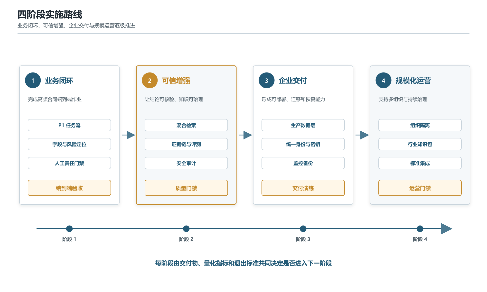
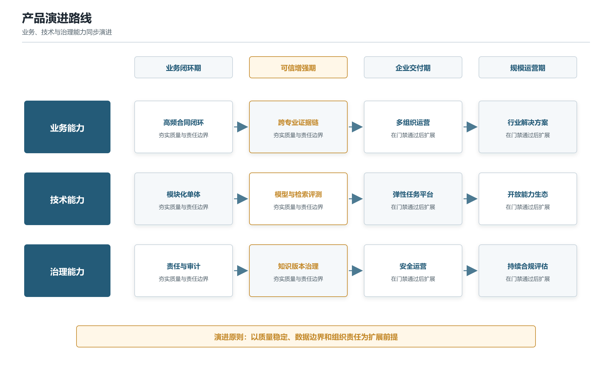

# 第七章 部署实施与运行保障

## 7.1 部署目标与环境划分

部署需要回答四个实际问题：服务放在哪里，合同数据经过哪些节点，配置由谁管理，发生故障后怎样恢复。开发、演示、测试和生产环境相互隔离，分别使用数据库、文件目录、账号和密钥。各环境可以使用同一构建产物，但不能共用真实合同和生产凭据。

开发环境强调调试效率，可使用 SQLite 和同步任务处理；测试环境应尽量接近生产拓扑，用于迁移、异步任务、权限、容量和恢复验证；生产环境采用 PostgreSQL、Redis、Celery、独立密钥、受控文件存储和监控。演示环境只存放虚构或脱敏数据，页面数字不作为生产性能依据。

| 环境或组件 | 主要用途 | 配置要求 | 验收条件 |
|---|---|---|---|
| 前端与网关 | 提供页面、静态资源和统一访问入口 | HTTPS、安全响应头、上传限制、反向代理和访问日志 | 主要浏览器与分辨率可用，错误页和路由回退正常 |
| FastAPI 服务 | 认证、业务接口、权限、事务和任务编排 | 生产模式、强密钥、数据库连接池、日志级别和健康检查 | 核心接口可用，越权被拒绝，依赖异常有明确响应 |
| PostgreSQL | 保存业务、状态、配置和审计数据 | 专用账号、字符集、时区、连接限制、备份与迁移 | 空库部署、升级、回滚和恢复按方案执行 |
| Redis 与 Celery | 队列、租约、缓存、Worker 和调度 | 持久化策略、并发、超时、重试、队列隔离和监控 | 重启后任务可识别，重复投递不产生重复业务数据 |
| 文件存储 | 保存原件、报告、附件和临时导出 | 加密、目录或桶隔离、容量告警、哈希和生命周期 | 授权读写正常，备份恢复后对象与数据库一致 |
| 文档解析与 OCR | 提取 DOCX、PDF 和扫描页内容 | 字体、渲染库、模型文件、页数与像素上限 | 规定格式可处理，低质量输入进入人工出口 |
| 模型与 Embedding | 执行专业审查、抽取和知识检索 | 提供方、模型版本、地址、密钥、并发和数据策略 | 固定样本结构合格，超时与不可用时能够降级 |
| 监控与备份 | 采集健康、容量、错误和恢复证据 | 指标、告警、日志留存、备份周期和通知责任 | 告警可触发，备份能恢复，敏感内容不进入监控标签 |

## 7.2 推荐部署拓扑

用户浏览器通过 HTTPS 访问反向代理，前端静态资源和 `/api` 请求由网关统一分发。API 服务访问 PostgreSQL、Redis 和文件服务，并向队列提交长任务。Worker 从队列获取解析、审查和导出任务，按授权对象读取文件和业务数据。调度器负责周期性补投、临期提醒和过期文件清理。

模型服务和 Embedding 可以部署在内网计算节点，也可以通过批准的网络出口调用外部服务。无论采用哪种方式，业务代码只调用统一适配层，模型凭据不进入浏览器。数据库、Redis 和管理端口不对用户网络直接开放。

容器化交付可使用 Docker Compose 编排数据库、缓存、API、Worker、调度器和前端。对于已有 Kubernetes 或虚拟机平台的单位，可以按同一组件关系转换部署方式；转换不改变任务幂等、数据存储和安全边界。

## 7.3 配置管理

配置分为非敏感运行参数和敏感凭据。数据库类型、服务地址、并发、超时、文件上限、日志级别和模型标识可以通过环境变量或受控配置提供；数据库口令、JWT 密钥、文件加密密钥和模型密钥由密钥管理机制注入。配置模板只列字段和示例，不含可用于生产的真实值。

生产启动门禁检查调试开关、数据库类型、异步任务、密钥强度和必要依赖。仍使用开发默认值或关键配置缺失时，服务应拒绝启动并给出配置项名称，不打印密钥内容。配置变更记录申请人、评审、影响范围和回退方式。

第五章所列数值是当前实现基线，部署时应逐项形成配置清单。文件与 OCR 上限用于保护资源；模型和导入超时用于终止失控调用；任务租约、重试等待和恢复查询上限用于协调后台任务。这些取值可以调整，但调整人、原因、生效环境、验证记录和回退值必须一并保存。访问令牌当前有效期为 480 分钟，生产环境应结合单点登录和终端使用方式评估是否缩短。

合同类型、风险等级、部门字典、规则和知识属于业务配置，需要版本与发布流程。运行参数与业务配置分开维护，避免运维调优意外改变专业判断。

## 7.4 数据库初始化与迁移

数据库结构通过 Alembic 迁移管理。首次部署在空库执行到指定版本，升级前备份数据库和文件对象，并在同版本副本上预演迁移。迁移脚本需要明确前向操作、数据转换、约束建立和可行的回退路径。

应用启动前核对数据库版本。迁移失败时停止启动，不在结构不完整的情况下继续提供写服务。涉及大表或不可逆转换时，采用分阶段迁移：先添加兼容字段，完成数据回填和双读验证，再切换代码，最后在后续窗口清理旧结构。

迁移验收除检查命令退出状态外，还要抽查用户、合同、风险、整改、知识和审计数据的数量与关联。时间、金额、枚举、非空约束和索引分别核对。回退后同样执行核心读取与写入用例。

## 7.5 服务启动与健康检查

推荐启动顺序为 PostgreSQL 和文件存储、Redis、数据库迁移、API、Worker 与调度器、前端与网关。基础依赖先通过健康检查，上层服务再接收流量。种子数据和演示账号不得自动写入生产数据库。

API 健康检查分为存活和就绪。存活表示进程能够响应；就绪表示数据库、必要配置和关键依赖满足服务条件。Worker 提供心跳、队列和任务指标；模型与 OCR 通过低频探测或固定样本检查可用性，不把包含真实合同的请求用作健康探测。

服务启动后依次验证登录、上传、解析、审查、复核、整改、报表和下载，再检查批量、越权与重启恢复。上线记录保存应用版本、数据库迁移版本、配置项名称和操作人员，不记录凭据值。

## 7.6 任务与容量管理

Worker 按解析、模型和导出等资源类型设置队列与并发。OCR 消耗 CPU 和内存，模型任务受推理并发或外部额度限制，报告生成关注内存与磁盘；不同任务不应使用一个无上限队列。资源上限通过容量测试确定，并保留队列长度和等待时间告警。

任务超时分阶段设置。当前后台任务时间上限为 1800 秒，文件项租约为 30 分钟，失败重试等待 10 秒。解析超时不直接重跑整个双专业审查，模型失败也不丢弃已完成的解析和规则输出。调度器每次最多检查 500 个待恢复项，避免恢复扫描本身占用过多资源。管理员可以查看积压和失败类别，但手工重投仍需幂等检查。

批次状态页面当前每 1500 毫秒轮询一次。这个间隔只影响用户看到进度的及时性，不改变后台任务状态；用户关闭页面后，Worker 仍按持久化任务继续执行。多用户部署若轮询压力过高，可延长间隔或改用受控通知，但不能把浏览器连接当作任务租约。

磁盘容量同时关注原件、解析中间文件、报告、导出和备份。临时文件按生命周期清理，正式数据不得因磁盘压力直接删除。达到预警阈值时限制新的批量任务，并通知责任人扩容或清理可安全移除的临时对象。

## 7.7 监控与告警

监控分为基础设施、应用、业务任务和安全四层。基础设施关注 CPU、内存、磁盘、网络、数据库连接和 Redis 状态；应用关注请求量、错误率、延迟和依赖失败；业务任务关注队列积压、各阶段耗时、失败类型、租约过期和重试；安全关注登录失败、越权、异常导出、授权变更和密钥错误。

告警设置等级、阈值、持续时间、通知对象和处置手册。短时波动可以先观察，数据不可写、文件不可读、队列停止消费和异常批量下载应立即处理。告警信息只包含定位所需标识，不附带合同正文或个人敏感信息。

日志通过请求标识、任务标识和合同版本标识关联。排障人员先判断是输入、应用、依赖、权限还是资源问题，再选择重试、降级、扩容或恢复。错误关闭后记录原因和预防措施，为后续阈值与用例调整提供依据。

## 7.8 备份与灾难恢复

数据库和文件对象按一致性策略备份，密钥材料由独立渠道保护。备份文件加密、校验并限制访问，至少保留一份与生产故障域隔离的副本。恢复点目标和恢复时间目标由使用单位根据业务影响确定。

恢复演练在隔离环境执行：准备目标基础设施，恢复数据库与文件对象，注入受控密钥，检查迁移版本，启动服务，然后核对合同数量、对象哈希、风险关联、整改状态和审计事件。最后执行核心业务用例，确认恢复后的系统不只是“能启动”，而是数据关系可用。

若模型或检索服务暂不可恢复，业务查询和人工处置可以按降级模式开放；若数据库或文件一致性无法确认，则保持只读或停止服务。灾难恢复过程记录时间线、人员、命令、校验和遗留风险。

## 7.9 升级、回退与发布

发布包包含前端、API、Worker、调度器、数据库迁移和配置变更说明。发布前完成依赖与镜像检查、迁移预演、备份和回归；发布窗口内先停止不兼容写入，再执行迁移和服务替换。滚动升级时，新旧版本必须在接口、任务和数据库结构上兼容。

回退条件包括核心接口不可用、数据写入错误、权限边界异常和任务大面积失败。仅回退应用不能解决已执行的数据迁移，因此方案需要分别规定代码回退、配置回退和数据恢复。知识、规则和模型配置使用独立版本，可以在不回退应用的情况下恢复上一稳定版本。

## 7.10 实施阶段与职责

图 7-1 的阶段关系以交付条件为分界。基础部署完成不等于可以投入使用；规则、知识、账号和接口准备后，还需按第八章留下验证证据。受控试用只扩大真实使用范围，不改变验收口径。

实施分为准备、基础部署、业务配置、数据与接口准备、验证、受控试用和正式运行。准备阶段确认组织、角色、合同类型、数据分类和网络；基础部署建立数据库、队列、文件、应用与监控；业务配置阶段发布字典、规则和知识；验证阶段按第八章执行；受控试用限制用户和合同范围，问题闭环后再扩大使用。

业务负责人确认流程、字段和管理口径；法务与财务评审风险规则、知识和人工边界；开发人员维护应用、接口和迁移；测试人员管理样本、金标准和证据；运维人员负责网络、数据库、队列、模型、密钥、监控与恢复。一个人可以承担多个角色，但样本标注、预测运行和验收确认应保持必要的复核关系。

## 7.11 交付物与运行交接

交付物包括应用部署包、配置清单、数据库迁移、接口说明、数据字典、账号与权限矩阵、知识与规则清单、测试方案、运行手册、备份恢复手册和问题处理流程。交付文档记录配置项名称和责任人，不记录真实口令或密钥。

运行交接至少覆盖日常巡检、用户与权限变更、知识发布、任务失败处理、备份检查、恢复演练、版本升级和安全事件响应。交接通过实际操作确认，不以阅读文档代替。服务等级、维护窗口和告警响应由双方根据部署条件约定。

图 7-2 表达的是变更顺序，不是实际进度说明。解析质量决定下游输入，规则和知识决定结论依据，容量问题才由并发和计算资源解决；运行中发现问题后，应先按错误来源归类，再决定改哪一层。

后续演进以使用记录和验证证据为依据。若错误集中在特定扫描版面，优先改进解析与样本；若某类风险误报频繁，检查规则、知识和适用范围；若队列持续积压，再调整并发或拆分计算单元。功能扩展不应破坏合同版本、风险证据和人工责任这三条基本边界。

## 7.12 参数校准与方案变更

生产能力受硬件、模型、网络、数据规模和组织配置影响。上线前应以第五章参数基线为起点，在目标环境验证容量、迁移、恢复和安全项目；未执行的项目在独立测试记录中保持未判定，不用开发环境或演示数据补齐结论。

日常调整超时、批次上限、轮询间隔或告警阈值时，只需更新受控配置和测试记录。只有需求范围、处理机制、数据关系、安全边界、部署拓扑或验收方法发生变化，才修订本详细方案。这样既保留设计基线，又避免把每次运行参数调整写成文档版本变更。
