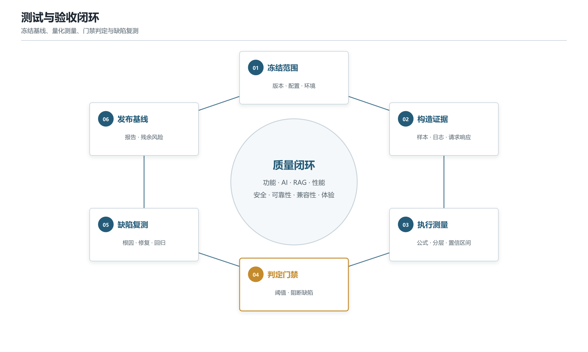

# 第八章 测试与验收方案

## 8.1 验收原则

本章规定可重复的测试方法、指标、判定和证据，不记录某一次执行产生的动态数字。每次测试的环境、样本、配置、步骤和观察值由独立《项目测试案例及报告》保存；软件、模型、知识、规则或部署条件变化后，可沿用本章口径重新执行，无需修改详细方案。

验收遵循五项原则：需求与用例一一对应；样本在运行前冻结；预测与人工修正分开；正常、异常和越权路径同时覆盖；未经目标环境验证的项目保持未判定，不用开发环境记录替代。

## 8.2 测试层次与证据

| 测试类别 | 测试对象 | 判定依据 | 证据形式 |
|---|---|---|---|
| 单元与组件测试 | 解析器、规则、状态机、权限函数、指标计算和前端组件 | 输入输出、边界值和异常分支符合设计 | 自动化日志、覆盖用例和失败快照 |
| 接口与集成测试 | API、数据库、文件、队列、模型适配与导出 | Schema、状态码、事务、幂等和依赖降级正确 | 请求响应记录、数据库核对和任务事件 |
| 业务流程测试 | 上传、解析、审查、复核、整改、报告与报表 | 角色动作、状态迁移和责任边界形成闭环 | 用例步骤、页面截图、对象与审计关联 |
| 准确性测试 | OCR、要素抽取、风险识别、分类与知识检索 | 在冻结金标准上按规定公式计算并达到阈值 | 样本清单、预测文件、金标准和错误清单 |
| 性能与容量测试 | 单份、批量、并发、队列、模型和导出 | 在目标环境达到约定规模，且无数据丢失或重复 | 环境清单、原始时序、资源曲线和任务事件 |
| 安全与权限测试 | 认证、角色、部门、下载、日志、密钥和输入安全 | 未授权访问全部拒绝，敏感信息不泄露 | 权限矩阵、请求记录、日志检查和扫描报告 |
| 部署与恢复测试 | PostgreSQL、迁移、Compose、备份、恢复和升级 | 可按手册重复部署、迁移、回退和恢复 | 执行记录、版本、校验清单和恢复核对 |
| 用户验收测试 | 目标角色的真实工作任务与管理口径 | 业务负责人和专业人员按职责确认 | 签署的用例单、问题清单和验收意见 |

## 8.3 测试环境与版本冻结

每次执行前记录操作系统、CPU、内存、磁盘、数据库、Redis、浏览器、OCR、模型、Embedding、应用版本和网络方式。性能与能耗测试还需记录设备、驱动、量化方式、并发、预热和采样工具。环境差异会影响结论，报告不得省略。

测试对象使用唯一版本标识。数据库迁移版本、规则版本、知识快照、提示模板、模型及参数在测试开始前冻结。修复缺陷或更换配置后重新执行受影响用例，并在报告中建立前后运行关系，不能覆盖原始记录。

测试账号至少覆盖业务、法务、财务、部门负责人、管理者和管理员，并设置两个以上部门用于验证隔离。账号使用专用测试凭据，测试后清理或停用。生产数据不得直接复制到测试环境；真实合同需要脱敏，同时保留判断风险所需上下文。

## 8.4 功能与流程验收

主流程用例从登录开始，依次执行合同上传、预检、解析、要素核对、法务与财务审查、风险复核、整改分派、反馈、复审、报告和报表。每一步检查页面状态、接口响应、数据库对象、状态迁移和审计事件。P1 用例必须全部通过，且不存在阻断业务或破坏数据一致性的缺陷。

异常用例覆盖空文件、格式伪装、损坏文件、重复文件、密码文件、扫描质量低、解析超时、模型超时、结构错误、知识无结果、专业意见冲突、批量部分失败、导出失败、重复提交和服务重启。验收重点不是“出现错误”，而是错误发生后已有数据是否保留、用户是否知道下一步、重试是否重复写入。

页面测试覆盖正常、加载、空、错误、无权限和处理中状态，并在常用桌面与移动宽度下检查文本、表格、按钮和弹窗。键盘焦点、表单标签、颜色对比和错误提示纳入可用性检查。报表加载失败时不得显示伪造零值，列表无数据和无权限必须有不同含义。

## 8.5 OCR 准确性验收

OCR 样本覆盖清晰打印、倾斜、低对比度、印章遮挡、表格、多栏和中英文数字混排。每个样本保存原图、页数、分辨率和人工校对文本。两名标注人员独立核对，分歧由第三方或共同复核形成金标准。测试前固定页面渲染、文本归一化和标点处理规则。

字符准确率以编辑距离计算：`CAR = 1 - (S + D + I) / N`，其中 `S` 为替换数，`D` 为删除数，`I` 为插入数，`N` 为金标准字符数。清晰扫描件的基准阈值设为不低于 95%。无法解析、超时和触发人工复核的页面单独统计，并纳入失败率，不能从分母中删除。

主体、金额、日期、比例、否定词等高影响内容另做关键字符或字段核对。若整体字符准确率达到阈值，但关键金额或否定词频繁错误，仍不能判定该类版面可自动进入审查。低质量样本用于验证人工出口，不要求通过降低门槛获得确定性结论。

## 8.6 要素抽取验收

要素样本按合同类型、篇幅、格式和字段出现方式分层抽取，覆盖空值、多主体、多币种、金额单位、多个付款节点和跨段条件。金标准由两名人员独立标注，预先规定字段边界、同义值、日期格式和部分匹配规则。

对每个字段计算精确率 `P = TP / (TP + FP)`、召回率 `R = TP / (TP + FN)` 和 `F1 = 2PR / (P + R)`。关键要素宏平均 F1 的基准阈值设为不低于 90%，同时逐字段报告样本数和错误类型。不能用大量容易字段抵消主体、金额、日期等关键字段的明显失误。

评测使用系统初始预测，不使用人工修正后的业务值。非法 JSON、字段类型错误、来源位置缺失和任务失败按协议计入失败。原始预测、归一化过程、金标准和字段级差异清单共同构成证据。

## 8.7 风险识别与原文定位验收

风险金标准按合同版本建立，包含专业维度、风险类别、等级、事实、原文位置和可接受建议。法务与财务人员独立标注，再处理分歧。测试集同时包含有风险和无风险条款，避免只计算命中样本。

高风险召回率按 `正确识别的高风险数 / 金标准高风险总数` 计算，基准阈值不低于 90%；风险分类准确率按 `分类正确的匹配风险数 / 已匹配风险数` 计算，基准阈值不低于 85%。误报率、漏报率和等级偏差同时报告，不以一项指标掩盖另一项。

原文定位准确率按风险位置是否指向包含金标准答案的页、段落或表格单元格判断，基准阈值不低于 95%。只能找到相似句但不能确认版本或位置的记录不算精确定位。模型建议由专业人员按可采纳、需修改和不可采纳分级评价，评价理由保留在报告中。

## 8.8 知识检索与证据验收

检索测试为每条风险查询标注相关知识、可接受来源和不适用来源，覆盖精确条号、同义表达、跨条款问题、失效版本、错误法域、错误合同类型、企业制度隔离和无答案场景。

`Recall@5` 表示金标准依据是否进入前五个候选，基准阈值不低于 90%；平均倒数排名用于观察首个正确候选的位置。引用真实性要求显示的来源、版本和原文确实存在；适用性准确率基准阈值不低于 95%。失效或范围错误的资料一旦被作为可靠依据，应按高优先级缺陷处理。

无合格来源时，系统应将风险置为待核对并进入人工出口。该场景的正确降级率要求 100%。测试保留关键词排名、向量排名、融合排名、过滤原因和最终关联，便于区分召回、排序和适用性判断问题。

## 8.9 批量、性能与稳定性验收

批量基线使用不少于 50 份有效合同并混入 2 份可预期的异常文件。测试记录文件清单、大小、页数、哈希、审查配置、并发和目标硬件。验收要求有效文件各自进入正确终态，异常文件给出独立原因，单项失败不影响其他文件，批次总量与各状态数量一致。

测试覆盖页面刷新、客户端关闭、Worker 重启、任务租约过期、重复提交和失败项重试。重复请求不得创建重复合同或风险；服务恢复后任务根据持久化状态继续或进入明确失败；重试只处理符合条件的项目。总耗时、单份分位延迟、吞吐、队列等待和资源峰值作为观察值写入独立报告，目标值由部署规模和服务等级约定。

稳定性测试在约定时间内持续提交代表性任务，关注内存增长、数据库连接、磁盘临时文件、队列积压和错误率。测试结束后核对业务对象、文件和任务事件，确认不存在丢失、重复和无法解释的处理中状态。

## 8.10 安全与权限验收

按照角色和部门建立权限矩阵，直接调用接口验证合同、风险、整改、报表、导出、知识、用户和审计的读写范围。覆盖修改部门参数、猜测合同标识、复用下载地址、访问他人批次和通过后台任务越权等方式。所有未授权操作应被后端拒绝，且不泄露对象是否存在。

认证测试覆盖错误口令、账号停用、令牌过期、伪造令牌和重复登录策略。输入安全覆盖伪造文件、超大文件、路径字符、公式注入、恶意 HTML 与异常 JSON。日志检查确保口令、令牌、密钥和整份合同不被记录。

文件加密、密钥注入、轮换和旧文件读取需要在隔离环境验证。导出任务生成前和下载时分别鉴权，过期链接不可使用。高影响操作必须有身份、理由、前后值和时间审计。

## 8.11 部署、迁移与恢复验收

在目标 PostgreSQL 版本上执行空库初始化、已有版本升级和允许的回退。迁移前后核对表、约束、索引、数量和关键关系。失败迁移必须停止应用写入，不能留下半完成结构继续运行。

按部署手册从干净环境启动数据库、Redis、API、Worker、调度器和前端，检查健康与核心用例。服务重启、队列中断、模型不可用和磁盘预警分别验证告警及降级。配置门禁需要拒绝弱默认密钥、错误数据库类型和缺失的生产依赖。

恢复测试从真实备份副本还原数据库、文件和必要密钥，再核对合同对象哈希、风险关联、整改状态与审计事件，并执行核心业务用例。恢复时间和数据丢失窗口作为观察值与约定目标比较。未执行恢复的备份不能判定为可用。

## 8.12 缺陷分级与验收判定

P1 缺陷包括数据丢失、越权访问、原件或风险关联错误、关键状态无法恢复以及把低质量输入误判为无风险；P2 缺陷影响主要功能但存在受控替代路径；P3 缺陷为不影响业务正确性的显示或易用性问题。

验收通过至少满足：P1 功能用例全部通过；不存在未关闭的 P1 缺陷；权限越权用例全部被拒绝；准确性指标达到约定阈值；批量与恢复在目标环境形成完整证据；文档、接口和数据字典与交付版本一致。任何关键外部条件不具备时，对应项目标记未判定，不降低阈值也不推断结论。

缺陷修复后先运行最小复现用例，再运行受影响模块和核心回归。报告保留修复前后记录。验收意见由业务、法务、财务、测试和运维按职责确认，技术人员不能代替专业角色签署风险准确性结论。

## 附录A 主要接口清单

接口统一使用 `/api/v1` 前缀。下表列出主要业务域，字段、错误码和示例以交付版本的接口文档为准。

| 接口域 | 主要接口 | 输入 | 输出与状态 |
|---|---|---|---|
| 认证 | `POST /auth/login` | 用户名、口令 | 访问令牌、用户身份；认证失败返回 401 |
| 合同 | `GET /contracts`、`POST /contracts/upload` | 查询条件或合同文件 | 合同列表或合同对象；输入无效返回 400/422 |
| 解析与审查 | `POST /contracts/{id}/parse`、`POST /contracts/{id}/audit`、`GET /contracts/{id}/audit-status` | 合同标识、审查维度 | 任务与阶段状态；冲突返回 409 |
| 合同风险 | `GET /contracts/{id}/risks`、`PATCH /risks/{id}/status` | 合同或风险标识、处置内容 | 风险列表或更新后状态；越权返回 403 |
| 批量任务 | `POST /batches`、`GET /batches/{id}`、`POST /batches/{id}/retry` | 多文件、审查范围、幂等标识 | 批次、逐文件状态和重试信息；创建返回 202 |
| 整改 | `GET /rectifications`、`POST /rectifications`、`PATCH /rectifications/{id}` | 风险、责任人、期限和反馈 | 整改对象及状态；非法迁移返回 409 |
| 报表 | `GET /dashboard/summary`、`GET /reports/summary`、`GET /reports/contracts-metadata`、`GET /reports/export` | 部门、类型、等级和时间筛选 | KPI、图表数据、元数据或导出响应 |
| 知识 | `POST /knowledge/import-file`、`GET /knowledge/cards`、`GET /knowledge/{id}` | 文件、来源、版本与适用范围 | 导入状态、知识列表或详情 |
| 规则与模板 | `GET/POST /rules`、`GET/POST /templates` | 规则或模板结构 | 版本化配置对象；无管理权限返回 403 |
| 管理与审计 | `GET /admin/access-matrix`、`GET /admin/audit-logs`、`GET /admin/llm-calls` | 管理筛选条件 | 权限矩阵、审计或模型调用元数据 |
| 基础字典 | `GET /admin/lookups/{category}`、`POST /admin/lookups` | 字典类别或项目 | 字典列表或新建对象 |
| 运行状态 | `GET /runtime/status` | 无或授权上下文 | 对外可见的模型与依赖状态，不返回密钥 |

## 附录B 核心数据字典

### B.1 用户与授权

`user_id`：用户唯一标识；`username`：登录名或外部身份映射；`department_id`：所属部门；`role_codes`：角色代码集合；`is_active`：账号是否可用。用户停用不删除其历史操作归属。

### B.2 合同与版本

`contract_id`：业务合同标识；`version_id`：不可覆盖的合同版本标识；`file_object_id`：受控文件对象；`file_hash`：内容哈希；`contract_type`：合同类型代码；`department_id`：数据归属；`parse_status`：解析阶段；`quality_status`：可自动处理、需确认或不可继续。

### B.3 审查任务与批次

`task_id`：一次处理任务；`batch_id`：批量任务标识；`batch_item_id`：逐文件任务项；`stage`：处理阶段；`status`：状态枚举；`idempotency_key`：防重复键；`lease_until`：Worker 租约期限；`attempt_count`：尝试次数；`error_code`：稳定错误类别。

### B.4 要素与风险

`element_code`：要素代码；`raw_value`：原始抽取值；`normalized_value`：标准化值；`source_location`：页、段或单元格位置；`confidence_state`：置信状态。`risk_id`：风险标识；`dimension`：法务或财务维度；`category`：风险类别；`severity`：等级；`fact`：风险事实；`suggestion`：修改建议；`evidence_status`：依据状态；`review_status`：人工复核状态。

### B.5 整改、知识与审计

`rectification_id`：整改标识；`assignee_id`：责任人；`due_at`：期限；`rectification_status`：整改状态；`review_comment`：复审说明。`knowledge_id` 与 `knowledge_version`：知识及版本；`effective_from`、`effective_to`：有效期；`scope`：适用范围。`audit_event_id`：审计事件；`actor_id`：操作者；`action`：动作；`object_type` 与 `object_id`：目标对象；`occurred_at`：发生时间；`request_id`：跨服务追踪标识。

## 附录C 术语与缩略语

| 术语 | 含义 |
|---|---|
| Agent | 面向特定专业任务组织上下文、规则、模型调用和结构化输出的执行单元 |
| 法务 Agent | 处理主体、权利义务、责任、效力和争议等法律维度的辅助审查单元 |
| 财务 Agent | 处理金额、价税、付款、发票和结算等财务维度的辅助审查单元 |
| OCR | 光学字符识别，用于从扫描页图像提取文本 |
| RAG | 检索增强生成，先检索受控知识，再辅助模型解释风险 |
| BM25 | 基于词项匹配的文本检索排序方法 |
| Embedding | 将文本映射为向量表示，用于语义相似检索 |
| RRF | 倒数排名融合，用于合并关键词和向量候选次序 |
| RBAC | 基于角色的访问控制，与部门数据范围共同决定权限 |
| Schema | 对请求、响应或模型结构化输出的字段与类型约束 |
| 幂等 | 同一业务请求重复执行时不产生重复业务对象或副作用 |
| 租约 | Worker 在限定时间内获得任务处理权的协调机制 |
| 金标准 | 在运行前由人工复核冻结、用于计算准确性的标准答案 |
| 风险证据链 | 风险事实、合同原文、知识依据、模型说明和人工处置之间的可追溯关系 |
| 未判定 | 测试条件不具备或证据不足，不能判定通过或失败的状态 |

## 附录D 参考文献

[S01] 全国人民代表大会：《中华人民共和国民法典》，国家法律法规数据库：https://flk.npc.gov.cn/

[S02] 全国人民代表大会常务委员会：《中华人民共和国电子签名法》，国家法律法规数据库：https://flk.npc.gov.cn/

[S03] 全国人民代表大会常务委员会：《中华人民共和国数据安全法》，国家法律法规数据库：https://flk.npc.gov.cn/

[S04] 全国人民代表大会常务委员会：《中华人民共和国个人信息保护法》，国家法律法规数据库：https://flk.npc.gov.cn/

[S05] 全国人民代表大会常务委员会：《中华人民共和国网络安全法》，国家法律法规数据库：https://flk.npc.gov.cn/

[S06] 国家市场监督管理总局：《网络交易监督管理办法》，国家市场监督管理总局：https://www.samr.gov.cn/

参考资料用于说明合同、电子数据与信息安全的通用治理背景。具体合同仍需结合交易事实、适用法域、资料版本和企业制度，由具有相应职责的专业人员判断。
