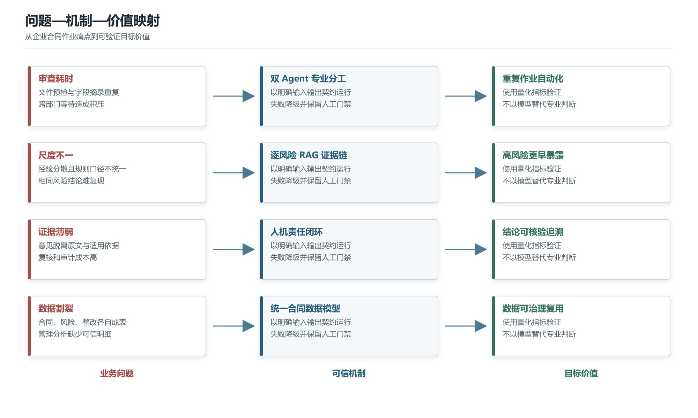
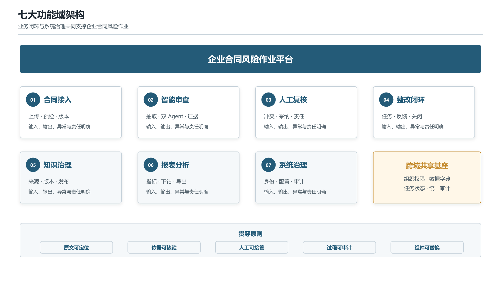

# 第一章 项目概述

## 1.1 合同审查发生在签署之前，也延续到履约之后

一份采购合同送到法务手中时，通常已经经过询价、供应商沟通和业务确认。经办人希望尽快签约，财务关心价税、付款和发票条件，法务还要核对主体、权利义务、违约责任与争议解决。问题往往不在某个孤立条款，而在条款之间：验收时间晚于付款时间，附件中的交付口径与正文不一致，违约责任没有覆盖关键义务，自动续期条款又没有明确退出期限。审查人员必须在有限时间内把这些线索连起来。

传统做法主要靠逐页阅读、检索法规、复制风险说明和来回传文件。不同人员会形成各自的批注习惯，财务意见与法务意见也容易散落在聊天记录、邮件和多个文档版本里。合同签署后，前期审查结论通常不会自然转成整改任务或管理数据。管理者能看到合同数量，却很难继续追问：风险集中在哪些部门，哪些条款反复出现，整改是否按期完成。

《“十四五”数字经济发展规划》提出推进产业数字化，并加强数据分类分级和全生命周期安全管理。[S01] 对合同场景而言，这意味着智能化处理必须同时回答两个问题：机器能否减少重复阅读，过程能否留下足够证据供人复核。只生成一段“合同有风险”的回答，没有原文位置、依据来源和处置记录，无法进入正式审查流程。

生成式 AI 服务还涉及内容准确性、数据来源和用户输入保护等治理要求。[S02] 系统需要说明模型做了什么、依据来自哪里，并为不确定结果留下人工决定入口。

## 1.2 我们对赛题的判断

A03 赛题要求运用文档解析、大模型和智能体技术识别合同漏洞、逻辑矛盾与法律风险，提取合同要素，形成多维报表；同时提出双 Agent、批量处理、扫描件识别、要素准确率以及 OpenClaw 与 GPU 对比等要求。把这些要求放到同一业务过程里，项目需要处理四类难点。

第一类是输入不稳定。合同可能来自 DOCX、文本型 PDF 或扫描 PDF，正文中混有表格、页眉、附件和印章图像。解析失败若被当成“未发现风险”，结果会产生误导。因此系统先判断文件是否可读、文本是否完整、是否需要 OCR，再决定能否进入审查。

第二类是审查尺度不同。法务关注效力、责任和争议，财务关注金额、税务与结算。两类判断可以共享主体、期限等基础要素，但不能混成一个角色。双 Agent 用于明确分工、保留各自证据，并把冲突交给人工处理；系统不把模型投票当作最终答案。

第三类是结论必须可解释。风险项要同时保存合同原文、所在位置、适用依据、风险等级、修改建议与置信状态。没有可靠来源、知识已失效或两个 Agent 意见冲突时，系统应降低确定性并要求复核。生成内容是辅助审查意见，不能替代授权人员作最终法律判断。

第四类是单份审查之后的数据利用。合同要素、风险和整改状态经过结构化后，才能支持批量任务、台账导出、部门范围过滤和多维统计。报表中的数字必须能回到合同与风险记录，演示数据不能被写成生产收益或客户成果。

## 1.3 项目定位与范围

“契鉴”是一套面向企业合同合规审查的本地化作业系统。它接收合同文件，完成加密存储、解析、要素提取和双 Agent 审查；审查人员在同一界面查看原文、依据和建议，确认或忽略风险，随后分派整改、复审关闭。合同要素和处置结果进入报表与台账，供管理者按合同类型、部门、风险等级和时间查看。

审查对象以中国大陆经营合同为主，合同订立、履行、变更、解除和违约等判断以《中华人民共和国民法典》等现行规范及交易事实为基础。[S03] 企业制度和标准模板可以补充内部口径，但不能替代上位法或被模型说明冒充为法律原文。

系统目前已贯通上传、解析、审查、复核、整改和报表接口，部门数据隔离、操作日志及前端主要状态也有自动化测试。批量上限、扫描件 OCR、PostgreSQL 迁移和 Compose 编排已经具备实现代码或配置，但仍需要按赛题指定数据和环境完成实测。OpenClaw 与 GPU 的性能、能耗比较依赖两套设备在同模型、同提示词、同数据集和同并发条件下采样，本方案只写比较方法，不预写优劣结论。

项目边界直接写入产品流程。系统不自动签署、修改或执行合同，也不代替印章、付款、诉讼和档案系统。遇到未覆盖法域、交易背景缺失、扫描质量过低、证据不足或重大事项时，系统给出状态提示并保留人工入口。

它与普通合同文件管理的区别，主要在风险对象和处理记录。文件管理系统通常保存合同、目录和审批状态；“契鉴”进一步把某段原文、某项依据、某次专业判断和后续整改关联起来。同一合同再次上传时，系统区分版本，不用新文件覆盖旧文件；知识或规则变化后，也可以依据版本信息解释当时为什么给出某项意见。这样，审查结果不再只是一份下载后难以继续利用的报告。

项目同样不把大模型放在所有环节。文件类型、大小、权限、金额格式和明确规则由确定性程序处理；语义判断才交给 Agent 和检索链路。确定性检查失败时，系统给出具体错误；模型输出异常时，系统保留原输入、结构校验结果和人工接管状态。不同环节用不同方法，便于测试，也减少一个模型错误向后传播。

## 1.4 一份合同如何经过系统

经办人上传合同后，系统先检查文件类型、大小和可读性，将原文件与解析结果分开保存。文本型文件进入版面解析，扫描件进入 OCR；质量低于阈值时不继续给出确定性审查结论。通过预检的合同生成统一文本和要素对象，法务 Agent 与财务 Agent 分别处理各自范围，规则命中、知识检索和模型分析在风险层合并。

系统把每条风险落到可定位的原文片段，并附上来源、适用性和建议。审查人员查看完整上下文后决定确认、忽略或补充说明。确认的风险可以生成整改项，记录责任人、期限、处理结果和复审状态。报表接口读取这些结构化记录，生成风险分布、趋势、部门排行和合同要素汇总；Excel 导出用于后续核对或移交。

批量任务沿用同一条单份链路，只在任务层增加文件上限、异步状态、失败隔离、重试和幂等控制。某个文件损坏不应使整批结果丢失。真正的 50 有效文件加 2 个异常文件测试、字段准确率计算和 OCR 字符准确率计算由《项目测试案例及报告》给出样本、步骤和结果，本材料说明实现机制与证据位置。

六份参赛材料按这一过程分工。源码证明功能真实存在；详细方案解释设计取舍和实现机制；演示视频按上传、审查、复核、整改、报表的顺序跑通关键路径；概要介绍帮助评委快速定位项目；测试案例及报告保存环境、样本和结果；简介 PPT 服务答辩。详细方案不复制完整测试日志，也不把计划中的指标提前写成结果。需要核验某项陈述时，可以沿本章表格找到对应源码、测试或界面证据。

## 1.5 对赛题要求的回应

| 赛题要求 | 契鉴的回应 | 对应证据 |
|---|---|---|
| 企业合同风险审查 | 将上传、解析、审查、复核和整改放在同一状态链中 | 源码、接口测试、前端流程截图 |
| 法务与财务双 Agent | 分开职责与输出结构，共享必要上下文，冲突进入人工复核 | Agent 实现与协同测试 |
| 多维报表 | 汇总合同要素、风险等级、部门范围和时间趋势，支持 Excel 台账导出 | 报表 API、权限测试与正常页面截图 |
| 批量处理 50 份以上 | 已实现批量上限、异步状态、失败隔离、重试与幂等 | 实现代码已具备，50+2 冻结样本待实测 |
| 扫描件与要素准确率 | 扫描件触发 OCR，低置信度转复核；字段指标按冻结金标准计算 | OCR 冒烟与指标工具已具备，赛题样本待实测 |
| OpenClaw 与 GPU 对比 | 固定模型、提示词、数据集、并发、输出结构和功率采样口径 | 基准执行器已具备，双设备数据待采集 |

上述回应把已完成的功能与尚需外部条件的指标分开。评审可以先沿界面和接口确认业务过程，再在测试报告中核对指定样本、环境及计算结果。

本方案所说的“证据闭环”，最小单位是一条风险记录：它有合同和版本标识，有可定位的原文，有依据与适用说明，也有人工处置及时间。任何一项缺失，都只能视为尚不完整的审查线索。
