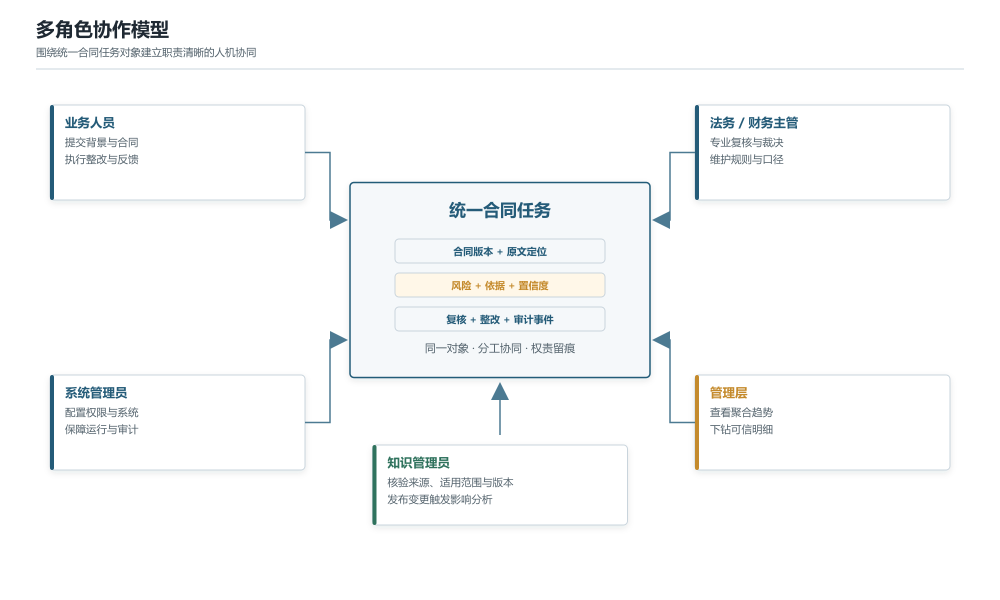

# 第二章 需求分析与建设目标

## 2.1 需求从交接点开始

合同审查由业务、法务、财务和责任部门接力完成。业务经办人提供交易背景和版本，法务判断条款风险，财务核对价税与结算，责任部门落实修改，管理者查看积压和风险分布。如果只提高某一个环节的阅读速度，时间往往会耗在下一次交接上：模型列出风险却没有原文位置，法务仍要重新搜索；法务留下批注，经办人却不清楚如何修改；整改已经完成，管理台账还停留在旧状态。

因此，本项目不按页面菜单收集需求，而是逐项检查“谁提供输入、谁作判断、交给谁处理、留下什么记录”。核心对象包括合同原文件、解析文本、合同要素、风险项、证据、复核意见、整改项和操作日志。每次交接都要保持对象标识与版本关系，避免同一条风险在聊天记录、Word 批注和系统列表中成为三份互不相认的数据。

交接还受时间影响。业务人员关心合同何时能继续流转，审查人员要知道哪些任务等待自己处理，负责人要识别已经逾期的整改。系统需要保存创建时间、更新时间、责任人和状态变化，并允许从当前状态回看处理经过。仅显示一个“已完成”标签，无法说明合同是否经过复核，也无法判断风险是被修正还是被忽略。

## 2.2 四类使用者的实际任务

业务经办人最早接触合同，也掌握交易事实。他需要确认上传的是待审版本，补充合同类型、相对方、所属部门和业务背景，并在收到意见后协调修改。系统可以提示缺失信息、显示进度和承接整改，但不能替经办人确认实际交付条件，更不能在未授权时直接改写合同。

法务审查人员关注主体资格、权利义务、违约责任、合同解除、争议解决和强制性规范。风险必须放回原文上下文中查看，模型摘要不能代替条款；引用的法规或制度还要核对效力、时间和适用范围。法务决定风险是否成立、等级是否合适，以及修改建议能否用于本次交易。高风险、低置信度、证据不足和 Agent 冲突都在此处理。

财务审查人员关注金额、币种、税率、发票、付款条件、结算方式和财务责任。某些问题可以通过规则发现，例如金额大小写不一致、付款节点缺少前置条件；另一些问题取决于业务事实，例如验收材料是否足以触发付款。财务 Agent 负责提出财务视角的疑点，财务人员仍需结合预算、税务政策和结算安排确认。

管理者不逐条阅读所有合同，但需要知道审查工作是否堆积、哪些部门高风险较多、常见风险是否重复发生、整改是否逾期。报表必须从可追溯的合同和风险记录计算，且遵守部门范围。管理者看到的是管理视角，不因此获得查看所有合同原文的权限。

| 角色 | 需要完成的判断 | 现有障碍 | 系统支持 | 最终责任 |
|---|---|---|---|---|
| 业务经办人 | 版本是否正确，交易背景和交付条件是否完整 | 文件反复传递，意见分散，进度不透明 | 上传校验、状态查询、意见接收和整改反馈 | 对业务事实、提交版本和整改沟通负责 |
| 法务审查人员 | 条款是否合法、责任是否失衡、依据是否适用 | 长文阅读耗时，检索和批注重复，证据难归档 | 法务 Agent、原文定位、依据关联、风险复核 | 对法律判断和重大事项升级负责 |
| 财务审查人员 | 价税、付款、发票和结算约束是否一致 | 财务条款跨页分布，与验收和违约条款相互影响 | 财务 Agent、要素抽取、一致性校验 | 对财务口径和结算条件确认负责 |
| 部门负责人 | 是否接受风险，整改是否按期完成 | 缺少统一分派和关闭记录 | 整改责任人、期限、复审和状态留痕 | 对本部门风险处置决定负责 |
| 管理者 | 风险集中在哪里，流程是否积压 | 台账靠人工汇总，数字难回到原记录 | 部门范围报表、趋势、排行和导出 | 对管理决策和权限授权负责 |
| 系统管理员 | 账号、角色、知识和日志是否受控 | 权限配置分散，变更缺少记录 | RBAC、部门隔离、知识版本与审计日志 | 对配置、运行和授权流程负责 |

## 2.3 输入要求：先确认机器读到了什么

系统需要接收 DOCX、PDF 等常见合同文件，并保留原文件、文件哈希、上传人、上传时间和合同版本。解析层输出统一文本、页码或段落位置、表格内容及质量信息。文本型 PDF 可以直接提取，扫描或混合 PDF 需要触发 OCR。解析异常、空文本、乱码、页数异常或 OCR 置信度偏低时，界面应明确显示原因和下一步操作。

要素抽取优先覆盖审查和报表实际使用的字段，包括合同名称、类型、主体、金额、币种、签订日期、履行期限、付款节点、验收条件、违约责任和争议解决等。每个字段保留来源位置、标准化结果和置信状态。系统已实现抽取结构、校验与指标工具；是否达到赛题要求的 90%，仍要在冻结样本上经双人复核建立金标准后计算，不能引用演示库中的字段完整度代替。

批量输入要允许正常文件和异常文件同时出现。任务层记录总数、已处理数、失败数与当前状态，每个文件保留独立错误；重试不能重复创建合同或风险。代码已经覆盖批量上限、异步状态、失败隔离、重试与幂等机制。50 份有效合同加 2 份异常文件的实际运行记录由测试报告单独保存。

版本要求贯穿单份和批量场景。合同修改后再次送审，系统应保存新版本与上一个版本的关系，审查人员能够确认本次意见对应哪一份原文。导出的台账和报告也要带出合同标识与生成时间，避免离开系统后失去上下文。对于同名文件，系统不能只凭文件名判断是否重复，而要结合文件内容、业务标识和幂等键处理。

## 2.4 判断要求：让不同专业意见保留差异

法务 Agent 和财务 Agent 使用各自的任务说明、规则范围和结构化输出。两者共享合同标识、解析文本及必要要素，不共享与任务无关的敏感数据。规则命中适合处理明确的禁用表达、字段缺失和一致性问题；知识检索负责返回可能适用的法规、制度或标准条款；模型用于理解上下文、归纳问题并起草建议。系统记录各环节来源，不能把模型生成的解释伪装成法规原文。

两个 Agent 对同一片段给出不同等级或不同处置意见时，系统保留双方结果和冲突原因。没有可靠来源、检索内容失效、上下文不完整或模型输出不符合结构时，风险状态直接进入“待复核”，系统不自动选择一方。审查人员可以确认、调整等级、补充依据或标记误报，所有动作写入日志。

风险项至少回答五件事：原文在哪里，问题是什么，依据是什么，建议如何修改，谁确认过。界面需要同时容纳上下文和结构化字段，避免用户在多个页面之间反复跳转。对重大交易、明显违法风险和无法判断的情形，系统只负责提请升级。

## 2.5 交接要求：意见要能变成任务

审查结论经人工确认后，可以生成整改项，记录责任部门、责任人、期限和处理说明。经办人提交修改版本或反馈后，法务或财务复审，决定关闭、退回或继续补充。忽略的风险也要记录操作者与理由，以便后续审计。状态变化不能覆盖历史，管理者看到的完成率应由这些事件计算。

报表层读取已授权范围内的合同、风险与整改记录，展示审查合同数、合规通过率、高风险条款数、风险总数、趋势、等级分布、部门排行和高风险条款排行。筛选和钻取使用同一数据范围，Excel 台账导出沿用当前筛选条件。业务角色只能读取所属部门数据；越权请求由后端返回 403，前端隐藏菜单仅作界面处理。

登录页是这条权限链的入口。系统目前提供真实账号认证与角色信息，演示环境可切换预置角色以说明不同视角；成稿截图中的账号、合同和统计均为演示数据，不代表真实客户或生产规模。

权限变化也要有可追踪的交接。人员调岗、部门调整或账号停用后，新的查询应按最新授权执行，历史操作仍保留原操作者。导出比普通浏览更容易造成数据扩散，因此需要与查询使用相同的部门范围并记录日志。前端隐藏按钮只改善界面，真正的边界由后端接口校验；无权限请求返回 403，调用者不能通过修改地址绕过。

## 2.6 建设范围与可验收目标

本阶段建设范围覆盖合同接入、文档解析、要素提取、智能审查、人工复核、整改跟踪、知识治理、多维报表、权限隔离和操作审计。系统与电子签章、OA、ERP、档案平台之间保留接口边界，不在本次材料中虚构已完成的企业集成。

业务验收沿合同对象逐步检查：上传后能否进入复核和整改，风险能否回到原文与依据，报表数字能否追溯到记录。工程验收检查权限、异常处理、恢复和构建能否重复执行。模型指标在冻结数据集上计算，并记录版本、阈值与人工复核规则。

当前可以由源码和本轮自动化结果确认的内容，包括主要业务接口、双 Agent 分工、风险证据关联、部门隔离、报表、前端状态及生产构建。批量 50 份以上、OCR 字符准确率、要素准确率、PostgreSQL 16 实机迁移、完整 Compose 启动以及 OpenClaw/GPU 性能和能耗对比，需要相应样本、数据库或硬件环境。项目详细方案说明这些工作的入口和口径，测试报告负责给出最终数字。

## 2.7 非功能约束

合同文件可能含商业秘密、个人信息和交易条件，默认应在企业控制的网络与存储范围内处理。访问控制同时检查角色和部门，日志记录登录、查询、审查、导出及配置变更。文件、凭据和模型调用配置不能写入前端包或公开日志，知识来源需要有效期与版本信息。

前端需要覆盖正常、加载、空数据、错误和无权限状态，并在桌面与 390px 移动端保持关键操作可用。本轮测试已经覆盖主要状态与移动端页面，但不据此宣称通过所有浏览器和终端认证。服务异常时，用户应看到可重试的原因；耗时任务应显示进度，刷新页面后仍可查询。

恢复要求按失败位置区分。上传失败时不创建半成品合同；解析失败时保留原文件和原因，允许修正文件后重试；某个 Agent 超时不抹掉另一个 Agent 的有效结果；知识检索不可用时，不生成带有虚构依据的确定性结论；报表接口失败时，页面显示重试入口，不能把空值包装成“零风险”。这些分支都要在日志或任务状态中留下记录。

部署方案采用前后端分离、任务执行器、缓存与关系数据库组合。开发和当前演示可以使用 SQLite，生产目标为 PostgreSQL。迁移脚本、生产配置门禁与 Compose 文件已经就绪，实机迁移、备份恢复和完整容器健康检查仍属于交付环境验收。

需求优先级按业务后果确定。会导致合同丢失、越权、错误定论或证据断裂的问题优先处理；影响效率但有人工替代路径的功能随后处理；知识包扩展和外部系统集成在核心链路稳定后推进。这样的排序也用于测试用例和缺陷分级。
