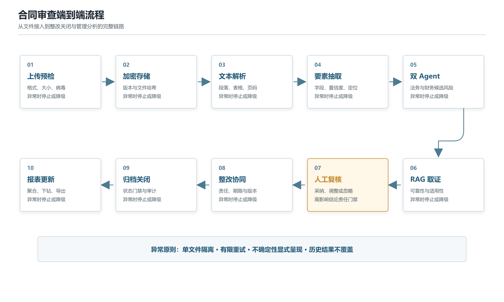
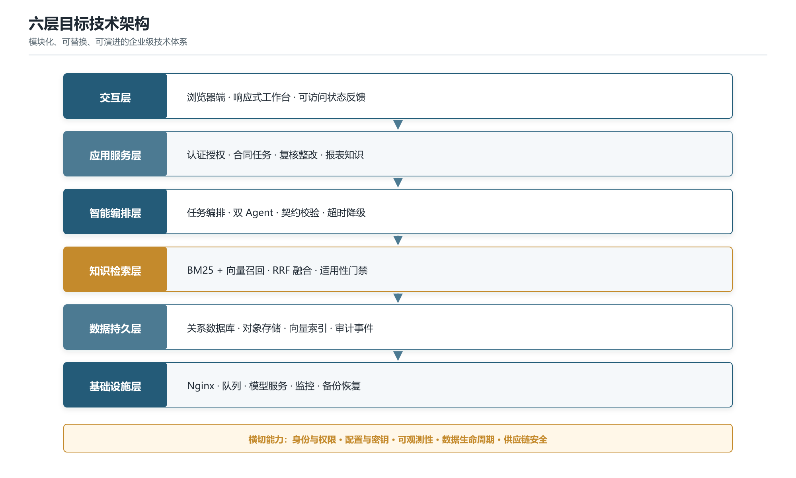
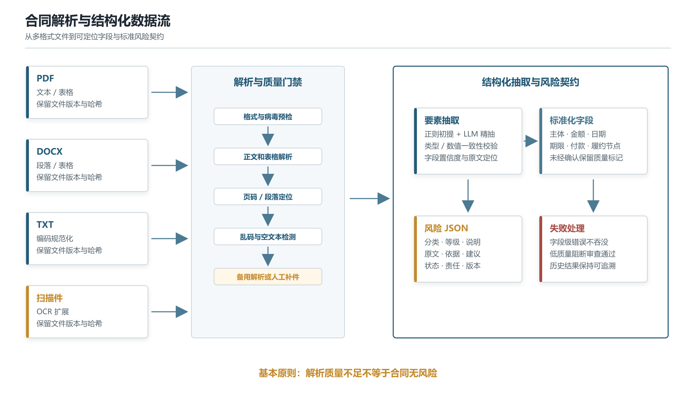
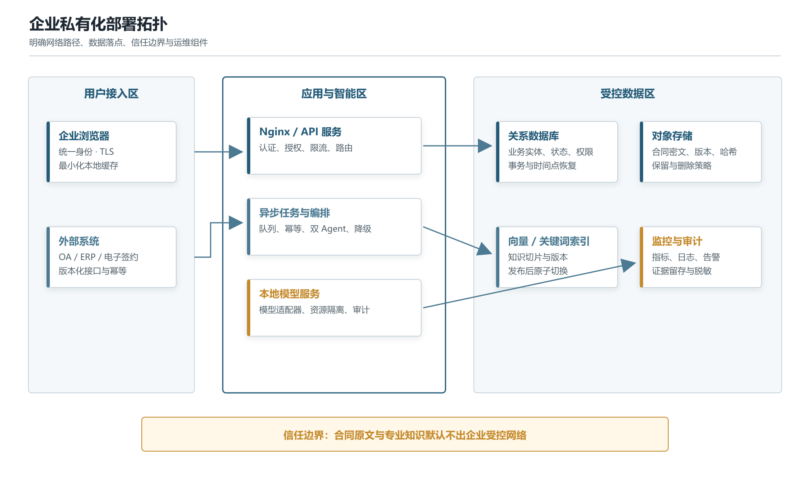

# 第三章 总体解决方案

## 3.1 以合同版本为主线

“契鉴”按一份合同从接入到形成可追溯记录的完整过程组织业务，模型调用只是其中一环。系统为原文件建立合同与版本标识，解析服务生成带位置的文本和结构化要素，审查服务产生候选风险，人工确认后进入整改与报表。后续上传修改稿时，新版本关联原合同，旧的原文、模型输出和人工意见仍然保留。

这条主线先保证风险和专业意见都能回到当时的合同版本，法务与财务也围绕同一个风险对象交接。报表直接聚合这些合同、风险和整改记录，可以继续钻取，不需要另做一组孤立数字。

正常路径依次经过上传预检、加密存储、文本解析、要素提取、规则检查、双 Agent 审查、知识检索、风险合并、人工复核、整改跟踪和统计分析。每一步都有输入、输出和失败状态。解析质量不足时流程停在解析层；模型超时时保留确定性规则结果；无可靠依据或意见冲突时进入人工复核。失败不会被折算成“未发现风险”。

## 3.2 功能按业务对象划分

合同接入域负责文件预检、版本、加密存储和批次；解析审查域负责文本、表格、OCR、要素、规则和双 Agent；复核整改域负责风险确认、误报标记、分派、反馈、复审和关闭；知识域负责法规、制度、模板及检索切片；报表域负责指标、筛选、钻取和导出；系统治理域负责账号、角色、部门、字典和审计日志。

模块之间传递明确对象。接入服务不直接生成法律结论，只交付可读取的合同版本；解析服务报告文本及质量，不把空结果当成成功；Agent 返回符合 Schema 的候选风险；知识服务返回来源、版本、有效期和适用范围；复核服务新增处置记录，不覆盖原始输出；报表服务只从权限过滤后的结构化数据聚合。

该划分允许项目在当前模块化应用中保持事务一致，也为后续拆分任务执行器、模型服务或检索服务保留接口。拆分的前提是监控数据表明确存在容量或隔离需要，而不是为了在方案图中增加组件。

### 3.2.1 接入域保存“原件”和“本次处理”

合同文件与审查任务是两个对象。同一份文件可以因审查维度、规则版本或失败重试产生不同任务，但原文件不必重复保存；同一合同的修改稿则形成新版本。接入域计算哈希、记录上传人和部门，并把文件校验与业务建档放在可回滚的操作中。文件落盘失败时不留下可见合同，数据库写入失败时清理未被引用的临时对象。

批量接入在批次下保存文件项。批次的完成状态由各文件项计算，不由某个浏览器请求决定。用户刷新或重新登录后，可以从服务端读取原进度。重复提交同一幂等键时返回原批次，防止网络重试创建两套任务。失败项重试产生新的执行记录，但继续关联原文件项，便于统计尝试次数和最终结果。

### 3.2.2 审查域区分事实、意见和依据

解析文本和抽取要素描述“合同写了什么”；Agent 风险描述“可能有什么问题”；知识切片描述“判断参考了什么”。三类数据分开保存。模型不能直接改写解析原文，检索结果也不能替代适用性判断。合并风险时引用这些对象的标识，前端再按用户权限组合展示。

审查配置保存合同类型、专业维度、规则集、知识版本、模型与提示模板版本。任务重跑时沿用原配置或明确选择新配置，不能静默变化。这样才能解释两次结果为何不同，也便于测试固定输入。候选风险先进入待复核区，后续人工状态通过独立事件追加。

### 3.2.3 复核域控制高影响动作

确认、忽略、下调等级、创建整改和关闭风险会影响报告与管理统计，均由服务端检查角色、部门和当前状态。法务可以处理法律类风险，财务可以处理财务类风险，跨专业冲突需要符合授权的共同复核。操作理由按风险等级和动作设置必填条件，前端提示只是交互辅助，后端规则不能省略。

整改记录引用已经确认的风险和合同版本。提交修改稿后，系统不把原风险直接改成“已解决”，而是等待复审人员对照新版本确认。逾期、退回和关闭都保留事件时间，报表才能区分任务完成与问题真正关闭。

### 3.2.4 知识与报表域各有版本口径

知识导入经过文件校验、元数据补充、解析、切片和发布。草稿或失效条目不进入正式检索；曾被历史风险引用的旧版本继续保留引用关系。更新法规时建立替换关系，避免删除后无法解释旧审查。知识条目数会随导入环境变化，材料不把演示库数量写成固定资产规模。

报表指标由后端定义口径，前端只负责筛选和展示。审查合同数按合同版本还是合同主体计数、通过率是否排除处理中任务、风险总数是否包含已忽略项，都需要在接口和导出中一致。当前页面展示的 KPI、趋势和排行取自演示库，用于确认计算链路和交互，不能换算成企业效益。

## 3.3 技术分层与失败处理

| 层级 | 核心职责 | 主要输入 | 主要输出 | 失败处理 |
|---|---|---|---|---|
| 交互层 | 登录、上传、风险复核、整改、报表和管理页面 | 用户动作、文件、筛选条件 | API 请求、可见状态、下载任务 | 显示加载、空、错和无权限状态，阻止重复提交 |
| 应用接口层 | 认证授权、参数校验、业务编排和响应封装 | JWT、请求 Schema、文件流 | 合同、风险、批次、报表等 API 响应 | 非法请求明确拒绝，写操作使用幂等控制 |
| 任务与领域层 | 解析、审查、检索、复核、整改、导出 | 合同版本、规则、知识、任务配置 | 解析结果、风险、处置和导出文件 | 分阶段重试，保留部分成功和失败原因 |
| 智能计算层 | 要素抽取、双 Agent、Embedding 与排序 | 最小化合同上下文、候选知识 | 结构化字段、专业意见、检索分数 | 超时限次重试，结构错误拒收，必要时转人工 |
| 数据层 | 业务数据、文件、索引、缓存和审计 | 事务写入、对象流、任务状态 | 可追溯记录、查询视图和恢复点 | 事务回滚、哈希校验、备份恢复和过期清理 |
| 基础设施层 | 网关、数据库、Redis、Worker、调度和模型运行时 | 配置、镜像、密钥、健康状态 | 网络入口、运行实例和监控信号 | 健康检查、启动门禁、告警和受控降级 |

前端采用 Vue 3、TypeScript、Vite、Element Plus、Pinia 和 ECharts；后端使用 FastAPI、SQLAlchemy 与 Pydantic 请求响应模型。开发环境使用 SQLite，生产目标数据库为 PostgreSQL；异步任务使用 Redis 与 Celery worker、scheduler。解析链路使用 pdfplumber、PyMuPDF、python-docx 与 RapidOCR，报表导出由 openpyxl 生成。模型通过统一 Adapter 接入 DeepSeek、Qwen 或 OpenClaw，业务代码不依赖某一家接口格式。

分层不是把一次请求机械传过六层。短查询由接口层完成权限校验后直接读取授权视图；解析、审查和导出等长任务写入任务记录，再由 worker 执行。任务每完成一个阶段就保存状态，使失败可以从最近的可靠位置恢复。同步开发模式使用同一服务函数，只省略队列调度，不能据此推断异步环境的吞吐。

## 3.4 数据怎样经过系统

浏览器上传文件后，接口先校验身份、部门范围、扩展名、MIME、大小和文件内容。通过预检的文件生成哈希，在受控内存中加密后写入存储，同时建立合同版本和任务记录。解析 Worker 读取授权文件流，输出段落、表格、页码映射和质量信息。扫描或混合 PDF 触发 OCR，并记录页数、置信度和失败原因。

要素提取从统一文本读取主体、金额、日期、期限、付款和验收等字段，保存标准化值与来源位置。一致性程序检查金额大小写、日期顺序、比例和必填字段。随后，编排器把法务与财务任务所需的上下文分别交给两个 Agent，输出先过 JSON 解析、枚举、长度和必填项校验，再进入候选风险区。

风险候选按条检索知识，返回内容与来源元数据分开保存。合并器处理重复、互补和冲突意见，形成统一风险记录。人工复核写入新的处置事件，确认风险后才可生成整改项。报表读取合同、风险和整改的授权视图，筛选、图表、钻取和 Excel 导出使用同一部门范围。

数据链路有两条明确分界。模型只接收完成权限检查并按任务裁剪的内容，不直接持有文件存储凭据；报表只读取结构化字段和必要摘要，不因统计需要扩大合同全文权限。日志记录任务标识、状态、耗时和错误类别，不记录令牌、密钥或非必要原文。

关系数据库维护合同、版本、任务、风险、知识元数据、复核和整改等需要一致性的对象；文件存储保存原合同和临时导出；Redis 保存任务调度和短期状态；检索索引保存知识向量及关键词索引。任何缓存和索引都能由权威数据重建，不能成为唯一证据。删除合同或知识时，需要同时处理其业务记录、文件对象和索引项，并遵守审计留存策略。

事务边界按用户可理解的动作确定。上传成功意味着文件与合同版本都已建立；确认风险成功意味着处置事件与当前状态同时可见；创建整改成功意味着责任和期限已经落库。调用模型、发送通知或生成导出文件不与数据库长事务绑定，而通过任务状态和补偿处理。这样可以避免外部服务变慢时占用数据库连接，也能明确告诉用户哪个阶段尚未完成。

## 3.5 接口和状态契约

系统以 `/api/v1` 组织认证、合同、批次、风险、报表、工作台、知识、整改、规则、管理、追问和运行时接口。请求与响应使用明确 Schema，金额采用定点值与币种字段，日期时间带时区。写操作需要业务标识或幂等键；批量任务返回任务标识，前端据此查询进度，不依赖浏览器连接一直保持。

合同版本至少区分已上传、解析中、待审查、审查中、待复核和已完成等过程状态。风险记录保存专业归属、类别、等级、原文、位置、依据、建议、置信状态、复核状态与整改状态。状态转换由服务端校验，例如未经确认的候选风险不能直接关闭，忽略高风险需要理由，整改关闭前需要复审记录。

接口错误使用稳定的状态码和业务信息。无权限返回 403，但不泄露目标合同是否存在；重复幂等请求返回既有任务；单文件解析失败写入该文件的状态，不把整批置为不可恢复；导出失败保留筛选条件，允许重新发起。前端据此显示可执行的恢复动作。

查询接口统一处理分页、排序和筛选，避免前端先下载全部数据再自行过滤。部门范围在查询构造阶段加入，汇总与明细复用相同授权条件。导出任务保存筛选快照和申请人，生成文件设置有效期；下载时再次检查身份，不能依靠一个长期公开地址。

任务状态采用服务端时间和事件顺序。worker 获得有限期租约后处理文件，租约到期可由其他 worker 接管；成功写入前检查幂等标识，避免重复风险。服务重启时，启动补投只选择确实需要恢复的任务。相关机制已有自动化契约，真实并发与故障恢复仍要在交付环境压测。

## 3.6 部署形态与信任边界

目标部署由 Nginx 前端入口、FastAPI 后端、Celery worker、scheduler、PostgreSQL 和 Redis 组成。后端启动前执行数据库迁移，服务依赖健康检查，worker 在后端、数据库和 Redis 可用后启动。生产配置门禁要求关闭调试模式、启用 PostgreSQL 与异步任务，并替换数据库密码、JWT 密钥和文件加密密钥等弱默认值。

浏览器到网关使用 TLS；应用只通过服务账号访问数据库和缓存；模型调用经过 Adapter，由配置决定访问企业内模型或经批准的服务。使用私有模型时，合同上下文可留在企业网络。若接入外部模型，必须先确认数据分类、字段最小化、传输和留存策略，不能因为接口可用就默认发送全文。

当前仓库有 PostgreSQL 迁移、回滚代码、生产配置检查和 Compose 编排文件，Compose 定义了 PostgreSQL 16、Redis、backend、worker、scheduler 与 frontend。现有证据能说明配置结构和依赖关系，不能代替目标机上的容器启动、数据库迁移、备份恢复及故障切换。因此，部署图表达交付形态，实机结果在具备 Docker 和 PostgreSQL 16 的环境中另行验收。

开发环境继续允许 SQLite 与同步审查，以降低本地启动成本。两种环境共用领域模型与接口，但并不被视为性能等价。涉及并发、锁、索引、迁移和恢复的结论必须来自 PostgreSQL 环境。

生产部署还需要确定文件存储容量、备份窗口、日志留存、模型显存或算力、出口策略和运维责任人。数据库迁移在启动前执行，失败时服务不应带着不完整结构继续运行。备份验收不能只检查文件是否生成，要在隔离环境恢复后核对合同、风险、任务和审计序列。密钥轮换需要验证旧文件仍可按策略读取，普通日志不得打印密钥值。

Redis 不保存唯一业务结果。队列中断时，已完成阶段仍在数据库，恢复后根据任务记录补投；若业务要求严格限制并发，可以按合同或文件项设置租约。模型服务不可用时，接入、解析、规则检查和人工流程可以继续，界面明确说明未执行的语义审查范围。

## 3.7 与外部系统的边界

项目可通过版本化接口接收 OA 或 BPM 的业务编号和审批背景，向电子签约平台传递已确认的合同版本，也可以使用 ERP 主数据辅助核对相对方、项目和预算。当前提交不宣称这些企业系统已经接入。外部接口只保留必要字段、来源和时间，回写失败不能改变本地审查结论。

统一身份认证可映射组织、部门和角色，实际授权仍由本系统后端核验。消息平台只接收完成、逾期或重大风险提醒，不发送合同全文。外部系统不可用时，待发送事件进入重试队列；重试达到上限后转人工处理，不能无限占用任务资源。

每个外部数据都带来源和获取时间。ERP 返回的供应商名称不能静默覆盖合同原文，OA 中的业务编号也不能替代系统合同标识。回调使用事件标识、签名、时间窗和幂等键；接口日志记录状态和追踪标识，但过滤令牌与敏感载荷。当前版本保留这些集成边界，没有把接口设计写成已经上线的企业案例。

总体方案的判断标准很直接：每个页面上的结论都应能回到业务对象，每个智能结果都应说明证据状态，每个失败都应有可见出口。第五章将进一步说明解析、双 Agent、RAG 与安全机制的具体实现。

验收时还要核对对象数量和状态是否一致：批次进度能否回到文件项，报表汇总能否回到风险明细，整改关闭能否回到复审事件。图纸与代码命名不同不构成问题，无法完成这些追溯才是架构缺口。
