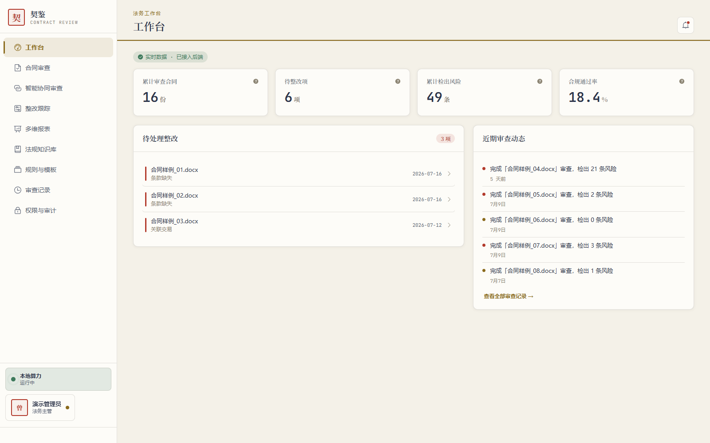
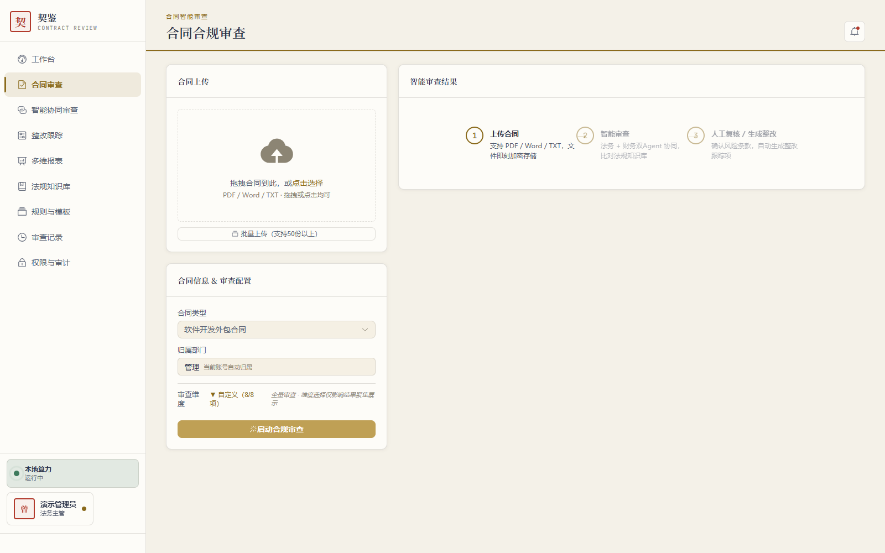
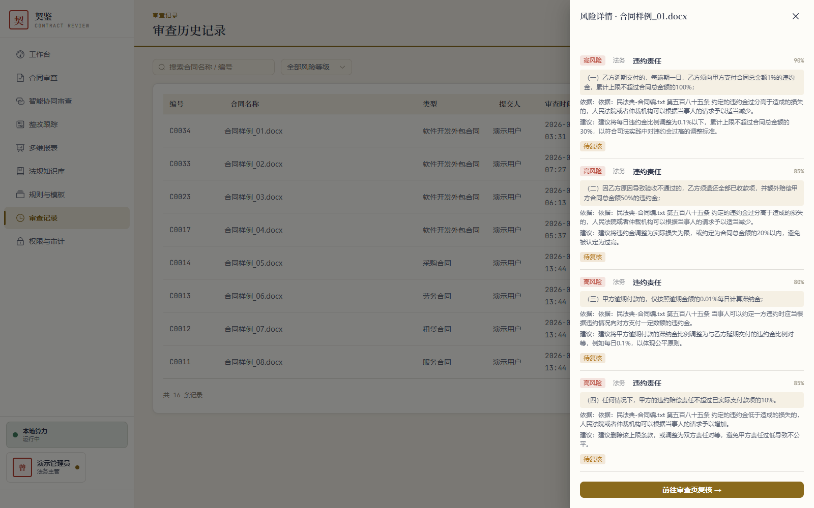
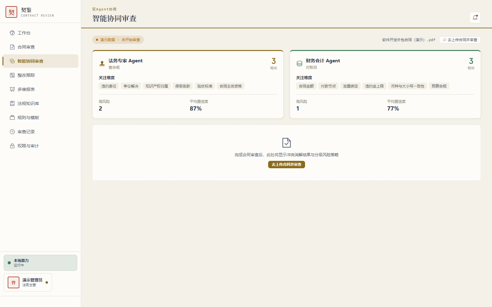
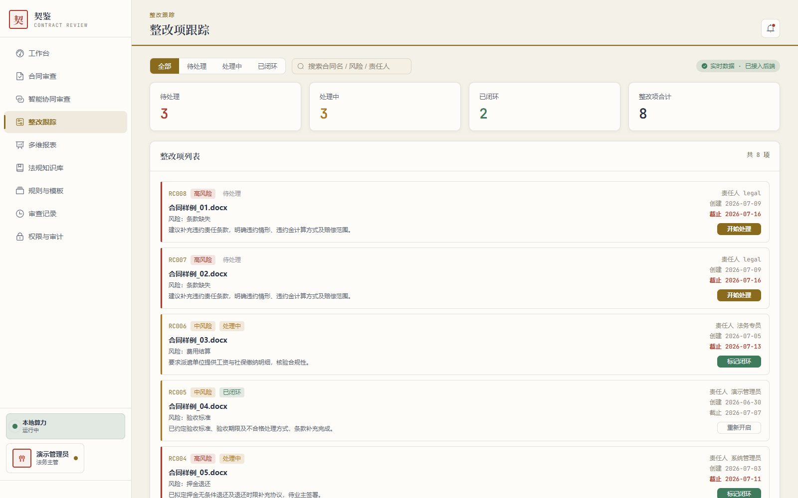
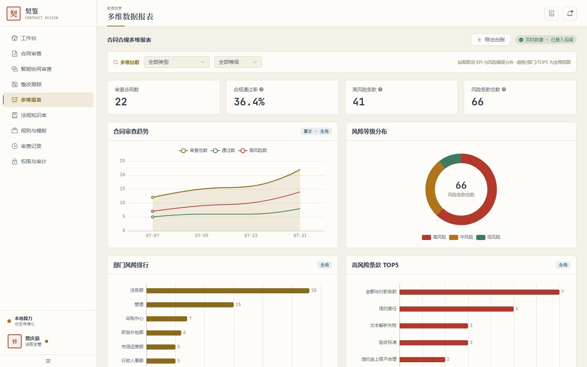

# 第四章 核心功能设计

## 4.1 从工作台进入一份真实任务

用户登录后先看到与角色相符的工作台。法务人员关注待复核风险、合同进度和整改逾期；财务人员关注付款、税务和结算相关任务；业务人员看到自己提交的合同及待处理整改；管理员可以进入权限、规则和审计页面。工作台上的数量来自后端汇总，并可进入对应列表，不使用写死的演示数字充当业务结果。

审查一份合同的正常路径可以归纳为七个阶段。每个阶段都给用户一个可见结果，也保留异常出口。

| 处理阶段 | 用户动作 | 系统处理 | 可见结果 | 异常出口 |
|---|---|---|---|---|
| 上传 | 选择合同、审查维度和必要元数据 | 校验权限、格式、大小、哈希并加密存储 | 文件进入任务队列，显示文件名与状态 | 拒绝不支持、空、损坏或超限文件 |
| 解析 | 等待或查看进度 | 提取正文与表格，必要时执行 OCR，评估质量 | 显示解析阶段、文本和要素来源 | 低质量、超时或空文本转人工补件 |
| 审查 | 发起单份或批量审查 | 执行规则、法务 Agent、财务 Agent 和知识检索 | 生成分级风险与审查摘要 | 模型失败保留规则结果，冲突待复核 |
| 风险定位 | 选择一条风险 | 读取原文位置、依据、建议和版本 | 同屏查看上下文和证据 | 无可靠依据时限制确定性并提示补充 |
| 人工复核 | 确认、调整、补充或忽略 | 校验权限和状态，写入处置事件 | 风险状态、操作者和理由更新 | 高影响动作要求理由，越权返回 403 |
| 报告与整改 | 导出结果或创建整改项 | 汇总已授权数据，关联责任人与期限 | 下载报告，整改进入待处理列表 | 导出失败可重试，整改不覆盖原风险 |
| 批量与报表 | 查看批次、筛选统计或导出台账 | 聚合进度、合同要素和风险数据 | 展示 KPI、趋势、排行和文件结果 | 单文件失败隔离，报表错误显示重试入口 |

## 4.2 上传与文件预检

合同审查页把文件选择、审查范围和任务状态放在连续区域。用户可以提交单份文件，也可以建立批量任务。前端在选择阶段检查数量和明显格式问题，后端再次校验 MIME、文件头、大小、空内容和权限，后端结果才是最终依据。文件名相同不等于内容相同，系统通过文件哈希、合同标识和幂等键避免重复提交。

通过预检的原文件在受控内存中加密并落盘，数据库只保存存储对象标识、哈希、版本和业务元数据。解析器读取解密流，不把明文写到公共临时目录。密码保护、损坏、内容为空或格式不匹配的文件停在预检或解析状态，界面显示原因；用户可以移除文件、补充正确版本或重试。

用户提交前可以看到每个文件的名称、大小和校验状态。进入任务后，文件状态由服务端返回，关闭浏览器不会取消已经接受的任务。上传过程中断时，系统不创建可供审查的半成品记录；文件成功但后续解析失败时，原件和失败原因仍然保留。重新上传修改稿需要选择原合同或提供业务标识，避免同一交易被误建成多个合同。

DOCX 解析正文、表格和段落关系；文本型 PDF 保留页码位置；扫描或混合 PDF 触发 RapidOCR。OCR 设置最大页数、单页像素和总超时，低置信度文本标记人工复核。当前代码和真实引擎冒烟可以确认调用与降级路径存在，字符准确率仍需冻结扫描件真值集后计算。

## 4.3 要素提取与审查启动

解析完成后，系统生成统一文本块和位置映射。要素服务先用确定性方法识别日期、金额、比例和常见字段，再由模型处理需要上下文的字段。每个结果保存标准化值、原文片段、位置和置信状态。金额采用数值与币种分离，日期保存标准格式，原文仍可查看。

一致性检查在 Agent 之前执行。金额大小写不一致、付款比例异常、结束日期早于开始日期、主体名称前后不同等问题可以直接形成候选风险或质量提示。确定性结果不需要模型“重新解释”才能成立。模型负责条款缺失、责任失衡、跨段约束和语义冲突等问题。

用户选择法务、财务或综合维度后，编排器创建任务。法务 Agent 获取主体、效力、权利义务、违约、保密、知识产权和争议解决相关上下文；财务 Agent 获取价税、发票、付款、结算、验收和资金责任相关上下文。两个 Agent 输出同一结构，但保留专业归属和原始意见。

审查启动前，页面显示合同版本、审查维度和当前规则范围。任务一旦进入处理中，重复点击不会再创建一份结果。用户可以离开页面，稍后从历史或工作台返回。阶段进度来自持久化任务记录，不用前端计时器猜测。某阶段失败时，界面说明已经完成和未完成的范围，例如“解析完成，财务维度审查失败”，避免用户把部分结果当成完整结论。

要素面板允许用户回到来源片段核对。字段为空可以是合同未约定，也可能是解析未读到，两种情况应有不同状态。人工修正值保留修改人和时间，并与模型原值区分。随后生成的报表使用确认值或按口径标记未确认值，不能无声覆盖。

## 4.4 风险原文、依据和建议同屏核对

风险列表按等级、专业、类别、状态和置信度筛选，高风险优先显示。选择风险后，详情区呈现合同原文及前后文、页码或段落位置、事实说明、依据来源、适用信息、修改建议、Agent 意见与当前状态。用户不需要根据一段摘要重新搜索整份合同。

知识依据以独立对象保存，包括标题、来源、发布日期或生效日期、版本、适用范围和切片内容。模型生成的分析与检索返回的原文分开显示，防止解释文字被误认为法规。没有可靠来源时，系统保留风险线索，但置信度受限并进入人工复核；已失效知识不能继续作为新风险的正式依据。

人工复核人员可以确认风险、调整等级、补充依据、修改建议或标记误报。每次动作写入操作者、时间和理由，不覆盖模型原始输出。重大风险、证据不足、低置信度和 Agent 冲突不得自动关闭。系统输出属于辅助意见，授权人员结合交易背景和完整合同决定是否采纳。

复核页面还要处理“看起来相似但不是同一问题”的风险。例如，付款条件缺少验收前提和验收条款没有明确标准可能引用同一段原文，却分别影响资金支付和履约判断。系统可以提示相似，不应强制合并。审查人员合并后仍保留原候选项标识，便于回看 Agent 分别发现了什么。

风险等级由后果、发生可能性和证据状态共同影响。确定性规则命中不必自动判为高风险；模型给出强烈措辞也不能直接提高等级。调整等级时记录理由，报表读取人工确认后的状态，同时允许在测试中对比模型原始等级，避免评测口径混淆。

## 4.5 双 Agent 协同处理

协同页面把法务和财务对同一合同的结果按共同事实、专业意见和冲突点组织。页面不模拟虚假的“思考动画”，而是展示两个 Agent 实际产生的结构化结果。法务意见可能指出付款条件缺少法律上的履约保障，财务意见可能指出付款比例与验收节点不一致；两者可以合并为复合风险，也可以保留为两个不同责任方向的问题。

合并器按原文位置、风险类别和语义相似度识别重复项。专业互补时，统一风险保留双方依据；等级不一致或建议相互矛盾时，状态标记为冲突，要求人工选择、合并或补充背景。系统不通过简单多数表决消除差异。任何冲突处理都要记录理由。

一个 Agent 超时或输出结构错误时，任务记录该维度失败，另一维度和确定性规则结果仍可查看。有限重试后仍失败的任务交给人工，不重复写入已经成功的风险。这样的部分成功状态对批量任务尤其重要。

协同结果还保留共享上下文的边界。法务 Agent 可以读取与付款义务相关的合同片段，但不需要读取系统中的预算余额；财务 Agent 可以看到争议条款对付款责任的影响，但不因此获得处理法律风险的最终权限。上下文按任务构造，减少无关信息，也避免专业职责在模型输出中被模糊。

## 4.6 整改、复审与关闭

已确认风险可以创建整改项，带入合同、版本、原文、风险等级和建议，并设置责任部门、责任人、期限与说明。业务人员处理后可以提交反馈或新合同版本；法务、财务根据风险归属复审，决定退回、继续补充或关闭。被忽略的风险也保留理由，不从历史中删除。

整改状态包括待处理、处理中、待复核和已关闭。状态转换由后端控制，普通业务角色不能替代审查人员关闭重大风险。新版本触发必要范围的再审，旧版本上的风险仍与当时原文关联。整改逾期、退回和关闭事件进入报表，用于分析处理积压，而不是只计算“发现了多少风险”。

系统把“建议”与“已整改”分开。模型给出的修改文本只是讨论起点，经办人可能采用另一种表达；是否解决原风险由复审人员确认。关闭记录至少包括处理说明、对应版本、复核人和时间。

整改列表支持按责任人、部门、等级、期限和状态筛选。即将到期与已经逾期使用文字和颜色共同提示，不能只靠颜色。业务人员只能处理分配给本人或本部门的事项，法务和财务按授权查看复审队列。责任人变更、期限调整和退回都产生新事件，历史值仍可查询。

如果交易决定接受某项风险，负责人可以记录接受理由和授权依据，而不是伪装成“已整改”。这一状态应与技术性关闭区分，并纳入后续统计。当前实现重点覆盖确认、忽略、整改和关闭流程，更细的风险接受审批可以在企业制度明确后扩展。

## 4.7 报告、批量任务和多维报表

单份审查完成后，用户可以查看审查摘要、风险明细和合同要素，并导出用于沟通的结果。报告中的每条风险保留原文与依据，生成时间和合同版本写入文件。下载行为进入审计日志。若报告生成失败，审查数据仍在数据库中，用户可以重新发起导出。

批量任务复用单份合同链路。任务记录总文件数、处理中、成功和失败数量，每个文件拥有独立状态。服务端设置数量上限，使用异步调度、租约、幂等提交和启动补投避免重复执行；失败项可以单独重试。一次 50 份以上的真实合同能力需要用 50 个有效文件加 2 个异常文件实测，检查完成时间、部分失败、刷新恢复和重复提交，现阶段不把代码上限写成吞吐结论。

批次列表显示创建人、审查维度、文件数、进度和完成时间。用户进入批次后可以区分等待、处理中、成功与失败文件，下载失败清单或只重试失败项。重试沿用原审查配置，若用户改用新的规则或模型，则新建任务并明确配置变化。管理员可以查看队列和失败类型，但查看合同原文仍需相应业务权限。

报表提供审查合同数、合规通过率、高风险条款数和风险总数，并显示审查趋势、风险等级分布、部门风险排行及高风险条款排行。筛选条件作用于图表、钻取与 Excel 导出，部门范围由后端统一限制。下图来自本轮连接真实本地服务和演示数据库的页面，用于说明报表构成；其中数量不代表生产规模或客户收益。

合同要素汇总可以按甲方、合同标的、金额、收付款节点等字段形成台账。字段缺失或置信度不足时应保留空缺与状态，不能为了报表完整而猜测。管理者钻取到明细时仍受角色和部门权限约束。

报表筛选至少包括合同类型、风险等级、部门和时间范围。切换筛选后，KPI、图表和排行一起更新；从某个部门柱形进入明细时，查询继承同一条件。导出前显示范围和字段，后端重新校验部门权限。数字口径随接口版本管理，若通过率定义变化，应记录版本并避免与旧报表直接拼接。

管理者需要的是可行动的信息。例如部门高风险较多时，可以进入合同和风险明细判断是业务结构差异、重复条款问题还是整改积压；高风险条款排行可以反向推动模板和规则调整。系统只提供事实与线索，不在没有交易金额、处理成本和人工工时数据时估算经济收益。

## 4.8 页面状态与异常出口

专业作业系统不能只设计正常截图。用户需要知道系统正在处理什么、哪里失败、哪些结果仍然可信以及下一步能做什么。错误提示不显示服务器路径、堆栈、密钥或合同全文；可重试操作带幂等控制，避免连续点击制造重复任务。

| 异常场景 | 系统反应 | 用户可采取的动作 | 保留证据 |
|---|---|---|---|
| 文件格式不符、损坏或空内容 | 拒绝进入审查，显示具体文件原因 | 移除文件或重新上传有效版本 | 文件名、哈希、校验类别和时间 |
| 扫描质量过低或 OCR 超时 | 标记解析质量不足，不给出确定性审查结论 | 补充清晰文件或申请人工录入 | OCR 页数、置信度、超时与复核状态 |
| 模型超时或结构错误 | 有限重试，保留规则和另一 Agent 的有效结果 | 重试失败维度或转人工审查 | 模型配置、任务状态和结构校验错误 |
| 无可靠知识依据 | 风险保留为待复核，限制置信状态 | 查询原文、补充正式来源或暂不采纳 | 检索候选、过滤原因和人工意见 |
| Agent 意见冲突 | 并列保存意见，禁止自动关闭 | 选择、合并或补充交易背景 | 双方输出、冲突类型和处置理由 |
| 批量部分失败 | 成功与失败文件分开统计 | 下载失败清单，修正后重试失败项 | 批次、文件状态、重试次数和幂等键 |
| 报表接口不可用 | 页面显示加载失败和重试入口，不显示伪造的零值 | 保留筛选条件并重新加载 | 请求标识、错误类型和时间 |
| 权限不足 | 后端返回 403，不透露目标对象细节 | 返回工作台或走授权申请流程 | 用户、角色、部门、请求目标和结果 |

空状态同样要给出正确动作。“暂无待复核风险”与“报表加载失败”不能使用同一空白页面；前者说明当前查询范围没有对象，后者说明结果未知。加载过程中使用稳定骨架或阶段进度，避免按钮和表格跳动。移动端保留查看任务、风险摘要和整改操作，宽表改为分组信息，不强行压缩所有桌面列。

通知与页面状态互相校验。一次成功提示不能代替持久化结果，用户返回列表后仍应看到新状态；网络断开时，不提前显示操作成功。高风险忽略、整改关闭、权限变更和敏感导出等动作需要明确对象与影响，必要时要求再次确认。键盘焦点、文本标签和风险等级不能只依赖图标或色彩。

## 4.9 一条操作如何被追溯

合同、风险、整改和报表使用统一标识关联。审查人员确认风险时，系统保存旧状态、新状态、理由和操作者；经办人提交新版本时，保存文件哈希和版本关系；管理者导出台账时，保存筛选范围与下载事件。后续出现争议，可以回答某个结论基于哪份文件、哪项知识、哪个模型配置以及由谁确认。

操作日志不等于无限收集。普通运行日志不写密钥和非必要原文，审计查询本身也受权限控制。需要删除或归档数据时，合同文件、结构化字段、索引和临时导出要按同一业务标识处理，并保留符合制度要求的最小审计记录。

核心功能至此形成从文件到风险、从风险到人工决定、再到整改和报表的连续过程。下一章说明其中最容易影响结论可信度的技术环节。

功能验收采用同一份合同贯穿各页面，避免分别准备互不关联的截图。测试人员应核对上传版本、解析文本、风险原文、复核事件、整改记录和报表明细的标识关系；再用损坏文件、无权限账号和服务异常检查出口。完整步骤、样本与实际结果由独立测试报告保存。
