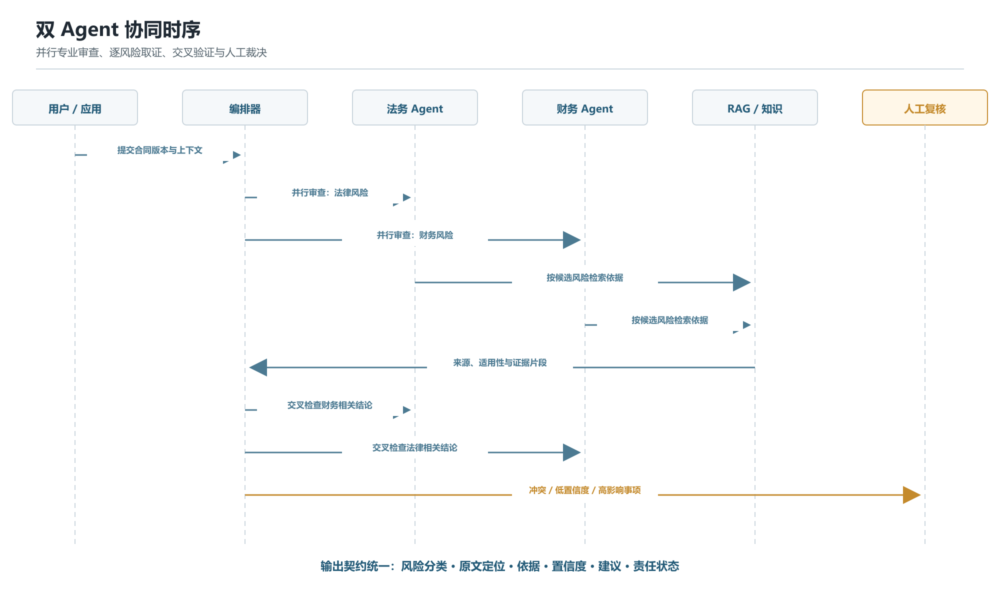
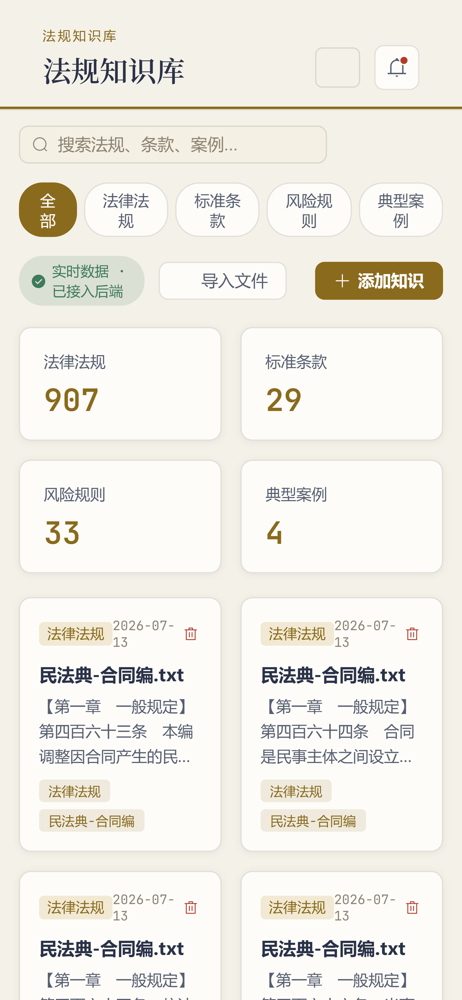
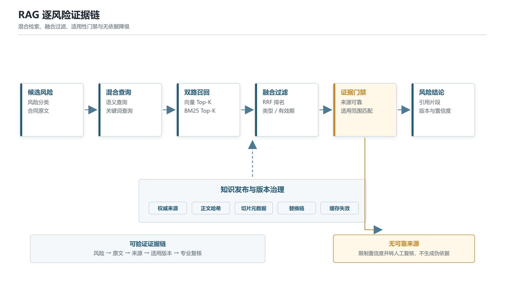
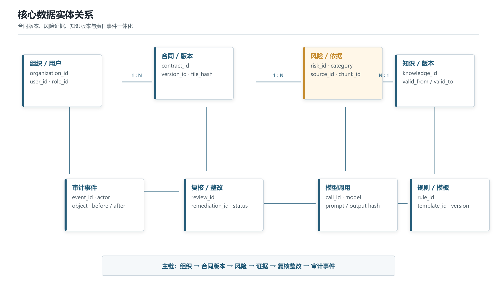
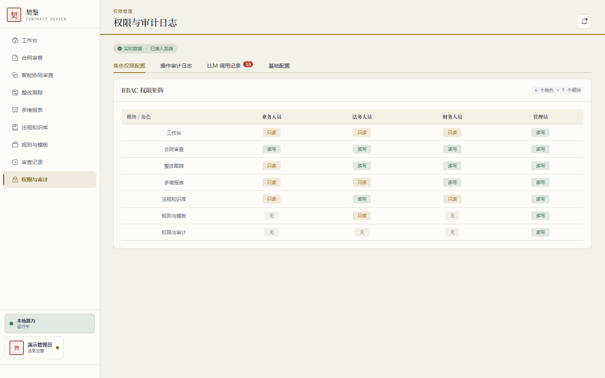
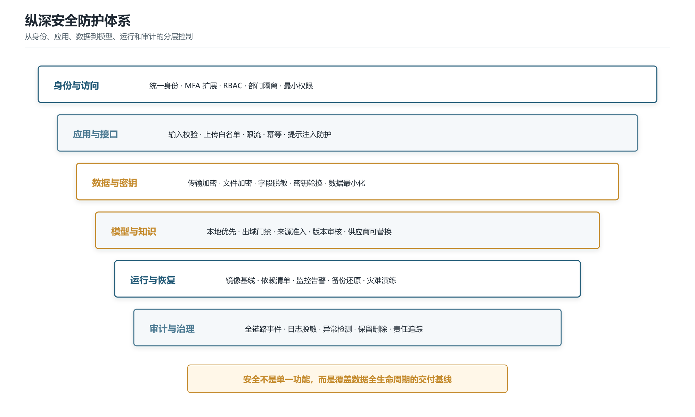

# 第五章 关键技术实现

## 5.1 技术选择服从审查过程

合同审查同时包含确定性处理和开放性判断。文件类型、金额格式、日期顺序、权限范围可以用程序明确校验；条款是否失衡、不同段落是否矛盾、某项法规是否适用，则需要结合上下文。项目没有把所有工作交给一个大模型，而是按问题性质组合解析器、规则、双 Agent、知识检索和人工复核。

这套组合的基本单位是合同版本和风险项。解析器先说明机器读到了什么，抽取器保存字段及来源，规则和 Agent 生成风险候选，RAG 为候选查找依据，人工决定是否采纳。任何环节不能用自己的输出覆盖上一个环节的原始结果。失败时也要指出缺的是文本、结构、模型意见还是可靠依据。

| 技术环节 | 选择依据 | 实际处理 | 输出 | 限制 |
|---|---|---|---|---|
| 文件预检与解析 | 输入格式和版面差异大，错误文本会污染后续判断 | 校验文件头、MIME、大小和哈希，分别解析 DOCX、文本 PDF、扫描 PDF | 原文件、统一文本、表格、位置映射和质量状态 | 密码文件、损坏文件和复杂版面需要补件或人工处理 |
| 要素抽取 | 报表与审查需要稳定字段，部分字段依赖上下文 | 正则和规则先抽取明确字段，模型补充语义字段，再做格式与一致性校验 | 标准化字段、原文位置、置信状态 | 准确率必须在冻结金标准上计算 |
| 双 Agent 审查 | 法务与财务关注点不同，需要保留专业差异 | 分别构造上下文和任务，校验结构化输出，合并重复与互补风险 | 法务意见、财务意见、统一风险及冲突 | 不能替代专业人员作最终决定 |
| 规则、知识与模型融合 | 明确规则、正式依据和语义判断的可靠性不同 | 规则先行，按风险检索知识，模型负责解释，来源类型分开保存 | 风险事实、证据、建议和来源标识 | 无可靠来源时不能给出确定性法律结论 |
| 批量调度 | 50 份以上任务不能依赖单个浏览器请求 | 持久化批次和文件项，使用租约、幂等、补投、失败隔离与重试 | 批次进度、文件结果和失败清单 | 真实吞吐仍需 50+2 文件实测 |
| 数据安全与审计 | 合同含商业秘密和个人信息，报表也可能越权 | 加密存储、RBAC、部门过滤、最小上下文、日志脱敏 | 受控访问、操作事件和安全配置状态 | 生产配置、备份恢复需在目标环境验收 |

## 5.2 文档解析先做质量判断

### 5.2.1 预检决定文件能否进入系统

上传接口不相信扩展名。后端结合文件头、MIME、大小和内容检查文件类型，计算哈希并核对权限。空文件、格式不符、超限文件和无法读取的加密文件在审查前被拒绝。批量任务逐个文件预检，某个异常文件不会拖垮整批。

通过预检的原件先加密后落盘，合同版本记录存储标识、哈希、上传者和时间。解析器获得的是受控解密流，不在公共临时目录留下明文。文件与数据库记录创建失败时执行补偿，避免出现页面可见但原件不存在的合同。

### 5.2.2 不同格式走不同路径

DOCX 解析段落、表格及其顺序，保留标题和单元格中的文本。PDF 先判断是否存在可用文本层；文本型 PDF 使用页级提取并保留页码，扫描或混合 PDF 再进入 OCR。长文件按页和文本块处理，防止一次把全文塞入模型上下文。

OCR 使用 RapidOCR 和 ONNX Runtime，配置单份最大页数、单页最大像素与总超时。输出包含识别文本、页码和置信信息。页面渲染失败、超时或整体置信度偏低时，解析结果标记为需人工复核。系统不会把低质量空白文本继续送入 Agent 后宣布“未发现风险”。

### 5.2.3 解析质量是后续任务的门槛

质量判断检查可见字符数量、乱码比例、页数覆盖、段落完整性、表格内容和 OCR 置信状态。轻微问题可以带警告继续，严重缺页、空文本和异常乱码停止自动审查。界面显示受影响范围，用户可上传更清晰文件或走人工录入。

解析结果保存统一文本、块标识、页码或段落索引、字符偏移和表格结构。风险引用这些位置，不依赖一段容易变化的字符串搜索。原文展示时再读取对应块及前后文，避免只给出截断句子。

当前实现已经具备 PDF、DOCX、OCR 调用、超时、低置信度复核和真实 OCR 引擎冒烟。字符准确率需要准备扫描件图像与人工真值，统一计算替换、插入和删除错误；没有这组数据时，只能说明链路可运行，不能说明识别率达标。

### 5.2.4 OCR 评测要保留版面差异

扫描件真值集需要覆盖清晰打印件、倾斜页面、低对比度、印章遮挡、表格和中英文数字混排，不能只选择最容易识别的页面。每个样本保存原图哈希、页数、分辨率和人工校对文本。评测前固定渲染参数、OCR 模型、阈值和文本归一化规则，测试后不因结果不理想而剔除困难样本。

字符准确率依据编辑距离统计替换、插入和删除错误，同时单独报告无法解析、超时和人工复核触发情况。只统计成功页面会高估效果。对合同审查而言，金额、日期、主体和否定词比普通字符更敏感，测试报告还应列出这些字段受 OCR 错误影响的样本。若某类版面持续失败，正确处理是补解析策略或要求更清晰原件，而不是降低质量门槛继续审查。

## 5.3 要素抽取保留来源与修正记录

### 5.3.1 字段从使用场景反推

抽取字段覆盖合同名称、类型、主体、标的、金额、币种、签订日期、履行期限、付款节点、验收条件、发票、违约责任和争议解决等。字段不是越多越好：只有被审查规则、报表或后续集成使用，并能定义真值的字段才进入核心 Schema。

规则适合日期、比例、金额和显式标签；模型处理“合同标的”“付款前置条件”等需要上下文的内容。抽取器先用确定性方法生成候选，再把必要片段交给模型补充。模型响应经过 JSON Schema、类型、长度和枚举校验，不符合结构的结果不能写入正式字段。

每个字段保存原文、位置、标准化值、抽取方法和置信状态。金额同时保存数值和币种，日期转换为统一格式但保留原始写法。字段之间执行一致性检查，例如金额大小写、付款比例合计、起止日期和主体名称。发现矛盾时生成质量提示或风险候选，不擅自选择一个值。

### 5.3.2 人工修正不覆盖模型原值

审查人员可以修正字段，但系统保留模型原值、修改后值、操作者和时间。后续报表优先使用已确认值；未确认的低置信字段带状态参与或不参与统计，由指标口径决定。这样既能保持业务数据可用，也能为准确率复盘保存预测结果。

要素准确率按冻结样本计算。两名复核人员先独立标注，再处理分歧形成金标准；评测工具按字段比对预测与真值，输出字段级准确率和宏平均。空值、多个主体、金额单位和日期格式必须预先规定。当前代码有指标计算、Schema、双人复核协议与报告入口，但尚无本轮冻结金标准，所以不写“已达到 90%”。

### 5.3.3 准确率之外还要检查失败方式

总体准确率可能掩盖少数字段的严重问题。测试报告需要逐字段列出样本数、正确数和准确率，并指出哪些字段通过规则、模型或人工修正得到。主体、金额、日期等字段的错误后果不同，不能用大量容易字段抵消关键字段失误。宏平均用于回应赛题统一指标，字段明细用于决定是否可投入业务。

评测时保留原始预测文件和运行配置。模型返回非法 JSON、字段类型不符或无法找到来源位置，应按协议计为失败，不能人工改完后当成模型正确。人工修正结果可以用于后续报表，但必须与评测预测分开。若样本分布与目标合同类型差异明显，报告应说明适用范围，不把局部结果外推到全部合同。

## 5.4 双 Agent 保留专业分工和冲突

### 5.4.1 为什么分成法务与财务

法务 Agent 处理主体资格、合同效力、权利义务、违约、解除、保密、知识产权与争议解决；财务 Agent 处理金额、币种、税率、发票、付款、结算、担保和资金责任。两个角色共享合同标识、解析文本及必要字段，但提示任务、规则范围和输出专业不同。

把两个角色分开，不是为了让模型调用次数增加，而是为了让责任和冲突可见。付款条款既可能产生法律上的履约保障问题，也可能产生财务上的现金流和凭证问题。双方可以引用同一原文，却给出不同风险类别与处置建议。合并后仍保存专业来源。

### 5.4.2 上下文按任务裁剪

编排器先提供合同类型、审查维度、相关字段和文本块。法务 Agent 不需要接收系统预算余额，财务 Agent 也不需要读取无关的知识产权材料。上下文过长时按条款结构、关键词和风险候选选择片段，并保留块标识，不能只截取开头若干字符。

法务任务先产生风险事实和关注片段，必要的共享信息进入财务任务；财务任务进行独立检查并对相关片段交叉验证。两者输出至少包含分类、等级、事实说明、原文引用、建议和置信状态。输出被严格解析，未知字段不自动进入数据库，必填项缺失触发重试或失败状态。

### 5.4.3 合并器不替人消除争议

系统依据原文位置、风险分类和文本相似度识别重复项。事实相同、建议互补时可以合并；事实不同但位置相近时保留为两项；等级或建议冲突时标记冲突。合并结果记录参与的原候选项，便于追溯。

冲突不能通过“谁的置信度更高”自动关闭。置信度来自模型、规则和证据状态，无法等同专业决定。人工复核者可以选择一个结论、合并为复合风险或补充交易背景，必须记录理由。系统已实现双 Agent 分工、共享上下文、冲突处理和结构化输出的自动化测试；这证明流程契约存在，不意味着模型不会漏判。

模型超时执行有限重试。一个 Agent 失败时，另一 Agent 和规则结果作为部分成功保存，任务明确显示缺失维度。恢复时只重跑失败步骤，避免重复创建风险。所有模型调用经统一 Adapter，记录提供方、模型、任务和耗时，敏感内容不写普通日志。

## 5.5 规则、知识和模型各自负责什么

确定性规则先处理能够清楚表达的问题，例如日期倒置、金额大小写不一致、付款比例异常和必填条款缺失。规则带适用合同类型、版本、启停状态和说明。命中结果直接保存规则标识，不需要模型将其改写成“法律条文”。

知识库保存法规、司法解释、企业制度、审查规则和标准条款等资料。每条知识有来源、类别、发布日期或生效日期、版本、适用范围和发布状态。导入文件经过解析、切片、审核和发布；草稿不进入正式检索，失效版本不支持新的正式依据，但保留历史引用。

检索先用本地 Embedding 计算语义候选，同时用 BM25 查找关键词候选，再通过 RRF 融合排名。之后按法域、合同类型、有效期、来源等级和适用范围过滤、重排。Embedding 模型可在企业环境离线运行；当向量检索不可用时，可降级到关键词检索，并向用户标记检索模式。

模型负责结合原文与候选依据解释风险和起草建议。检索内容与模型说明在数据结构和界面中分开，模型不能创建不存在的来源编号。来源不可靠、已失效、不适用或与风险事实无直接关系时，过滤器不给予正式证据状态。没有可靠来源并不代表线索一定错误，但必须转人工判断。

### 5.5.1 风险级证据链

每条风险分别发起检索，而不是为整份合同生成一组笼统参考文献。查询由风险事实、原文片段、合同类型和专业维度组成；返回的知识切片保留文档标识、版本和分数。适用性检查通过后，风险才关联为可靠依据。用户可以从风险打开来源并核对上下文。

| 证据状态 | 触发条件 | 系统处置 | 人工动作 |
|---|---|---|---|
| 可靠依据 | 来源受控、在有效期内、适用范围匹配且与风险事实相关 | 显示原文、来源、版本和适用说明 | 核对完整上下文，决定是否采纳意见 |
| 候选依据 | 检索相关但适用范围或事实关系仍需确认 | 标记“待核对”，不作为自动关闭条件 | 补充交易背景或查阅正式文本 |
| 无可靠来源 | 候选为空、来源失效或全部被过滤 | 保留风险线索，限制置信状态并转复核 | 补充依据、降级为关注项或不采纳 |
| Agent 冲突 | 两个专业意见的事实、等级或建议不一致 | 并列保存双方输出，禁止自动关闭 | 选择、合并或要求联合复核 |
| 解析证据不足 | 原文缺页、乱码、位置不可确认或 OCR 质量低 | 暂停确定性审查，标记输入质量问题 | 提供清晰版本或人工核录 |
| 知识版本失效 | 风险引用的资料已被替换或停止适用 | 历史引用保留，新任务不再使用 | 判断既有结论是否需要重审 |

风险记录还保存规则、知识、模型和提示模板版本。后续知识更新或模型切换时，可以识别哪些结论可能受影响。现阶段系统提供知识版本与关联基础，批量影响分析属于后续可扩展能力，不能写成已经完成全部历史重审。

### 5.5.2 检索效果单独评测

审查结果看起来合理，不等于检索正确。RAG 测试需要为一组风险查询标注相关知识及可接受来源，分别计算候选召回、前若干项命中、无关来源比例和过滤结果。测试保留原始候选、BM25 排名、向量排名、融合排名及最终依据，才能判断问题发生在召回、融合还是适用性过滤。

知识库测试还要覆盖同名不同版本、已失效资料、法域不匹配、企业制度与上位法冲突、查询无结果等情况。无结果场景的正确行为是转人工，不是降低来源门槛。模型对知识片段的解释可另做人工评分，但不能与检索命中率混成一个数字。正式报告应列出数据集、知识快照和阈值，使后续知识更新可以复测。

## 5.6 批量调度和报告生成

批量服务在数据库中保存批次、文件项、审查维度、进度和错误。提交请求先做数量与权限检查，再用幂等键创建批次。worker 获取文件项租约后执行解析和审查，租约避免多个 worker 同时处理同一项；服务重启后，补投逻辑选择未完成且符合恢复条件的任务。

单个文件失败时，文件项记录失败阶段、错误类别和尝试次数，批次继续处理其他文件。用户可以下载失败清单，只重试失败项。重试复用原文件与配置，不重复建立合同；若更换规则、模型或审查范围，则创建新任务并保留配置差异。成功项不会因整批重试而再次写入风险。

进度由已保存的文件项状态计算，用户关闭页面后任务仍可继续。前端轮询只负责显示，不决定任务是否存在。等待、处理中、部分成功、完成和失败状态都有明确含义。队列或 Redis 不可用时，交付环境拒绝新长任务或按受控策略处理，不在内存中伪造已经接受的批次。

批次的一致性检查包括四点：批次数量等于文件项数量；成功、失败与处理中之和等于总数；每个成功文件只有一组当前结果；重试后的历史执行仍可追踪。worker 在写入成功状态前完成风险和要素事务，异常退出时租约到期后可以接管。接管者先检查既有阶段结果，再决定继续或重做，不能依赖进程内变量。

资源限制同样属于任务设计。服务端限制单批文件数、单文件大小、OCR 页数、模型并发和重试次数，避免一个批次占满全部资源。管理员可以查看积压和失败类型，但普通用户只能看到授权部门的批次。测试需要观察队列积压、进程重启和超时后的状态，而不是只看最终是否出现“完成”。

报告服务读取合同版本、确认状态、风险、依据和要素，生成可下载结果。Excel 台账与页面报表使用同一筛选和部门范围；导出任务记录申请人、时间和筛选快照，文件设置有效期。生成失败不丢失审查记录，用户可以重新发起。

赛题要求一次批量处理 50 份以上。当前服务允许的代码上限、租约、幂等、补投和失败隔离已有自动化验证，但容量上限不是实测结果。测试报告需要冻结 50 份有效合同和 2 份异常文件，记录硬件、模型、并发、总耗时、成功与失败、刷新恢复、重复提交和重试结果。

## 5.7 数据模型支撑追溯而非只支撑页面

核心实体包括用户、合同、批次、批次文件、风险、整改、知识切片、规则、模板、访问角色、审计日志、模型调用日志和基础字典。合同与版本保存原件和解析状态；风险关联合同版本、专业结果与依据；整改引用已确认风险；审计事件记录高影响操作。

模型输出和人工结果分开保存。风险当前状态便于查询，处置事件保留变化过程；整改关闭不会删除原风险，知识失效不会删除历史引用。报表从这些记录聚合，因此可以从 KPI 钻取到合同和风险，也可以解释某个统计口径是否包含忽略项或处理中任务。

开发环境使用 SQLite 便于本地运行，生产设计使用 PostgreSQL。Alembic 迁移覆盖建表、约束和回滚路径，生产配置会拒绝弱默认设置。当前已经通过 SQLite 迁移烟雾和迁移代码检查，PostgreSQL 16 空库、旧库升级、回滚、备份和恢复仍需实机执行。

索引依据查询路径设置，例如合同部门与状态、风险合同与等级、批次状态、整改责任人与期限。索引调整需要基于真实数据量和执行计划，材料不预设未经测量的性能提升。金额使用定点类型，时间统一保存带时区值，外部接口通过明确 Schema 转换。

## 5.8 权限、安全与运行审计

系统提供 admin、legal、finance、business 等角色，并在后端同时检查角色和部门范围。菜单过滤减少无关入口，但不是授权依据。业务角色只能读取所属部门数据，越权请求返回 403；管理员的配置权限也不自动等于可以浏览所有合同原文。相关部门隔离已有自动化测试。

认证使用 JWT，令牌有有效期。生产环境要求独立且足够强的 JWT 密钥，文件使用 Fernet 加密存储；数据库密码、加密密钥和模型密钥通过环境配置提供，不进入源码、前端包或普通日志。生产配置存在弱默认值时，backend、worker 和迁移命令拒绝启动。

数据处理还要符合《中华人民共和国数据安全法》《中华人民共和国个人信息保护法》和《中华人民共和国网络安全法》对分类保护、个人信息处理及网络运行安全的要求。[S04][S05][S06] 实施单位需结合合同内容和组织制度确定数据级别、访问范围、留存期限及对外传输条件。

模型上下文经过权限检查和字段裁剪。使用企业内模型时，合同数据可留在本地网络；如果接入外部模型，要先明确数据分类、供应商留存、传输加密和允许字段。统一 Adapter 只是技术接口，不代表任何提供方自动满足企业合规要求。

审计日志记录登录、审查、风险处置、整改、导出和管理配置等操作，包含用户、目标、动作、时间、结果和必要追踪标识。日志不保存密码、令牌、密钥或整份合同。模型调用日志记录任务和运行信息，用于定位超时与失败，敏感提示内容按配置脱敏。

密钥有独立生命周期。首次部署生成 JWT 与文件加密密钥，保存位置与应用配置分离，访问由运维角色控制；轮换时记录版本和生效时间，验证新文件使用新密钥、旧文件仍能按计划读取。密钥丢失会导致加密文件无法恢复，因此备份必须与业务数据分开保管，并定期演练。任何导出的排障包都不得包含真实密钥。

权限测试不能停留在菜单。需要直接调用接口验证不同角色对合同、风险、报表、导出和管理配置的读写范围，并覆盖通过修改部门参数、合同标识或下载地址尝试越权的情况。管理员操作、授权变化和导出都写入审计；审计查询本身受控，避免日志成为绕过业务权限的数据入口。

备份与恢复覆盖数据库、文件对象、必要索引配置和密钥管理记录。删除流程按合同标识处理原件、结构化数据、索引与临时导出，同时保留制度要求的最小审计记录。当前材料描述可交付设计，实际恢复时间、数据丢失窗口和密钥轮换必须在目标环境演练。

## 5.9 OpenClaw 与 GPU 对比的正确做法

性能对比需要固定模型或等价模型版本、量化方式、提示词、合同数据集、输出 Schema、并发、预热、超时和重试策略。分别记录单份延迟、吞吐、成功率、结构合格率、硬件利用率和运行日志。只比较页面上一次请求的延迟，无法区分网络、缓存、模型和数据差异。

能耗比较还需要两套设备同口径的功率时序，至少覆盖空闲基线、预热、推理和任务结束，并按成功任务计算总能耗或单位任务能耗。缺少功率采样时，评测工具固定输出 `not_measured`，不根据额定功率或主观判断估算节能比例。

项目已经有同口径基准执行器和统计测试，可以约束数据格式与计算方法；目前缺少 OpenClaw 和对照 GPU 的真实运行、功率数据，因此没有优劣结论。测试报告应保留设备、驱动、模型、参数、原始时序和统计脚本输出，避免只展示一张结果表。

## 5.10 技术边界

现有实现能降低重复阅读和整理工作，但不会自动获得交易背景，也不能保证检索到的条文在所有案件中适用。模型可能漏判、误判或给出不合适的修改建议；OCR 可能误读印章、表格和低清文字；规则也可能因合同类型变化而产生误报。系统用证据、版本、结构校验和人工复核控制这些风险，而不是宣称消除风险。

真正进入企业环境前，还要完成真实合同脱敏样本评测、PostgreSQL 与 Compose 实机验收、模型和硬件选型、备份恢复、安全检查及组织权限映射。技术章节给出这些工作的入口和判断方法，最终结果以独立测试报告和目标环境记录为准。

人工复核结果可以帮助改进系统，但不能直接回写并改变同一任务的原始预测。误报、漏报、等级调整和建议修改先进入评测样本或规则改进清单，由专业人员确认原因：是解析错误、规则范围不当、知识缺失、检索排序问题，还是模型判断问题。修正对应环节后，在固定回归集上重新测试，再发布新的规则、知识或模型配置。

这种反馈路径避免“用户点一次忽略，系统就永久学会忽略”的风险。企业制度、合同类型和交易背景可能不同，单次处置不应自动成为普遍规则。发布变更时记录版本、生效范围、评审人和回退条件；旧任务继续保留当时配置，新任务才使用已发布版本。由此形成的是可审计的改进过程，不是未经控制的在线学习。
