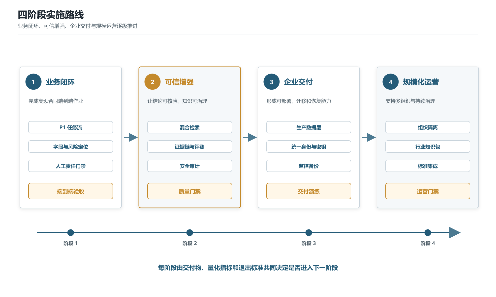
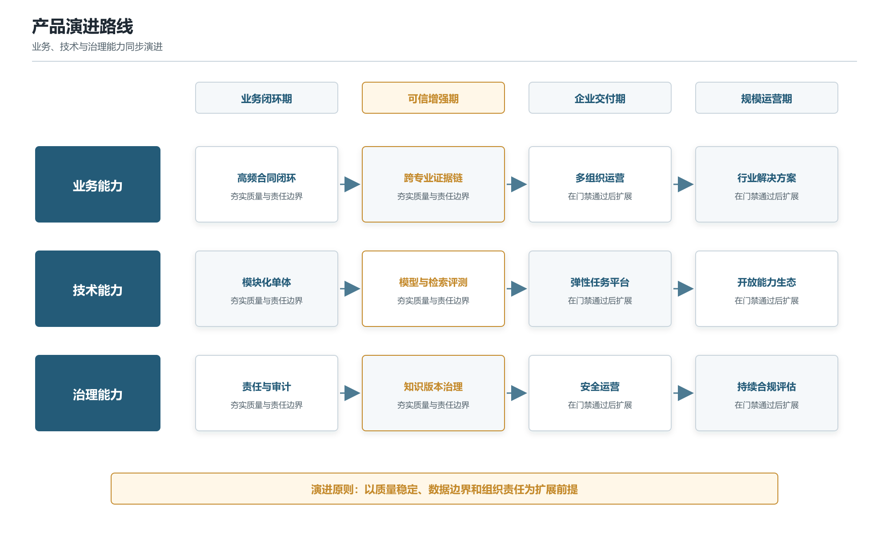

# 第六章 项目实现与应用

## 6.1 当前实现形态

项目采用前后端分离的 Web 应用。前端以 Vue 3、TypeScript、Element Plus 和 ECharts 构建工作台、合同审查、协同、整改、报表、知识、规则与管理页面；FastAPI 后端提供认证、合同、批次、风险、报表、知识、整改和审计接口。SQLAlchemy 负责数据访问，开发环境使用 SQLite，生产目标为 PostgreSQL。

解析服务支持 DOCX、文本 PDF 和扫描 PDF，RapidOCR 处理需要识别的页面；规则、法务 Agent、财务 Agent 与 RAG 共同产生风险候选。异步交付形态使用 Redis、Celery worker 和 scheduler，Nginx 提供前端入口。仓库同时包含 Alembic 迁移、Dockerfile、Compose 文件、演示数据脚本、法规导入脚本和本地质量门禁。

当前本地演示已经贯通上传、解析、双 Agent 审查、人工复核、整改和报表。页面正常、空、错及移动端状态有测试覆盖；本轮质量门禁验证了评测、后端、前端、类型检查和生产构建。演示环境的合同、用户和统计数据只用于说明功能，不对应真实客户。

## 6.2 开发、演示与交付环境分开

| 环境或组件 | 项目用途 | 当前证据 | 交付条件 |
|---|---|---|---|
| Vue 前端 | 专业工作台、风险复核、整改和报表交互 | 前端测试、类型检查、Vite 生产构建和页面截图 | 按目标浏览器、分辨率和统一身份环境复测 |
| FastAPI 后端 | 业务接口、权限、任务编排与审计 | 后端自动化测试和本地真实接口运行 | 配置 TLS、日志、密钥和运行监控 |
| SQLite | 本地开发和演示数据 | 当前质量门禁与演示数据库 | 不用于替代生产并发和恢复结论 |
| PostgreSQL 16 | 生产关系数据与事务 | Alembic 迁移、回滚代码和 SQLite 迁移烟雾 | 完成空库、旧库、回滚、备份与恢复实测 |
| Redis 与 Celery | 批量解析、审查、导出和定时任务 | 批次状态、租约、幂等、补投与重试契约测试 | 在目标并发下验证队列恢复和资源上限 |
| 文档解析与 OCR | 提取正文、表格、位置和扫描文本 | 多格式解析测试、真实 OCR 引擎冒烟 | 用冻结扫描件计算字符准确率和低置信度召回 |
| LLM 与本地 Embedding | 双 Agent 语义审查与知识检索 | Adapter、Agent、混合检索与证据链测试 | 确定模型版本、数据策略、容量和故障预案 |
| Docker Compose | 编排数据库、缓存、后端、任务与前端 | YAML 结构和依赖关系可解析 | 目标机完整启动、健康检查、升级和故障恢复 |

开发环境允许同步执行和 SQLite，以便调试单个环节；演示环境使用预置账号和数据说明业务过程；交付环境必须采用强配置、PostgreSQL、异步任务、加密密钥和运维检查。三种环境的代码路径尽量一致，但容量、安全和可恢复性不能互相代替。

配置通过环境变量提供。生产模式检查调试开关、数据库类型、异步任务、数据库密码、JWT 密钥和文件加密密钥，仍为弱默认值时拒绝启动。模型服务的地址、密钥和提供方也由配置决定，前端不接触这些凭据。

### 6.2.1 实施角色和交接

业务负责人确认合同类型、字段、风险等级和整改流程；法务、财务共同评审规则与知识；开发人员维护接口、数据迁移和前端；测试人员管理样本、金标准与结果；运维人员负责网络、数据库、队列、模型、密钥、备份和监控。一个人可以承担多个角色，但同一项准确率的预测与金标准复核不应由同一过程完成。

上线变更至少经过配置核对、迁移预演、备份、部署、健康检查和核心用例回归。数据库结构或知识版本变化时，记录变更内容和回退条件。模型切换需要重新跑固定样本，不因 API 兼容就认为输出等价。发生问题时按文件、任务、模型、检索、权限或基础设施分类，减少多人重复排查。

## 6.3 适用对象与典型场景

项目适合有固定合同审查流程、法务与财务共同参与、希望在企业网络内管理合同数据的组织。典型使用者包括法务主管和审查人员、财务主管、采购或销售经办人、部门负责人及系统管理员。不同组织可以调整合同类型、部门字典、规则和知识来源，但风险状态与证据结构应保持稳定。

采购合同场景中，经办人上传供应商合同，系统提取主体、金额、付款、验收和违约信息；法务核对责任与争议条款，财务核对价税和付款条件，确认的问题进入整改。销售或服务合同可以沿用同一过程，只更换规则和关注字段。批量场景用于集中处理一组合同，管理者随后查看部门和条款风险分布。

系统也可以作为 OA、电子签约或 ERP 前后的审查服务，但当前提交只保留接口边界，没有虚构完成企业集成。组织若没有明确的合同版本、授权与整改责任，软件本身不能替代制度建设；实施时需要先确认部门、角色、合同类型和高影响动作的审批规则。

## 6.4 项目实现中的取舍

项目先贯通可演示、可测试的业务链，当前不拆成大量微服务。合同、风险、复核和整改目前共享关系模型，保证状态一致；解析、模型、检索和任务接口保持独立，便于按容量拆分。只有监控证明某个环节需要独立扩缩时，才调整部署单元。

双 Agent 以专业职责区分，不使用多个名称不同但任务相同的模型角色。RAG 按风险检索，不为整份合同附一组泛化参考文献。报表直接读取结构化业务对象，不要求用户另填统计表。错误状态在页面中有明确入口，批量失败保留成功项。上述取舍均可从源码、接口或界面复核。

## 6.5 实施顺序与交付物

第一阶段冻结合同、版本、风险、证据和整改的数据契约，跑通上传到报表的主路径；第二阶段补充混合检索、知识版本、模型评测、权限和审计；第三阶段在目标环境完成 PostgreSQL、异步任务、Compose、备份与监控；其后再根据真实使用记录扩展合同类型、知识包和外部集成。

每个阶段都有退出条件。主路径阶段需要正常与异常用例可重复，风险能够回到原文；可信增强阶段需要无依据、低置信度和冲突可进入人工；企业交付阶段需要迁移、启动、恢复和权限检查通过。远期功能不写入当前完成度。

企业交付的推荐顺序是先准备数据库、缓存和密钥，再执行 Alembic 迁移，随后启动后端并检查健康状态，最后启动 worker、scheduler 和前端。灌入演示或知识数据前先确认环境，生产数据不使用开发种子。升级前记录当前版本与备份，迁移失败时停止应用，不带着半完成结构继续提供服务。

健康检查通过后，用最小闭环验证登录、上传、解析、审查、复核、整改和报表；再检查批量、导出、越权与服务重启。交付记录保存镜像或提交版本、配置项名称、迁移版本和执行人员，但不保存密钥值。只有恢复演练成功，备份才算可用。

参赛交付包含源码、详细方案、演示视频、概要介绍、测试案例及报告和项目简介 PPT。详细方案保存设计判断与实现机制；测试报告保存样本、环境、步骤、日志和结果；视频沿核心业务流程演示；概要与 PPT 服务快速理解和答辩。六份材料使用同一事实台账，避免同一指标在不同文件出现多个版本。

## 6.6 应用与交付边界

当前证据能够支持“核心流程已实现并通过本地质量门禁”，不能支持“已经在企业生产环境规模应用”。项目没有真实客户、收入、市场份额或节能结果，不在材料中补写这些内容。演示库中的合同数量、风险数量和接口延迟也不能替代正式性能数据。

交付前需要由使用单位确认数据分类、允许的模型部署方式、账号与部门映射、知识来源、备份周期、日志留存及人工复核责任。真实合同测试应先脱敏，仍需保留能判断字段和风险的上下文。重大合同及特殊法域由专业人员处理。

后续扩展优先依据缺陷和使用记录：若 OCR 失败集中在特定版面，先补样本与解析；若某类误报频繁，调整规则和知识；若队列积压，再扩 worker 或拆分计算服务。项目路线不以功能数量衡量，而以主路径是否稳定、证据是否完整和外部条件是否具备来决定。

交付验收由业务、专业、测试与运维角色分别确认所负责的证据。某一环境未完成的项目继续列为待验收，不用其他环境的通过记录替代。
