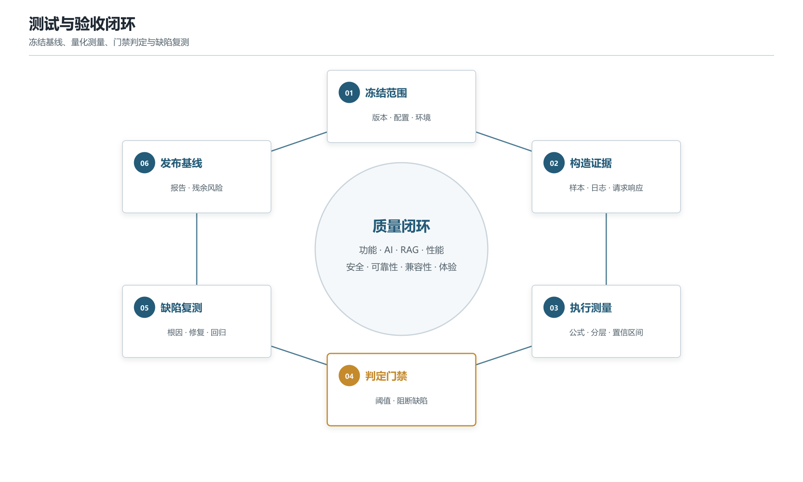

# 第七章 验证情况与总结

## 7.1 验证只回答本轮能够证明的内容

本章依据 2026 年 9 月 3 日重新执行的本地质量门禁、源码与配置检查整理。自动化测试能够证明接口契约、状态流转和既有样例没有回归，但不能代替真实合同、PostgreSQL 16、完整容器或两套硬件的验收。为避免把实现状态写成结果，结论分为“已验证”“已实现待实测”和“依赖外部条件”。

## 7.2 本轮质量门禁结果

评测专项运行结果为 59 passed；后端为 208 passed、1 skipped、6 warnings；前端为 13 passed、6 skipped。TypeScript 类型检查通过，Vite 生产构建通过并转换 2352 个模块。质量门禁汇总状态为 passed，对应提交基线 `cdc994c56b6220ccb2ca9a672a0e1e63338b9d7a`。

前端 6 个跳过项是需要本地服务的 E2E，用例按默认门禁约定在未设置服务地址时跳过，不能计为通过。后端的 1 个跳过和 6 条警告同样如实保留。上述数字只描述本轮代码和既有样例，不说明真实合同准确率、批量吞吐或硬件性能。

本轮还连接真实本地前后端和演示数据库检查了报表页面。登录、页面标题与 KPI 卡片出现，页面没有“加载失败”，浏览器控制台无错误，报表相关接口返回 200。该检查证明报表正常状态可以运行，页面中的 22 份合同、66 条风险等数字只是演示数据。

## 7.3 赛题指标与证据状态

| 赛题指标 | 当前状态 | 本轮证据摘要 | 仍需条件 |
|---|---|---|---|
| 上传、解析、审查、复核、整改和报表 | 已验证 | 源码、接口和前后端测试；正常报表页连接真实本地服务检查 | 进入目标环境后复测配置与容量 |
| 法务与财务双 Agent | 已验证 | 分工、共享上下文、结构化输出和冲突处理测试 | 用真实合同复核漏判、误判和专业边界 |
| 风险原文、依据与建议关联 | 已验证 | 风险级证据绑定、混合检索及无可靠来源转复核测试 | 持续维护正式知识来源与适用范围 |
| 人工复核与整改留痕 | 已验证 | 风险状态、确认、忽略、整改接口和页面测试 | 使用单位确认授权和高影响动作流程 |
| 多维报表与 Excel 台账 | 已验证 | 报表 API、部门范围、前端页面与导出实现 | 用目标数据核对指标口径和敏感字段 |
| 部门隔离、RBAC 与审计 | 已验证 | 业务角色部门查询与越权 403 等自动化测试 | 映射真实组织，执行安全与日志审查 |
| 一次批量处理 50 份以上 | 已实现待实测 | 批量上限、异步状态、租约、幂等、补投、失败隔离和重试代码及契约测试 | 冻结 50 份有效合同加 2 份异常文件，记录真实耗时和恢复 |
| 扫描件 OCR | 已实现待实测 | RapidOCR 调用、页数与像素限制、总超时、低置信度复核和引擎冒烟 | 冻结扫描真值集，计算字符准确率与低置信度召回 |
| 合同要素准确率不低于 90% | 已实现待实测 | 指标计算、JSON Schema、双人复核协议和报告入口 | 双人标注形成金标准，按字段宏平均出具结果 |
| PostgreSQL 16 数据库 | 已实现待实测 | Alembic 迁移、回滚代码、生产配置门禁和 SQLite 迁移烟雾 | 空库、旧库、回滚、备份和恢复实机验收 |
| Compose 私有化部署 | 已实现待实测 | PostgreSQL、Redis、backend、worker、scheduler、frontend 编排结构通过解析 | 有 Docker 的目标机完整启动、健康检查、升级与故障恢复 |
| OpenClaw 与 GPU 性能 | 依赖外部条件 | 同模型、提示词、数据集、并发和 Schema 的基准执行器与统计测试 | 两套真实硬件、固定模型和完整原始运行数据 |
| 能耗对比 | 依赖外部条件 | 无真实功率时序时工具输出 `not_measured` | 同口径采集空闲、预热和推理功率时序 |

## 7.4 测试报告需要补齐什么

《项目测试案例及报告》应保存硬件、操作系统、数据库、模型、配置、提交号和执行时间。功能用例覆盖正常、空、错误、无权限、重试和恢复；AI 效果用例保存合同样本、人工真值、阈值和逐项结果；部署用例保存命令、健康检查、迁移、回滚及恢复记录。

50+2 批量测试不能只截取最终“完成”页面，还要保留文件清单哈希、异常文件类型、批次事件、各文件状态、刷新恢复和重复提交结果。OCR 与要素准确率需要先冻结标注协议和样本，再运行工具，不能测试后调整真值来适应预测。

OpenClaw/GPU 对比固定模型、量化、提示词、数据集、并发、预热、超时和输出结构。能耗使用真实功率时序；任何一侧缺数据时不计算节能比例。测试报告可以在条件具备后更新数字，详细方案只保留方法和本轮可证明状态。

最终判定按指标逐项进行，不用“整体可用”替代未完成项目。任何 P1 指标缺少样本、原始记录或计算结果，都保持待实测；外部环境暂时不可得时，记录负责人、所需设备和复测入口，不填写推测数字。

## 7.5 原稿与材料边界复核

两份原详细方案的 SHA256 均为 `4752FE64A45B2591726AADC5203B3ADC75416DE611D4F5C1EA62FCD95A07E230`，原概要介绍为 `AFE0A9ECD457901AB9E91FF0352DEA451BFC490F5A77405DDCBB4712C2863449`。重构版使用独立文件名生成，成稿后再次核对这些哈希，确认原稿未被覆盖。

详细方案回答设计取舍、实现机制和证据摘要；概要介绍用 9 页说明项目、流程与完成度；完整日志和指标明细留在测试报告。演示视频沿上传、风险复核、整改和报表顺序操作，PPT再从概要提炼答辩要点。六份材料共享事实，不共享整段正文。

## 7.6 结论

“契鉴”已经形成可运行的合同合规审查主路径：合同进入系统后，解析和要素结果有来源，法务与财务 Agent 分开给出意见，风险可以回到原文和依据，人工复核与整改留下记录，管理者从报表继续钻取。部门隔离、异常状态和操作审计使这条路径具备企业作业的基本约束。

项目下一步集中补齐指定条件下的硬证据，不再增加功能名称。50+2 文件、OCR、要素准确率、PostgreSQL、Compose 以及 OpenClaw/GPU 对比都有实现入口或测试方法，但缺少相应样本、数据库或硬件时，不能写成达标。完成这些实测后，评审可以从测试报告直接复核原始记录与计算结果。

系统提供辅助审查意见。合同效力、重大交易和争议处置仍由授权人员结合完整合同、交易背景与正式依据决定。对于证据不足、模型冲突、输入质量低或知识失效的情况，保留不确定性并转人工处理，是当前方案必须坚持的产品边界。

## 7.7 参考文献

[S01] 国务院：《“十四五”数字经济发展规划》，国发〔2021〕29号。https://www.gov.cn/zhengce/content/2022-01/12/content_5667817.htm

[S02] 国家互联网信息办公室等：《生成式人工智能服务管理暂行办法》，2023年8月15日起施行。https://www.cac.gov.cn/2023-07/13/c_1690898327029107.htm

[S03] 全国人民代表大会：《中华人民共和国民法典》，2021年1月1日起施行。国家法律法规数据库：https://flk.npc.gov.cn/

[S04] 全国人民代表大会常务委员会：《中华人民共和国数据安全法》，2021年9月1日起施行。国家法律法规数据库：https://flk.npc.gov.cn/

[S05] 全国人民代表大会常务委员会：《中华人民共和国个人信息保护法》，2021年11月1日起施行。国家法律法规数据库：https://flk.npc.gov.cn/

[S06] 全国人民代表大会常务委员会：《中华人民共和国网络安全法》，现行有效文本。国家法律法规数据库：https://flk.npc.gov.cn/

参考资料只用于说明法律与治理背景，具体合同仍需根据交易事实、适用法域和资料时点由专业人员判断。
