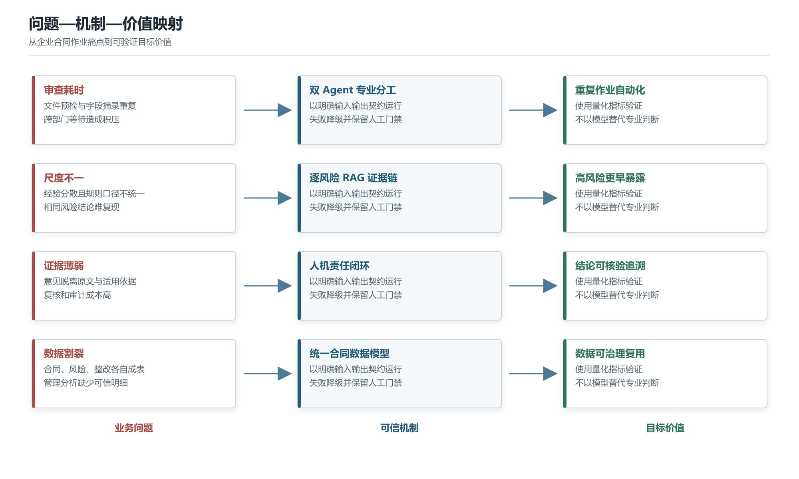

# 第一章 项目概述与赛题解读

## 1.1 项目背景

合同连接企业采购、销售、交付、结算与争议处理，是权利义务的法律载体，也是经营活动中最集中、最敏感的数据对象之一。大型企业和政府单位通常面临合同类型多、参与部门多、审批链路长、规则来源分散等问题。法务需要判断主体资格、权利义务、违约责任和争议解决，财务需要核验金额、税率、付款条件与结算约束，业务人员则关心交付、验收和履约可操作性。传统作业方式依赖逐页阅读、人工摘录和跨部门沟通，审查结论难以统一，合同数据也难以持续沉淀为可分析资产。

《“十四五”数字经济发展规划》提出以数据资源为关键要素，推进产业数字化，并强化数据分类分级和全生命周期安全管理。[S01] 生成式人工智能为长文本理解、要素抽取和风险解释提供了新的技术路径，同时也带来生成内容准确性、数据来源合法性和用户输入保护等治理要求。[S02] 因此，企业合同智能化不能停留在“上传文件后生成一段回答”，而应建设覆盖合同接入、机器审查、人工决策、整改闭环、知识治理和经营分析的可信作业系统。

## 1.2 命题理解

A03 赛题要求围绕企业级合同合规审查与多维报表生成，综合运用本地智能算力、文档解析、大模型与智能体技术，识别合同漏洞、逻辑矛盾和法律风险，提取关键元数据并形成结构化报表。命题的核心不只是模型能否读懂单份合同，而是能否将法务、财务、业务和管理者的工作组织为稳定、可解释、可验收的业务闭环。

本方案将命题转化为五项建设任务：第一，建立多格式、批量化、可恢复的合同接入与解析链路；第二，构建法务专家 Agent 与财务会计 Agent 的分工协同机制；第三，将法规、制度、规则和标准条款组织为可治理的检索增强知识体系；第四，为每条风险绑定合同原文、适用依据、置信度和人工处置记录；第五，将合同要素、风险状态和履约节点转化为台账与多维报表。五项任务共同回答“能处理、能判断、能解释、能闭环、能管理”五个问题。

## 1.3 业务对象与问题边界

系统面向中国大陆法律环境下的大型企业、事业单位和政府部门，重点服务采购合同、销售合同、服务合同、租赁合同、保密协议等常见经营合同。审查对象包括合同正文、表格、附件及版本关系；知识依据包括现行法律法规、司法解释、企业制度、审查规则、标准模板和经治理的案例材料。

系统输出属于辅助审查意见，不构成法律裁决。合同效力、重大交易决策和争议处置需要授权人员结合交易背景、主体情况和完整证据作出判断。系统不代替电子签章、印章审批、付款或诉讼系统，也不在未经授权时自动修改、签署或执行合同。对未覆盖法域、低质量扫描件、上下文不足、知识失效或模型冲突等情况，系统必须明确提示不确定性并转入人工复核。

## 1.4 建设目标

| 目标 | 目标描述 | 可验证结果 |
|---|---|---|
| 效率目标 | 减少重复阅读、摘录、检索和台账维护工作 | 支持单份与批量任务，过程可追踪，失败文件可独立重试 |
| 质量目标 | 统一法务与财务审查尺度，降低高风险漏检 | 冻结样本集、字段级与风险级指标、分层阈值和人工复核机制 |
| 可信目标 | 让每项风险可定位、可解释、可追溯 | 原文片段、位置、依据、知识版本、模型版本和处置记录完整关联 |
| 协同目标 | 将法务、财务、业务和主管纳入同一闭环 | 复核、分派、整改、再审与关闭状态清晰，责任角色明确 |
| 管理目标 | 将非结构化合同转化为经营数据资产 | 形成合同台账、风险分布、履约节点和多维分析报表 |
| 安全目标 | 保护合同中的商业秘密与个人信息 | 私有化部署、最小权限、部门隔离、加密脱敏和审计追踪 |

## 1.5 交付目标

方案交付由业务方案、系统设计、实施计划和验收体系四部分构成。业务方案明确用户、场景、功能域、流程和优先级；系统设计明确智能体协同、RAG 证据链、解析抽取、数据安全、部署拓扑与交互规则；实施计划定义阶段目标、角色资源、依赖、交付物和退出标准；验收体系定义功能、AI 效果、检索、性能、安全、可靠性、兼容性和体验测试方法。最终测试数据由独立测试报告生成，详细方案只固化长期有效的测量口径和门槛。

## 1.6 设计原则

1. **业务闭环优先。** 技术能力必须落到上传、审查、复核、整改、归档和分析的实际任务中。
2. **证据先于结论。** 风险意见必须同时呈现合同原文和经过适用性检查的依据；证据不足时不输出确定性结论。
3. **AI 辅助、人作决策。** 高风险、低置信度、模型冲突和知识失效场景由授权人员处理并留痕。
4. **数据最小暴露。** 合同原文默认留在企业安全域，按角色和部门控制访问，外部集成只获得必要字段。
5. **规则可治理。** 法规、制度、模板和模型均具备版本、有效期、适用范围与变更记录。
6. **指标可复现。** 需求、架构和测试使用统一对象与口径，结论能够由样本、日志或构建产物复核。

## 1.7 方案阅读路径

第 2 至 5 章回答为何建设、为谁建设和建设什么；第 6 至 12 章回答系统如何运行、如何实现以及如何保护数据；第 13 至 16 章回答如何实施、如何验收、如何控制风险和如何持续发展；第 17 章汇总结论与资料来源。该结构使评审能够从问题价值追溯到技术设计与验收证据，也使产品研发人员能够将章节内容直接转化为实施任务。
