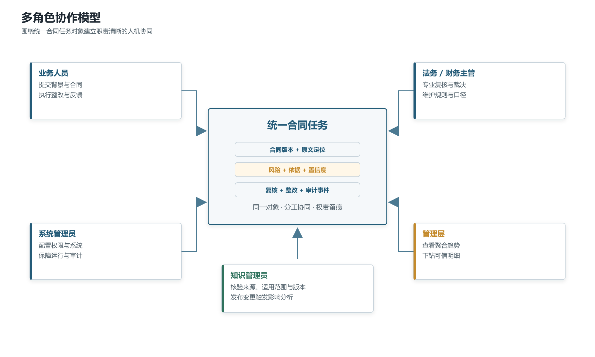

# 第三章 用户研究、业务痛点与需求分析

## 3.1 分析方法与约束

需求分析以角色职责、业务任务和风险责任为主线，不虚构访谈样本或客户数据。需求来源包括赛题任务、企业合同管理通用流程、法律与数据治理要求，以及系统目标能力的可验收边界。每项核心需求均标注优先级、前置依赖和验收标准：P1 构成业务闭环与赛题交付的必要能力，P2 提升可信度、效率和企业适配，P3 面向规模化运营与生态集成。

## 3.2 用户角色

| 角色 | 主要目标 | 核心任务 | 关注信息 | 责任边界 |
|---|---|---|---|---|
| 法务主管 | 统一审查尺度并控制法律风险 | 配置审查范围、复核风险、分派整改、维护法律知识 | 高风险原文、法律依据、建议、冲突与处理状态 | 对重大法律风险和最终审查意见负责 |
| 财务主管 | 控制金额、税务、付款与结算风险 | 复核金额税率、付款条件、发票要求和资金节点 | 金额结构、现金流节点、财税风险及跨条款矛盾 | 对财务口径与资金风险判断负责 |
| 业务人员 | 高效提交合同并落实整改 | 上传合同、补充业务背景、查看授权结果、处理整改 | 阻断问题、修改建议、责任人、期限与版本 | 提供真实业务信息并执行确认后的整改 |
| 系统管理员 | 保证系统、权限、知识和模型可用 | 组织角色配置、知识发布、模型参数、审计和运维 | 服务状态、版本、权限、告警、日志与资源 | 不代替法务或财务作专业结论 |
| 管理层 | 掌握合同规模、风险与履约态势 | 查看聚合指标、趋势、重点事项和部门对比 | 金额、相对方、风险分布、整改与履约节点 | 使用聚合数据决策，默认不访问非必要原文 |

角色权限遵循职责分离原则。系统管理员能够维护账户与系统配置，但不因管理员身份自动获得全部合同正文；管理层能够查看聚合报表，但访问敏感条款需通过授权；业务人员只能访问本人或本部门职责范围内的合同；法务与财务可以查看其被授权的专业信息。任何临时提权均应具备审批依据、有效期和审计记录。

## 3.3 核心业务场景

### 3.3.1 合同审查

业务人员选择合同类型、部门和审查维度，上传 PDF、DOCX 或 TXT 文件并补充交易背景。系统完成文件校验、加密存储、解析、要素抽取和一致性检查，随后由法务与财务 Agent 生成候选风险。审查结果按高、中、低等级排序，每项风险展示原文位置、问题说明、适用依据、建议和置信度。

异常场景包括文件损坏、密码保护、扫描质量过低、重复上传、模型超时和知识依据不足。系统不得将“无法解析”呈现为“未发现风险”，也不得在证据不足时输出确定性法律结论。

### 3.3.2 复核整改

法务主管和财务主管按专业范围处理待复核风险，可确认、忽略或标记为需修改。高风险忽略必须填写理由；需修改项形成整改任务，包含责任角色、期限、建议和关联合同版本。业务人员提交整改说明或新版本后，系统进行差异定位与必要的重新审查，复核通过后关闭风险。

整改闭环需要保留风险初始内容、每次判断、操作人、时间、附件、版本和关闭依据。新版本不得覆盖已审查文件，历史结论也不得因重新运行模型而被静默改写。

### 3.3.3 知识治理

系统管理员或授权知识管理员导入法律法规、司法解释、企业制度、审查规则、标准条款和案例材料，填写来源、法域、合同类型、业务维度、生效日期与失效日期。系统进行格式解析、条文切片、重复检测和索引构建，经审核后发布。新版本发布时建立替换关系，并触发受影响范围分析与缓存失效。

知识无法确认来源、已失效、适用范围不明或内容冲突时，不得进入正式依据池。案例只用于辅助理解，不冒充法律法规；企业制度只在相应组织与业务范围内适用。

### 3.3.4 经营分析

管理层按时间、部门、合同类型、相对方、金额区间、风险等级和整改状态查看聚合数据，并可钻取授权范围内的合同清单。财务主管关注付款节点、币种、税率和资金计划，法务主管关注高风险类别、重复问题、整改周期和规则命中趋势。

报表必须说明统计口径、数据时间和筛选条件。无数据时显示空状态，不用固定演示值填充；字段未经人工确认时标注质量状态；导出文件应用权限过滤、水印和操作审计。

### 3.3.5 系统管理

系统管理员维护组织、用户、角色、数据字典、模型适配器、任务参数、审计策略与告警阈值。系统提供服务健康、任务积压、模型调用、知识索引、存储和备份状态。配置变更应经过校验并保留前后值，关键配置支持回滚。

系统管理与业务审查解耦：管理员可以诊断任务失败原因，但默认只查看必要元数据；需要读取合同原文排障时，必须通过受控授权并记录原因。

## 3.4 用户任务与痛点链

| 用户任务 | 典型阻碍 | 用户需要的结果 | 对应能力 |
|---|---|---|---|
| 提交一批合同 | 格式混杂、失败原因不清、重复录入 | 每份文件状态清晰，异常可独立处理 | 批量接入、预检、幂等与失败隔离 |
| 快速找到重大问题 | 风险散落、优先级不明确 | 先看阻断性风险并回到原文 | 风险分档、原文定位、摘要与筛选 |
| 判断 AI 结论是否可信 | 依据不明、法条可能失效 | 查看可靠来源、适用范围和版本 | 逐风险证据链与知识治理 |
| 协调法务与财务意见 | 对象不同、结论冲突、沟通留痕不足 | 在同一风险上比较意见并明确负责人 | 双 Agent、冲突消解和责任分派 |
| 推动合同修改 | 建议停留在报告中、无法追踪 | 风险转为有期限的整改任务 | 整改状态机、版本关联和复核关闭 |
| 汇总经营数据 | 手工台账慢、口径不一致 | 可筛选、可解释、可导出的聚合数据 | 结构化台账、指标口径和权限过滤 |

## 3.5 核心需求清单

| 编号 | 需求 | 优先级 | 前置依赖 | 验收标准 |
|---|---|---|---|---|
| R-01 | 账号认证、角色授权与部门隔离 | P1 | 组织与角色模型 | 页面和接口同时鉴权；跨部门访问被拒绝并记录 |
| R-02 | PDF、DOCX、TXT 单份与批量上传 | P1 | 文件存储、任务机制 | 批量内单文件失败不影响其他文件；刷新后状态可恢复 |
| R-03 | 文件安全预检与加密存储 | P1 | 密钥服务、安全策略 | 拒绝损坏、超限或不支持文件；落盘内容不可明文读取 |
| R-04 | 正文、表格和位置映射解析 | P1 | 解析器、OCR 扩展接口 | 原文可按页码、段落或单元格定位；失败原因可区分 |
| R-05 | 合同关键要素抽取与证据 | P1 | 解析文本、字段模型 | 每个非空字段包含原文、位置和置信度；核心指标达到第 14 章阈值 |
| R-06 | 金额、比例、日期和主体一致性校验 | P1 | 结构化字段 | 预置矛盾样本被识别并显示参与比较的原值 |
| R-07 | 法务与财务双 Agent 协同审查 | P1 | 模型适配器、审查编排 | 两类职责、共享上下文、交叉验证和冲突结果可追踪 |
| R-08 | 逐风险原文、依据、建议和置信度 | P1 | RAG、风险数据模型 | 正式依据通过来源和适用性检查；无可靠来源时转人工 |
| R-09 | 人工复核与整改闭环 | P1 | 权限、通知、版本关系 | 高风险必须处理；忽略和关闭均有理由与证据；状态转换合法 |
| R-10 | 合同台账、多维报表与 Excel 导出 | P1 | 结构化合同与风险数据 | 指标口径明确；筛选、钻取、导出数据一致且遵循权限 |
| R-11 | 法规、制度、规则和模板治理 | P2 | 知识模型、索引服务 | 支持审核发布、有效期、替换链、回滚和影响范围记录 |
| R-12 | 合同版本比对与增量再审 | P2 | 版本关系、差异算法 | 展示新增、删除和修改条款；历史结果不被覆盖 |
| R-13 | OA、统一身份和消息平台集成 | P2 | 标准 API、事件机制 | 鉴权、幂等、超时、重试和回调签名规则完整 |
| R-14 | 模型评测与可替换适配 | P2 | 冻结数据集、模型网关 | 同一评测口径可比较模型，切换不改变业务数据契约 |
| R-15 | 多组织与行业知识包 | P3 | 租户隔离、配置继承 | 组织数据、知识与配置隔离，公共能力可受控复用 |
| R-16 | 履约预警与外部主数据关联 | P3 | ERP/供应商/项目接口 | 节点来源可追溯，预警不越权，外部失败不破坏审查数据 |

## 3.6 非功能需求

### 3.6.1 性能与容量

交互查询应在用户可感知的合理时间内返回，长时间解析和审查任务采用异步执行并显示阶段进度。系统需支持赛题要求的批量合同处理，单文件失败不阻塞批次。性能指标以冻结硬件、固定样本和 P50/P95 分位数报告，避免只报告最佳值。

### 3.6.2 可靠性与可恢复性

上传、解析、抽取、审查、索引和导出任务均应具备幂等标识。模型、Embedding 或外部系统不可用时，系统保留可继续的规则与人工流程，明确标记降级范围。关键数据执行备份与恢复演练，任务可从最近成功阶段重试。

### 3.6.3 安全与合规

系统执行最小权限、部门隔离、传输与存储加密、字段脱敏、密钥轮换、操作审计和数据生命周期管理。日志不得记录密码、令牌、密钥或非必要合同全文。模型输入按照最小上下文原则裁剪，并记录模型、提示模板和知识版本。

### 3.6.4 易用性与可访问性

核心任务在正常、加载、空、错误、权限不足和批量部分失败状态下均有明确反馈。界面支持键盘操作、可见焦点、语义标签和足够对比度；在 390px、1440px 和 2560px 宽度下保持主要任务可用且无非预期横向溢出。

## 3.7 需求验收原则

每项 P1 需求至少对应正常、异常和权限三类验收用例。AI 能力必须同时检查质量指标与责任边界：高召回不能以不可接受的误报为代价，引用正确不能忽略适用性，平均时延不能掩盖长尾失败。需求变更需记录来源、影响章节、数据结构和测试项，确保产品、技术与验收口径保持一致。
