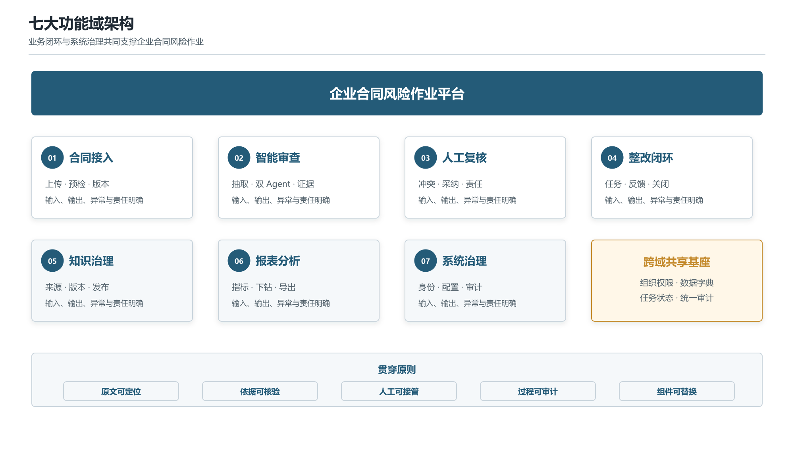
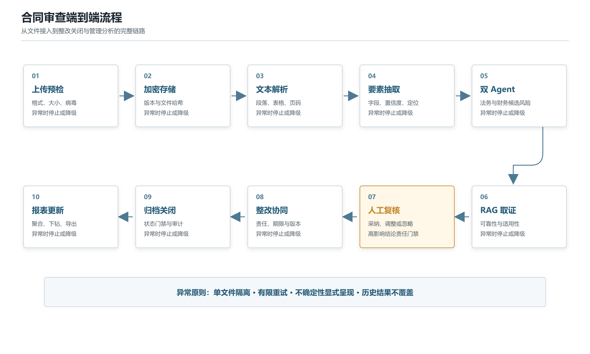

# 第五章 系统总体解决方案

## 5.1 总体思路

契鉴采用“一条业务闭环、两个专业 Agent、三类可信约束、七个功能域”的总体方案。一条业务闭环贯通接入、解析、审查、复核、整改、归档和分析；两个专业 Agent 分别承担法务与财务审查；三类可信约束分别是规则约束、知识证据约束和人工责任约束；七个功能域包括合同接入、智能审查、人工复核、整改闭环、知识治理、报表分析和系统治理。

总体方案以合同版本为主线，以风险条目为协作对象，以知识版本为依据边界，以审计事件为追溯载体。所有模块围绕统一标识关联，避免文件、风险、整改和报表成为彼此割裂的数据孤岛。

## 5.2 核心闭环

### 5.2.1 接入与理解

用户上传合同并补充类型、部门、经办角色、相对方线索与审查范围。系统完成扩展名、MIME、大小、恶意内容、密码保护、空文件和重复性校验，随后加密落盘并创建幂等任务。解析服务提取正文、表格、段落层级和位置映射；要素服务结合规则与模型识别主体、金额、期限、付款和履约字段，并执行格式与一致性校验。

### 5.2.2 审查与取证

编排器依据合同类型和审查维度生成任务上下文。法务 Agent 识别主体、效力、权利义务、违约、知识产权、保密与争议解决风险；财务 Agent 识别金额、税率、发票、付款、结算和资金风险。确定性规则优先处理金额不一致、比例异常和日期倒置，RAG 根据候选风险检索适用知识。协同层合并重复风险，标记互补或冲突结论，并形成统一风险结构。

### 5.2.3 复核与整改

风险按等级、专业和置信度进入复核队列。用户可以从风险直接定位原文和依据，查看 Agent 意见差异。确认风险后可分派整改；忽略高风险需说明理由；低置信度或无可靠依据的意见只能作为关注项。整改提交新版本或说明材料后，系统定位变化范围，执行必要再审，并由授权角色关闭。

### 5.2.4 归档与分析

审查完成后，合同原文件、解析文本、结构化字段、风险、依据、人工动作和整改证据共同归档。报表服务基于统一口径聚合合同数量、金额、相对方、时间、风险、整改和履约节点。所有钻取与导出继续执行部门和角色权限，不因数据进入报表而扩大访问范围。

## 5.3 七个功能域

| 功能域 | 核心职责 | 主要输入 | 主要输出 | 关键依赖 |
|---|---|---|---|---|
| 合同接入 | 文件预检、批量任务、加密存储、版本关联 | 文件、元数据、审查范围 | 合同版本、接入任务、预检结果 | 身份权限、对象存储、任务机制 |
| 智能审查 | 解析、抽取、规则、Agent、RAG 与风险汇总 | 合同版本、规则、知识、模型配置 | 结构化字段、候选风险、审查摘要 | 解析器、模型适配器、检索服务 |
| 人工复核 | 风险确认、忽略、补充依据、冲突处理 | 候选风险、原文、依据、权限 | 复核结论、责任角色、操作记录 | 风险状态机、审计、通知 |
| 整改闭环 | 分派、处理、版本更新、再审与关闭 | 已确认风险、责任人、期限 | 整改任务、新版本、关闭证据 | 合同版本、差异定位、消息服务 |
| 知识治理 | 导入、切片、审核、发布、替换与失效 | 法规、制度、规则、模板、案例 | 可检索知识、版本和影响范围 | 元数据、索引、审核流程 |
| 报表分析 | 台账、指标、筛选、钻取和导出 | 合同字段、风险、整改、履约节点 | 看板、明细、Excel 文件 | 指标字典、权限过滤、导出任务 |
| 系统治理 | 组织、权限、模型、配置、日志和运维 | 管理配置、运行指标、审计事件 | 权限策略、告警、变更与运行记录 | 身份服务、监控、密钥与备份 |

## 5.4 可信审查机制

### 5.4.1 规则、模型与知识分层

确定性规则处理可精确表达的校验，例如金额大小写不一致、付款比例不等于百分之百、结束日期早于生效日期。模型负责语义理解、条款缺失、责任失衡和跨段关系等开放问题。知识库为模型风险提供正式依据和企业口径。三者输出保留来源类型，不允许把模型常识或内置提示词显示为法律条文。

### 5.4.2 风险数据契约

每条风险至少包含：唯一标识、合同与版本、专业归属、风险分类、等级、原文、位置、事实说明、依据数组、建议、置信度、Agent 结果、复核状态、整改状态、规则/知识/模型版本以及创建更新时间。结构化契约同时服务前端展示、报表统计、接口集成和测试验收。

### 5.4.3 降级与人工接管

解析质量低时暂停智能审查并请求更清晰文件；Embedding 不可用时可使用关键词检索并标记模式；模型超时时执行有限重试，失败后保留规则结果；知识依据不足时限制置信度；双 Agent 冲突时禁止自动关闭。降级状态必须向用户说明影响范围，并进入可筛选的待处理队列。

## 5.5 外部系统协同

| 外部系统 | 协同内容 | 数据最小化策略 | 失败处理 |
|---|---|---|---|
| OA/BPM | 接收审批上下文、回写审查摘要和状态 | 仅传业务编号、版本、结论摘要与跳转地址 | 幂等重试，回写失败不丢失审查结果 |
| 电子签约平台 | 审查通过后发起签署，回收签署状态 | 传递必要文件版本与签署主体，不保存平台密钥 | 签署失败留在外部任务状态，不改变审查结论 |
| ERP/财务系统 | 同步供应商、项目、预算和付款节点 | 使用主数据编码关联，按字段授权 | 外部数据标记来源与时间，不覆盖人工确认值 |
| 统一身份认证 | 单点登录、组织和角色映射 | 不复制非必要身份属性 | 认证不可用时按策略拒绝登录或启用受控本地应急账号 |
| 消息平台 | 完成、超期和重大风险提醒 | 消息不包含合同全文或敏感条款 | 发送失败进入重试队列，不阻塞业务状态 |

## 5.6 建设范围分层

| 范围层级 | 建设重点 | 进入条件 | 退出标准 |
|---|---|---|---|
| 核心闭环 | 接入、解析、抽取、双 Agent、复核、整改、台账与基础权限 | 业务对象和字段字典冻结 | 核心任务端到端可用，P1 指标可测量 |
| 可信增强 | 混合检索、知识版本、模型评测、安全审计、版本再审 | 核心数据契约稳定 | 证据链、降级和质量评测通过验收 |
| 企业交付 | 私有化拓扑、数据库迁移、异步任务、备份监控与身份对接 | 目标环境与安全要求确认 | 安装、迁移、恢复、运维和安全检查通过 |
| 规模运营 | 多组织、行业知识包、模型评测平台和系统生态 | 交付模板与治理制度成熟 | 配置复用、组织隔离和持续运营机制可验证 |

## 5.7 方案约束

系统能力受输入质量、知识范围、模型能力和业务背景完整度影响。扫描件质量不足会降低位置与字段可靠性，未披露的交易背景可能改变条款判断，法规更新可能使旧依据失效，模型输出也存在波动。因此，方案通过输入质量门禁、知识有效期、置信度分层、人工复核和版本化评测控制不确定性，而不作“零误判”或“全自动审查”的承诺。

## 5.8 总体验收

总体方案通过四类证据验收：业务证据证明合同能够走完接入至归档闭环；数据证据证明字段、风险、依据与状态关系完整；技术证据证明架构、部署、接口与降级路径可实现；测试证据证明质量、性能、安全和体验指标具有明确样本与判定方法。四类证据共同构成后续详细设计和项目实施的基线。
