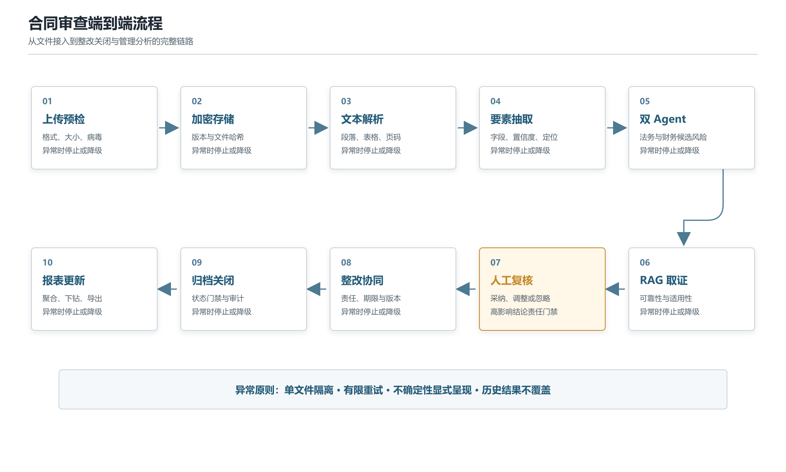

# 第六章 功能架构与核心业务流程

## 6.1 功能域划分原则

功能架构以业务责任和数据所有权划分边界，而不是按页面菜单拆分。合同接入负责建立可信输入，智能审查负责生成结构化字段与候选风险，人工复核负责专业判断，整改闭环负责风险处置，知识治理负责依据质量，报表分析负责数据使用，系统治理负责权限与运行保障。七个功能域通过合同版本、风险标识和审计事件协同，任何域的失败都必须有明确状态与恢复路径。

## 6.2 七个功能域详细设计

### 6.2.1 合同接入

**职责：** 接收单份或批量合同，校验文件与业务元数据，完成加密存储、去重、版本关联和任务创建。

**输入：** PDF、DOCX、TXT 文件，合同类型、所属部门、经办角色、优先级、审查维度和可选业务背景。

**输出：** 合同主记录、不可变合同版本、文件哈希、预检结果、批次与子任务标识。

**依赖：** 身份认证、权限策略、对象存储、密钥服务、病毒检测和任务队列。

**失败处理：** 不支持格式、文件损坏、密码保护、大小超限或恶意文件在落入正式存储前被拒绝；同批其他文件继续处理。网络中断支持断点或幂等重传，重复内容由文件哈希与用户策略决定跳过、关联新版本或保留副本。

### 6.2.2 智能审查

**职责：** 完成解析、OCR 扩展、要素抽取、一致性校验、规则审查、双 Agent 审查、RAG 取证、冲突检测和风险汇总。

**输入：** 合同版本、解析配置、合同类型、审查范围、规则版本、知识版本与模型配置。

**输出：** 带位置的解析文本、结构化要素、质量报告、候选风险、依据引用、审查摘要和运行记录。

**依赖：** 文档解析器、模型适配器、Embedding、检索索引、规则引擎和异步任务。

**失败处理：** 解析质量不足时暂停后续智能环节；模型或检索不可用时保留规则结果并显示降级范围；单个 Agent 失败不伪造协同结果；超时执行有限重试，超过阈值转人工接管。

### 6.2.3 人工复核

**职责：** 将 AI 候选风险转化为专业处置结论，支持确认、忽略、补充依据、调整等级、处理冲突和发起整改。

**输入：** 风险条目、合同原文、知识依据、Agent 意见、置信度、历史同类处理与用户权限。

**输出：** 复核状态、人工意见、等级变更、责任分派和审计事件。

**依赖：** 风险状态机、权限服务、原文定位、知识详情和操作审计。

**失败处理：** 越权操作被拒绝；高风险忽略、等级下调或依据替换必须填写理由；并发修改使用版本号检测冲突，提示用户重新加载，不静默覆盖他人结论。

### 6.2.4 整改闭环

**职责：** 将需修改风险转换为可执行任务，管理责任、期限、说明、附件、新版本、再审和关闭。

**输入：** 已确认风险、整改建议、责任部门、责任角色、期限和合同版本。

**输出：** 整改任务、处理记录、新合同版本、差异范围、复核结论和关闭证据。

**依赖：** 合同版本、通知服务、差异定位、智能审查和人工复核。

**失败处理：** 超期事项触发提醒但不自动关闭；新版本解析失败时保留原整改任务；再审产生新增风险时建立关联而非覆盖旧风险；关闭条件不满足时拒绝状态转换。

### 6.2.5 知识治理

**职责：** 管理法规、司法解释、企业制度、规则、模板和案例的导入、切片、审核、发布、替换、失效与索引。

**输入：** 知识文件、来源机构、法域、类别、条文编号、合同类型、业务维度、生效与失效日期。

**输出：** 知识文档与切片、正文哈希、向量、发布版本、替换链、索引状态和影响范围。

**依赖：** 解析器、元数据模型、Embedding、向量与关键词索引、审核权限。

**失败处理：** 来源不明、元数据缺失或内容冲突的知识进入草稿或驳回状态；向量构建失败时事务回滚或保持旧索引可用；发布新版本后使相关缓存失效，禁止已失效条目作为正式依据。

### 6.2.6 报表分析

**职责：** 提供合同台账、风险结构、整改进度、履约节点、质量指标和导出能力。

**输入：** 已授权合同字段、风险、整改、部门、相对方、时间与指标字典。

**输出：** KPI、趋势、分布、明细钻取、Excel 文件和导出审计记录。

**依赖：** 结构化数据、指标口径、权限过滤、查询与导出任务。

**失败处理：** 数据不足时显示空状态；未确认字段带质量标记；大数据量导出转异步任务；部分字段无权访问时按列脱敏或移除，不用空权限绕过查询限制。

### 6.2.7 系统治理

**职责：** 管理身份、组织、RBAC、数据字典、模型、任务参数、密钥、审计、备份、监控和告警。

**输入：** 管理配置、身份目录、运行指标、审计事件、安全策略与备份计划。

**输出：** 权限决策、配置版本、运行状态、告警、审计查询和恢复记录。

**依赖：** 统一身份、配置中心、密钥管理、日志监控与备份设施。

**失败处理：** 配置发布前进行格式和依赖校验；关键配置支持回滚；监控不可用不应阻断业务写入，但必须产生本地告警；身份服务中断时依据安全策略拒绝新会话或启用受控应急账户。

## 6.3 端到端主流程

1. 用户登录后，系统根据角色、部门和数据范围建立会话上下文。
2. 用户创建批次，选择合同类型与审查维度，上传合同并补充业务背景。
3. 接入服务执行文件校验、病毒检测、哈希去重与权限校验，将文件加密写入对象存储。
4. 任务编排器创建解析任务；解析器读取解密流，输出正文、表格、页码、段落和附件映射。
5. 要素抽取先执行正则和词典初提，再由模型补全复杂字段，最后进行类型、范围和一致性校验。
6. 规则引擎识别确定性异常；编排器构造最小必要上下文并启动法务 Agent。
7. 法务 Agent 输出候选法律风险，编排器将与金额、付款、履约相关的必要信息共享给财务 Agent。
8. 财务 Agent 输出财税与资金风险，并对相关法务结论进行交叉检查。
9. 协同层合并重复风险、建立互补关系、标记冲突，并按“风险分类 + 原文事实”发起 RAG 检索。
10. 检索结果经过来源可靠性、法域、合同类型、业务维度和有效期检查，合格依据进入风险证据链。
11. 汇总器形成风险清单与审查摘要；高风险、低置信度、无可靠依据或 Agent 冲突项进入重点复核队列。
12. 授权人员确认、忽略或发起整改。需修改项分派给业务责任角色并设置期限。
13. 业务人员提交整改说明或新版本；系统定位差异、执行必要再审，由专业角色复核关闭。
14. 合同、风险、依据、人工动作和整改证据归档，结构化数据更新台账与报表。

## 6.4 状态模型

### 6.4.1 合同版本状态

| 状态 | 进入条件 | 允许操作 | 正常出口 | 异常出口 |
|---|---|---|---|---|
| 已接收 | 文件预检通过并加密落盘 | 取消、查看批次 | 待解析 | 接入失败 |
| 解析中 | 解析任务领取 | 查看阶段进度 | 待审查 | 解析失败、待人工补件 |
| 待审查 | 文本与基础要素可用 | 修正元数据、发起审查 | 审查中 | 人工终止 |
| 审查中 | 审查任务领取 | 查看阶段与降级状态 | 待复核 | 审查失败、部分完成 |
| 待复核 | 风险清单形成 | 复核、分派、补充依据 | 整改中或待归档 | 复核冲突 |
| 整改中 | 存在未关闭整改 | 提交说明或新版本 | 待归档 | 整改超期 |
| 待归档 | 必审风险处理完毕 | 导出、确认归档 | 已归档 | 归档失败 |
| 已归档 | 归档校验通过 | 查询、导出、关联新版本 | 终态 | 仅创建新版本，不覆盖 |

### 6.4.2 风险状态

风险由“待复核”进入“已确认”“已忽略”或“需修改”。已确认风险可以直接归档，也可按决策转为需修改；需修改风险创建整改任务后进入“整改中”，整改复核通过后进入“已关闭”。高风险不得在无理由时忽略，已关闭风险不得直接改写内容；若新版本改变事实，创建新的风险评估记录并关联原风险。

## 6.5 关键异常分支

| 异常 | 检测点 | 系统行为 | 人工接管点 |
|---|---|---|---|
| 扫描质量不足 | 解析质量评估 | 停止自动审查，保存质量报告 | 业务人员补充清晰文件或确认 OCR 文本 |
| 关键字段多候选 | 要素一致性校验 | 标记候选值与证据，不写入已确认字段 | 业务或财务人员选择正确值 |
| 模型超时或不可用 | 模型网关 | 有限重试，保留规则结果并标记未完成范围 | 法务/财务决定重试或人工审查 |
| Embedding 不可用 | 检索服务 | 降级关键词检索，记录检索模式 | 知识管理员处理索引故障 |
| 无可靠知识依据 | 适用性检查 | 限制置信度，不生成伪造法条 | 法务补充依据或保留关注项 |
| Agent 结论冲突 | 协同汇总 | 保留双方结论并阻止自动合并 | 对应主管作出冲突处理决定 |
| 并发复核冲突 | 风险版本校验 | 拒绝后提交，展示最新状态 | 用户重新核对后提交 |
| 外部回写失败 | 集成适配器 | 本地结果不回滚，异步重试并告警 | 管理员确认外部系统状态 |

## 6.6 人工接管规则

以下情形必须进入人工队列：高风险；置信度低于发布阈值；正式依据为空、失效或适用范围不明；法务与财务结论冲突；规则与模型结论矛盾；解析质量低于门槛；关键字段存在多个候选；用户要求忽略高风险或下调等级。接管界面应同时提供任务原因、原文、上下文、候选依据、系统处理记录和可执行动作，不能只显示“请人工处理”。

## 6.7 流程验收

端到端验收至少覆盖正常单份、正常批量、部分文件失败、扫描件低质量、模型不可用、知识无命中、Agent 冲突、越权访问、整改超期和外部回写失败。每条路径都应验证状态转换、用户提示、数据一致性、审计记录和恢复方式，确保异常被显式管理而非吞掉。
