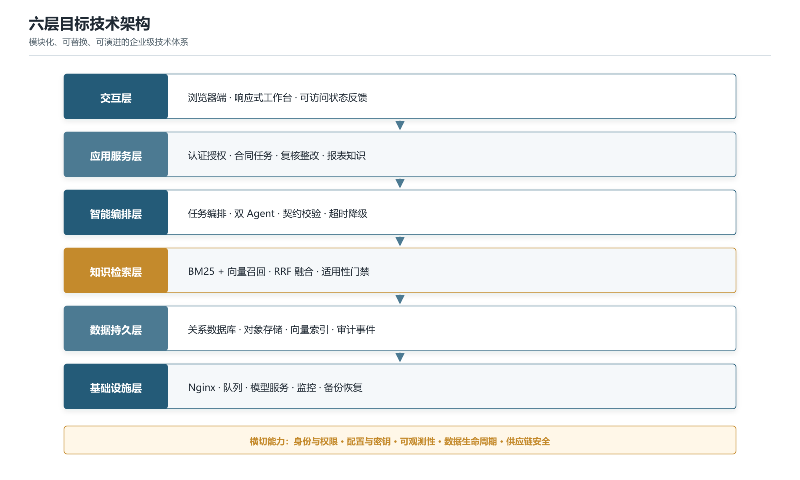
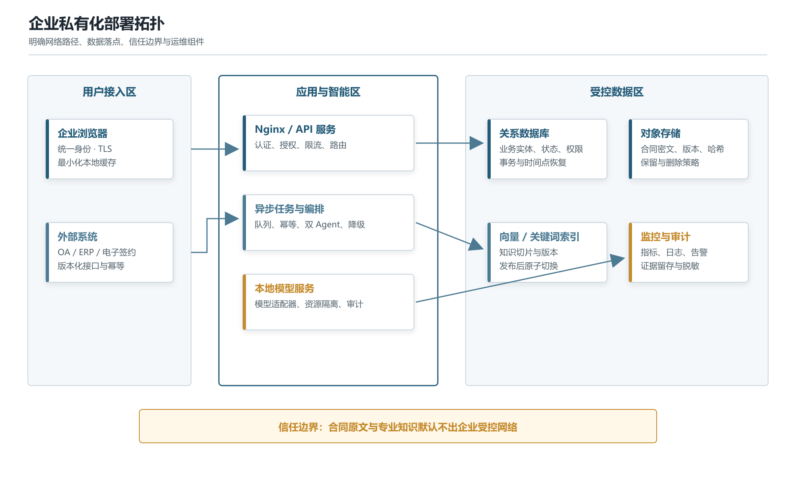

# 第七章 技术架构、部署架构与数据流

## 7.1 架构目标

技术架构服务于四个目标：一是让合同接入至风险归档的核心链路稳定可恢复；二是让模型、知识和规则可替换、可评测、可追踪；三是让合同原文和敏感字段受企业安全边界保护；四是允许系统从一体化部署平滑演进到企业级组件组合。架构采用模块化边界与稳定数据契约，不以拆分微服务数量衡量先进性。

## 7.2 六层技术架构

### 7.2.1 交互层

交互层由浏览器端管理界面组成，提供工作台、合同审查、协同分析、整改、报表、知识库、历史、规则和系统管理。该层负责输入校验、任务状态呈现、原文定位、权限可见性和错误反馈，不在前端保存密钥或执行可信权限判断。路由可见性只改善体验，最终授权由服务端完成。

### 7.2.2 应用服务层

应用服务层以 FastAPI 提供认证、合同、风险、整改、知识、报表、规则、字典和审计接口。服务通过用例编排业务事务，执行角色与部门权限，维护合同及风险状态机，并对外提供版本化 REST API。同步接口处理短操作，解析、审查、索引和大批量导出通过任务标识异步执行。

### 7.2.3 智能编排层

智能编排层包含文档解析协调、要素抽取、规则引擎、双 Agent 编排、冲突消解、风险汇总和模型网关。模型网关统一处理供应商适配、超时、重试、并发、输入裁剪和调用日志。编排器只接受版本化合同上下文，输出符合风险 JSON 契约的结果，避免模型自由文本直接进入业务数据库。

### 7.2.4 知识检索层

知识检索层管理知识文档、切片、元数据、关键词索引、向量索引、混合召回、重排与适用性过滤。向量和 BM25 两路结果使用稳定融合策略，随后按来源等级、法域、合同类型、业务维度、生效日期和失效日期过滤。检索结果包含切片标识、原文、来源、条文编号、版本和得分，支持逐风险引用。

### 7.2.5 数据持久层

数据持久层由关系数据库、对象存储、向量存储和缓存构成。关系数据库保存用户、组织、合同、版本、字段、风险、依据关联、整改、规则、知识元数据、任务和日志；对象存储保存加密合同、附件和导出文件；向量存储保存知识切片向量；缓存只保存可重建的会话、查询和任务状态。业务主数据不得只存在缓存或模型上下文中。

### 7.2.6 基础设施层

基础设施层提供 Nginx 入口、容器运行、异步任务、关系数据库、对象存储、本地模型服务、日志、指标、告警、密钥和备份。组件按环境配置组合：比赛或试点环境可采用单节点容器化部署，企业环境可将数据库、对象存储、任务 Worker、模型和监控独立扩展。两种形态使用相同业务接口与数据契约。

## 7.3 模块职责与接口边界

| 模块 | 负责 | 不负责 | 主要接口 |
|---|---|---|---|
| 身份与权限 | 登录、会话、RBAC、部门数据范围 | 仅靠前端菜单控制权限 | 登录、用户上下文、授权决策 |
| 合同服务 | 合同、版本、批次和状态 | 文档内容解析 | 上传、查询、版本关联、任务状态 |
| 解析服务 | 文本、表格、位置与质量报告 | 法律风险判断 | 解析任务、解析结果、位置映射 |
| 抽取与规则 | 字段候选、标准化和确定性校验 | 开放式法律结论 | 字段抽取、规则执行、一致性结果 |
| 审查编排 | Agent 调用、共享上下文、冲突与风险汇总 | 知识内容发布 | 审查任务、风险契约、调用记录 |
| 知识服务 | 知识版本、索引和检索 | 自动决定合同效力 | 导入、审核、发布、检索、替换 |
| 复核整改 | 人工状态与整改任务 | 静默修改模型原始输出 | 复核、分派、更新、关闭 |
| 报表服务 | 指标聚合、钻取和导出 | 绕过数据权限 | 指标、明细、异步导出 |
| 审计监控 | 事件、指标、告警与追踪 | 保存非必要合同全文 | 审计查询、健康检查、告警 |

## 7.4 企业私有化部署拓扑

部署划分为访问区、应用区、智能计算区和数据区。用户浏览器通过企业内网或受控 VPN 访问 Nginx；Nginx 终止 TLS、限制请求大小并转发到 FastAPI。FastAPI 处理认证和短事务，将长任务写入队列；Worker 从对象存储读取加密文件，经授权获取解密材料，调用解析、Embedding 和本地模型服务。关系数据库、对象存储和向量索引部署在数据区，仅允许应用与 Worker 通过白名单端口访问。监控组件采集指标与脱敏日志，不读取合同全文。

| 区域 | 组件 | 入站路径 | 出站限制 | 主要数据 |
|---|---|---|---|---|
| 访问区 | 浏览器、Nginx | 企业用户经 HTTPS | 仅转发已允许 API 与静态资源 | 会话令牌、必要业务字段 |
| 应用区 | FastAPI、任务调度、Worker | Nginx、内部队列 | 访问数据区和智能计算区白名单 | 业务事务、任务上下文 |
| 智能计算区 | 本地 LLM、Embedding、OCR | 仅应用区内部调用 | 默认禁止访问公网 | 最小必要合同片段与知识切片 |
| 数据区 | PostgreSQL、对象存储、向量索引、备份 | 仅应用区服务账号 | 备份走受控存储路径 | 业务数据、加密文件、知识与索引 |
| 运维区 | 日志、指标、告警、密钥管理 | 各组件受控上报 | 通知渠道只发送脱敏摘要 | 运行指标、审计事件、密钥引用 |

## 7.5 信任边界

第一道边界位于浏览器与 Nginx 之间，所有请求使用 TLS，令牌设置有效期并防止被脚本读取。第二道边界位于应用区与智能计算区之间，模型只接收完成权限检查和最小化裁剪的上下文。第三道边界位于应用区与数据区之间，服务使用独立账号和最小数据库权限，对象访问采用短期凭证或服务身份。第四道边界位于系统与外部 OA、ERP、电子签约和消息平台之间，接口采用双向鉴权、签名、时间窗、幂等键和字段白名单。

管理员、运维人员和模型服务均不被默认视为可信主体。管理操作需要独立审计，生产密钥不进入源码、镜像或普通日志；排障读取合同原文需要临时授权和目的记录。

## 7.6 关键数据流

### 7.6.1 文件与解析数据流

浏览器上传文件至应用服务，服务完成预检后在内存中加密并写入对象存储，同时向关系数据库写入合同版本、文件哈希和存储对象标识。Worker 使用受控密钥读取解密流并传给解析器，不将明文写入临时公共目录。解析结果以文本块、表格和位置映射写入数据库或受控文档存储，质量报告决定是否进入审查。

### 7.6.2 审查与证据数据流

应用服务读取授权合同版本和审查配置，编排器生成法务与财务上下文。模型输出先经过 JSON 解析、字段校验、长度与枚举限制，再写入候选区。每条风险触发检索，知识服务返回带版本和适用性信息的切片。汇总器把合格依据关联到风险，将无依据或冲突项标记为人工处理。全过程记录任务、规则、知识、模型和提示模板版本。

### 7.6.3 复核与报表数据流

人工复核写入独立处置记录，不覆盖模型原始输出。整改与新合同版本建立关联，关闭动作验证必填证据。报表服务从经过权限过滤的结构化视图聚合指标，钻取查询继承相同数据范围；导出文件写入临时受控对象并设置过期时间，下载记录进入审计日志。

## 7.7 外部接口原则

所有外部接口采用版本化路径和明确 Schema，日期时间使用带时区的 ISO 8601，金额使用定点数与币种字段，不用浮点数。写操作要求幂等键；回调包含事件标识、业务标识、发生时间、载荷摘要和签名；重试使用指数退避与最大次数。接口日志记录状态、耗时和追踪标识，不记录令牌、密钥和非必要全文。

## 7.8 可用性与降级

| 故障 | 影响 | 降级路径 | 恢复要求 |
|---|---|---|---|
| 本地模型不可用 | 语义抽取和 Agent 审查暂停 | 继续文件接入、解析、规则校验和人工流程 | 恢复后从审查阶段幂等重试 |
| Embedding 不可用 | 向量召回停止 | 使用 BM25/关键词检索并标记模式 | 重建缺失向量，切换索引前做一致性校验 |
| 队列不可用 | 长任务无法调度 | 拒绝新长任务或受控同步处理小任务 | 恢复积压任务且不重复执行已成功步骤 |
| 数据库主节点故障 | 业务读写中断 | 企业部署按恢复策略切换或只读 | 校验事务、任务与审计序列一致性 |
| 对象存储不可用 | 文件读写中断 | 保留元数据和失败状态，不启动解析 | 恢复后验证对象哈希并重试 |
| 外部系统不可用 | 回写或通知失败 | 本地业务继续，事件进入待发送队列 | 幂等补发并记录最终结果 |

## 7.9 演进路径

起步形态采用模块化应用与统一数据库，减少部署和事务复杂度；任务接口、存储接口、模型接口和检索接口保持独立，使计算密集模块可以单独扩展。随着合同量和组织规模增长，优先拆分异步 Worker、对象存储、模型服务和检索服务，再根据监控证据决定是否拆分业务服务。任何拆分都需保持数据所有权和接口契约，不允许多个服务直接共同修改同一业务表。

## 7.10 架构验收

架构验收不以图纸完整为唯一标准，而通过可执行场景验证：正常上传审查链路、批量部分失败、模型与检索降级、越权访问、密钥轮换、数据库备份恢复、外部回调重试和全链路追踪。每个场景需证明信任边界、数据落点、状态变化和恢复结果与设计一致。
