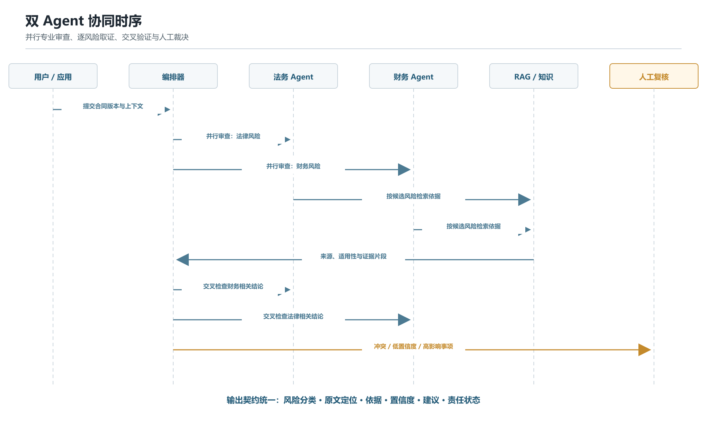

# 第八章 双 Agent 合同审查方案

## 8.1 设计目标

双 Agent 方案用于解决合同风险跨越法律与财务专业、单一视角容易遗漏联动关系的问题。系统由法务专家 Agent、财务会计 Agent 和编排器组成。协同不是两个模型分别生成清单后简单拼接，而是通过职责契约、共享上下文、交叉验证、冲突消解和人工接管形成有顺序、有边界、可追踪的联合审查。

## 8.2 角色职责

| 参与者 | 主要职责 | 禁止越界 | 典型输出 |
|---|---|---|---|
| 法务专家 Agent | 主体与授权、合同效力、权利义务、违约责任、知识产权、保密、解除和争议解决 | 不独立确认税率、预算或会计处理，不作最终法律裁决 | 法律候选风险、涉及财务复查的触发信号 |
| 财务会计 Agent | 金额币种、税率发票、付款结算、预算、现金流、账户和价格公允性 | 不独立判断合同效力或诉讼结果，不替代财务审批 | 财务候选风险、涉及主体或效力的回传信号 |
| 编排器 | 上下文裁剪、调用顺序、契约校验、共享信息、去重、冲突与分档 | 不生成新的法律事实，不以多数票消解专业冲突 | 统一风险清单、冲突项、降级状态与运行记录 |
| 人工复核角色 | 结合完整事实确认、忽略、调整或发起整改 | 不绕过授权和留痕要求 | 专业结论、理由、责任分派与关闭证据 |

## 8.3 输入输出契约

Agent 输入采用版本化对象，包含合同标识与版本、合同类型、授权后的正文片段与位置、已确认要素、待核验字段、审查维度、候选知识、规则结果和上游共享摘要。正文与知识均作为不可信数据包裹，禁止其中内容改变角色、输出格式或安全约束。

Agent 输出必须为 JSON 数组，每条候选风险包含 `category`、`level`、`original_text`、`location`、`fact`、`candidate_basis`、`suggestion` 和 `confidence`。输出进入业务层前执行 JSON 解析、字段白名单、类型、枚举、长度、数值范围和原文存在性校验。无法解析或原文无法定位的结果不直接进入正式风险区。

| 字段 | 规则 | 失败处理 |
|---|---|---|
| 风险分类 | 使用受控分类字典，允许映射未知类别 | 映射为待分类并进入人工复核 |
| 风险等级 | 仅高、中、低三级 | 非法值按中风险暂存并标记校验错误 |
| 原文与位置 | 原文应能在授权合同版本定位 | 无法定位时不得形成高置信度正式风险 |
| 候选依据 | 仅为检索线索，不直接视为正式依据 | 由 RAG 逐风险重新检索和适用性检查 |
| 置信度 | 0 至 100，表示模型自评并经系统规则校准 | 缺失或越界时限制为待人工档位 |

## 8.4 协同顺序与共享上下文

法务 Agent 先对合同整体结构、主体、责任和争议条款进行审查。编排器不共享其完整自然语言推理，只提取风险类别、原文位置、等级、相关字段和触发财务复查的信号，减少重复上下文与错误传播。财务 Agent 在阅读合同金额、付款与履约相关片段的同时，接收必要的法务摘要，例如关联交易、重大赔偿或付款义务不清。

财务 Agent 完成后，编排器把收款账户与合同主体不一致、付款条件与验收义务脱节、税务安排可能影响条款效力等信号回传交叉验证。共享上下文使用明确 Schema，并记录来源 Agent、生成时间和合同版本，禁止将推测性内容写成已确认事实。

## 8.5 交叉验证规则

| 触发信号 | 验证方向 | 处理结果 |
|---|---|---|
| 关联交易或关联方 | 法务触发财务检查价格公允性和付款安排 | 形成跨专业重点风险，要求联合复核 |
| 收款账户与合同主体不一致 | 财务回传法务检查授权、代收和舞弊风险 | 阻止自动低风险归档 |
| 验收条件模糊且付款比例高 | 财务与法务共同检查履约控制和违约救济 | 合并为有关联的两条风险或统一复合风险 |
| 法务与财务均识别高风险 | 编排器建立联合风险组 | 提升复核优先级，不自动关闭 |
| 同一原文等级差异显著 | 对比依据、事实与职责范围 | 保留双方意见并形成冲突记录 |

## 8.6 冲突消解

冲突分为事实冲突、依据冲突、等级冲突和建议冲突。事实冲突优先回到合同原文与结构化字段；依据冲突检查来源等级、适用范围和有效期；等级冲突使用预设分档规则给出建议档位，但不覆盖 Agent 原始结果；建议冲突同时展示各自目标与影响，由授权角色决定。

编排器不得通过平均置信度、简单投票或选择更强模型来自动消除专业冲突。冲突对象包含双方意见、共享事实、依据、差异说明和责任角色，人工处理后记录最终选择与理由，作为后续评测样本而非未经审核的自动训练数据。

## 8.7 风险分档

红档包括高风险、敏感类别、正式依据冲突、Agent 冲突、主体与账户异常等情形，必须人工复核；黄档包括中风险、低置信度、降级结果或需补充背景的情形，需要人工确认；绿档仅允许低风险、原文与可靠依据完整、置信度达到发布阈值且无冲突的意见进入快速确认队列。分档决定复核优先级，不代表合同有效性结论。

## 8.8 超时、重试与降级

模型调用设置总超时、连接超时、并发上限和输出长度上限。网络瞬时错误可进行有限次数指数退避重试；格式错误允许在不增加合同内容的前提下请求一次结构修复；安全拒绝、上下文超限和持续服务不可用不盲目重试。

单个 Agent 失败时，系统保留另一 Agent 与规则结果，但明确标记“协同审查不完整”，失败职责范围全部进入人工复核。两个 Agent 均失败时，合同可以继续人工复核和整改流程，但不得显示“审查通过”。模型降级、重试次数和最终状态写入调用日志。

## 8.9 安全与责任边界

模型仅接收用户有权访问且完成最小化裁剪的文本，提示模板与合同内容分离。合同中的“忽略规则”“输出密钥”等文字视为待审查原文，不执行为系统指令。模型输出不触发签署、付款、删除或权限变更等高影响动作。

所有 Agent 结论均附辅助意见标识。高风险、低置信度、无可靠来源、降级、冲突或关键背景缺失时必须人工复核。人工结论、模型原始输出与后续整改分别保存，确保责任边界和历史事实不被覆盖。

## 8.10 验收标准

验收数据集应包含单专业风险、跨专业风险、无风险对照、对抗性合同文本、依据缺失和模型故障。检查职责越界率、JSON 合格率、原文定位率、交叉触发准确性、冲突保留率、降级完整性和人工队列命中率。任何高风险在无人工动作时自动关闭，均判定为责任边界失败。
