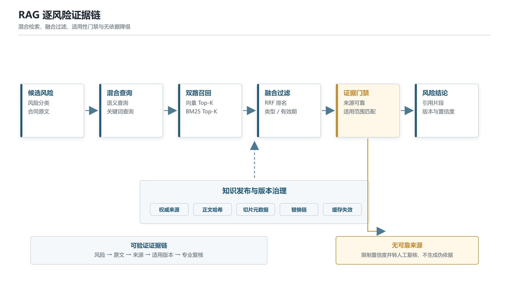

# 第九章 RAG 知识库与可验证证据链

## 9.1 建设目标

RAG 知识体系用于为候选风险提供可核验依据，并统一企业审查口径。它不是把文件批量向量化后直接交给模型，而是覆盖来源准入、结构化元数据、条文切片、双路召回、适用性过滤、版本替换、事务发布和质量评测的治理系统。

## 9.2 知识分类与来源等级

| 类别 | 示例 | 用途 | 可靠性规则 |
|---|---|---|---|
| 法律法规 | 民法典、数据安全法、个人信息保护法 | 正式法律依据 | 以国家法律法规数据库或发布机关正式文本为准 |
| 司法解释 | 合同编通则司法解释 | 解释适用与裁判规则 | 以最高人民法院正式发布为准 |
| 企业制度 | 采购、授权、财务、印章与数据制度 | 企业内部合规判断 | 需明确发布部门、适用组织和有效期 |
| 审查规则 | 金额、比例、日期、必要条款规则 | 确定性检测与风险分档 | 需有规则负责人、版本和测试用例 |
| 标准模板 | 采购、销售、服务等标准合同条款 | 条款缺失和偏离比较 | 需明确合同类型、立场和批准版本 |
| 案例材料 | 经筛选的裁判或内部复盘材料 | 辅助解释与场景提示 | 不冒充法律规范，隐私和商业信息先治理 |

正式依据优先使用法律法规、司法解释和有效企业制度。模板、规则与案例可以支撑建议或企业口径，但必须显示来源类型。来源不明、内容转载、版本无法确认或授权不清的材料不得发布到正式知识空间。

## 9.3 元数据模型

知识文档记录标题、来源机构、来源 URL 或文件编号、类别、法域、发布单位、版本、生效日期、失效日期、适用组织、合同类型、业务维度、密级、审核状态和替换关系。知识切片记录文档标识、条文编号、标题层级、正文、前后文、正文哈希、向量模型、向量维度和索引时间。

正文哈希用于重复检测与变更识别；条文编号和标题层级用于精确引用；生效和失效日期用于审查时点过滤；适用合同类型和维度用于减少语义相似但业务无关的误召回。元数据缺失的条目只能保留在草稿区。

## 9.4 切片策略

法律法规优先按“条”切片，保留章、节、条号和必要上下文；一条过长时按款项拆分，但每个子切片重复包含条号与上位标题。企业制度按编号条款或标题层级切分，模板按独立条款切分，案例按事实、争议焦点、规则和结论分段。切片不以固定字符数生硬截断法律语义。

切片正文应足以独立理解，不包含导航、页眉页脚、版权噪声或无关目录。表格内容转为带列名的结构化文本。每次处理保存解析器版本和质量结果，低质量扫描材料必须经过人工核对后发布。

## 9.5 混合检索

每条候选风险独立构造“风险分类 + 合同原文事实 + 必要合同类型”的查询。向量路由检索语义相关内容，BM25 路由检索法条编号、专有名词、主体和精确表达。两路各取候选集合后使用 Reciprocal Rank Fusion（RRF）融合：

`RRF(d) = Σ 1 / (k + rank_i(d))`

其中 `rank_i(d)` 为文档在第 i 路的排名，`k` 为降低头部排名差异的稳定常数。向量路由在进入融合前执行余弦相似度阈值，异常、空值、非有限或维度不一致的向量被丢弃并记录。RRF 分数只用于候选排序，不直接代表依据适用性或法律置信度。

## 9.6 适用性过滤与重排

融合候选依次经过来源可靠性、法域、审查时点、合同类型、业务维度、适用组织和知识状态过滤。失效法规可用于解释历史合同，但必须与合同审查时点匹配并标记历史版本；企业制度不得跨组织使用；案例与模板不得显示为法条。

过滤后根据查询与切片事实相关性、条文完整性、来源等级和元数据质量重排。最终返回内容、来源、条文编号、版本、有效期、检索模式、原始排名和融合分。前端展示可读依据，审计记录保存完整检索元数据。

## 9.7 逐风险证据链

候选风险产生后，系统不直接接受 Agent 在文本中给出的法条，而是重新独立检索。正式风险包含：合同版本与原文位置、风险事实、风险分类、检索查询、候选来源、适用性检查、采用依据、建议、置信度、规则/知识/模型版本和人工结论。

可靠来源存在且事实匹配时，依据进入正式风险；只有弱来源、适用范围不明或结果互相冲突时，系统保留候选但标记“需人工确认”；完全无可靠来源时输出“无可靠检索依据，请人工复核”，置信度不得高于人工复核阈值。任何内置兜底规则只能显示为“系统规则”，不得冒充法规或司法解释。

## 9.8 版本替换与影响分析

新知识通过草稿、审核、发布三个阶段。发布时在单一事务内写入文档、切片、向量、版本和替换关系；任何步骤失败则整体回滚，旧版本继续服务。发布成功后使相关检索缓存失效，并按合同类型、维度和审查时点计算可能受影响的历史合同范围。

知识失效不删除历史引用。历史风险继续绑定当时使用的版本，界面提示该依据状态；重新审查创建新结果并引用新版本。删除仅适用于未发布草稿或依法到期的数据清理，正式历史通过逻辑状态和保留策略管理。

## 9.9 缓存与故障处理

BM25 索引和检索缓存使用知识空间、版本与过滤条件作为键，文档正文哈希或发布版本变化时强制失效。Embedding 服务不可用时可构建无向量的文本索引并降级至 BM25，但响应必须标记检索模式。向量库不可用、结果全被阈值过滤或查询为空时，不回退到无法追溯的通用模型知识。

批量导入按文档事务隔离，某份文件失败不污染其他文档；同一正文哈希的重复导入遵循跳过、替换或新版本策略。索引与数据库不一致时，知识保持非发布状态并触发修复任务。

## 9.10 安全与责任边界

知识导入执行文件预检、权限检查、来源登记和敏感信息识别。不同组织、密级和适用范围的知识在检索前进行权限过滤，不能先召回再仅靠前端隐藏。用户上传的合同不得自动进入共享知识库，人工复核意见也不得未经审核自动改变生产规则。

知识服务提供依据而非裁决。引用正确率、适用性准确率和无依据降级率分别评测，防止“检索到了真实法条但用错场景”被算作成功。

## 9.11 验收标准

测试集覆盖精确条号、同义表达、跨条款问题、失效版本、错误法域、错误合同类型、企业制度隔离、空向量和服务故障。验收至少测量 Recall@K、MRR、引用真实性、适用性准确率、失效知识拦截率、无依据降级正确率和索引回滚一致性。每项指标的样本与阈值在第 14 章统一定义。
