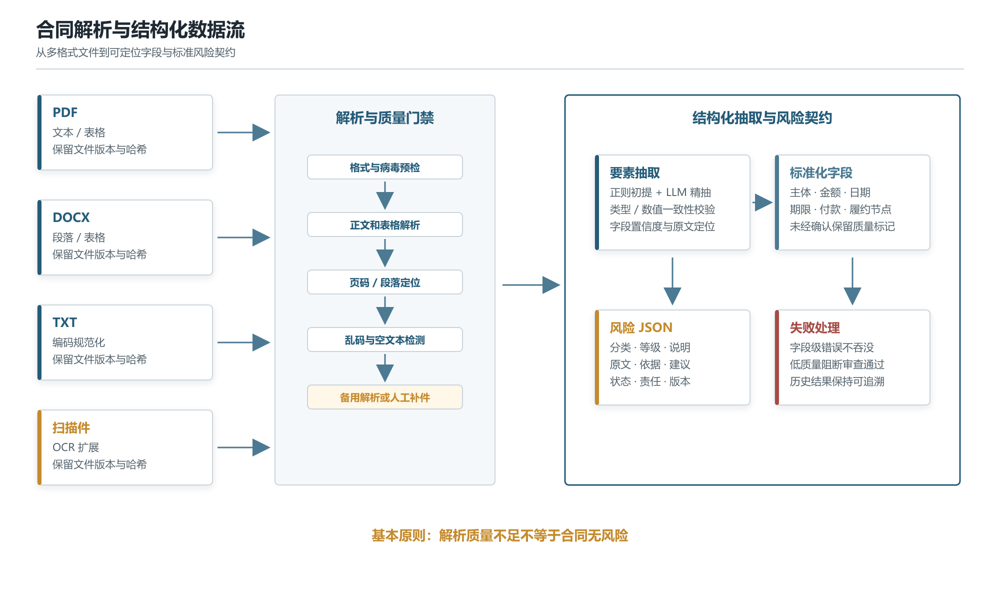

# 第十章 文档解析、要素抽取与风险识别

## 10.1 处理目标

文档处理链将 PDF、DOCX 和 TXT 转化为可定位文本、结构化要素和可验证风险。设计重点不是获得一段纯文本，而是保留页码、段落、表格单元格、标题层级和附件关系，使每个字段与风险都能回到原文。扫描件 OCR 作为扩展路径，低质量输入通过质量门禁进入人工处理。



## 10.2 文件预检

文件进入解析前校验扩展名、MIME、魔数、大小、密码保护、损坏、空白、宏与恶意内容，并计算 SHA-256 哈希。文件名只作为展示信息，不能决定真实格式。预检通过后加密存储原文件，解析器通过受控解密流读取，不在公共临时目录保留明文。

预检结果分为通过、需人工确认和拒绝。扩展名与内容不一致、文件损坏或命中恶意内容直接拒绝；密码保护或不支持格式提示用户处理；重复文件根据合同版本策略进行关联，不静默覆盖。

## 10.3 多格式解析

### 10.3.1 PDF

原生 PDF 优先提取文本层、字符坐标、页码、阅读顺序和表格。若文本为空、乱码比例高或字符覆盖率不足，切换备用解析器；仍不满足质量门槛时进入 OCR。OCR 记录分辨率、语言、页面置信度和人工核对状态，不能把空文本视为无风险。

### 10.3.2 DOCX

DOCX 解析段落、标题、页眉页脚、表格、批注与必要的文本框内容，保留文档顺序和表格坐标。重复页眉页脚在标准化视图中去除，但原文件保持不变。旧版 DOC 通过受控转换服务处理，转换失败不修改原文件。

### 10.3.3 TXT 与附件

TXT 检测 UTF-8、GB18030 等允许编码并统一为内部 Unicode。附件与主合同建立关系，按附件类型选择解析策略；报价表、技术规格和付款计划中的表格字段可参与一致性校验，但风险原文需标明附件名称和位置。

## 10.4 解析质量模型

质量报告包含字符覆盖、乱码比例、空白页、页面旋转、表格保留、标题层级、位置映射和 OCR 置信度。系统设置“可自动审查、需人工确认、不可继续”三级门槛。质量低时先让用户查看问题页面与建议操作，不继续消耗模型资源，也不输出误导性审查摘要。

## 10.5 要素模型

| 要素组 | 核心字段 | 标准化规则 | 证据要求 |
|---|---|---|---|
| 身份主体 | 甲方、乙方、统一社会信用代码、联系人 | 名称去空白但保留原值，代码校验长度与校验位 | 原文、页码或段落、候选列表 |
| 合同基本信息 | 编号、名称、类型、标的 | 类型映射受控字典，标的不做过度摘要 | 标题或正文证据 |
| 金额财税 | 总额、币种、税率、含税状态、发票 | 金额使用定点数，保留大小写与原单位 | 所有参与计算的原值 |
| 时间履约 | 签订、生效、期限、交付、验收 | 日期统一 ISO 形式，保留条件性表达 | 位置、触发条件和原文 |
| 付款节点 | 比例、金额、条件、期限、收款账户 | 节点有序，比例和金额分别校验 | 每个节点独立证据 |
| 责任条款 | 违约、赔偿、解除、争议、保密、知识产权 | 关联风险分类，不压缩掉限定条件 | 完整条款与必要上下文 |

每个字段包含标准值、原始值、位置、方法、置信度、确认状态和修改历史。多个候选值不得随意选择，进入人工确认队列。

## 10.6 混合抽取策略

第一步使用正则、词典和版面规则提取格式稳定字段，例如统一社会信用代码、金额、日期和明确标签后的主体。第二步由 LLM 处理别名、跨段标的、条件性付款和复杂期限，输入只包含必要片段并使用低随机性。第三步执行 JSON Schema 校验、类型转换、范围检查、实体归一和跨字段一致性检查。

LLM 输出只覆盖有充分证据且通过校验的字段，不用 `null` 覆盖规则结果。规则与模型值冲突时同时保留候选、证据和来源，关键字段交由人工确认。人工修正作为评测样本进入受控反馈池，不直接更新提示模板或生产规则。

## 10.7 一致性校验

确定性校验包括大小写金额一致、分项合计与总额一致、付款比例总和、税率与含税金额关系、结束日期与生效日期顺序、主体名称与收款账户关系、正文与附件的交付和验收条件一致性。校验结果展示参与比较的字段与原文，不只显示“数据异常”。

对于需要业务背景的校验，例如付款比例是否合理或赔偿上限是否可接受，系统只能形成候选风险并说明假设，不能把企业偏好写成普遍法律要求。

## 10.8 风险识别与结构

风险由确定性规则、法务 Agent、财务 Agent 和交叉验证产生，统一写入以下契约：

```json
{
  "contract_version_id": "CV-001",
  "category": "付款与验收联动",
  "level": "high",
  "agent": "finance",
  "original_text": "合同签订后五日内支付全部价款……",
  "location": {"page": 4, "paragraph": "4.2"},
  "fact": "全部价款早于交付与验收支付",
  "basis_ids": ["KC-104"],
  "suggestion": "将尾款与验收通过及合格发票挂钩",
  "confidence": 82,
  "tier": "red",
  "requires_manual_review": true
}
```

原文、事实与建议分开保存，避免建议被误认为合同事实。依据通过关联表绑定知识切片与版本，不只保存不可解析的字符串。模型原始输出、规范化结果和人工结论分别留存。

## 10.9 置信度校准

置信度综合模型自评、原文定位、字段一致性、依据可靠性、适用性、Agent 冲突和解析质量。模型自报高分不能覆盖无依据或低质量输入。存在无可靠来源、原文无法定位、知识失效、Agent 冲突或解析质量不足任一情形时，置信度上限受规则限制并要求人工复核。

发布阈值通过冻结验证集校准，不把所有合同统一使用同一阈值。高风险优先保证召回，低风险快速确认需同时具备较高精确率和完整证据。

## 10.10 错误分级与降级

| 级别 | 示例 | 系统处理 | 用户结果 |
|---|---|---|---|
| 阻断错误 | 文件损坏、恶意内容、无法解密 | 停止该文件处理 | 明确原因与可操作建议 |
| 质量错误 | OCR 低置信度、表格严重丢失 | 暂停智能审查 | 展示问题位置并请求确认 |
| 局部错误 | 个别字段无法抽取、单个 Agent 失败 | 保留其他结果，标记不完整 | 进入针对性人工复核 |
| 外部依赖错误 | 模型、Embedding、消息平台不可用 | 有限重试并按能力降级 | 显示降级范围和恢复状态 |
| 展示错误 | 导出失败、图表查询超时 | 不回滚审查数据 | 可重新生成或缩小查询范围 |

## 10.11 验收标准

解析测试覆盖原生 PDF、复杂 DOCX、表格合同、扫描件、旋转页、加密文件、损坏文件和多附件。抽取按字段计算精确率、召回率和 F1，并单独报告主体、金额、期限和付款节点。风险结构检查 JSON 合格率、原文定位率、依据关联完整率、置信度校准误差和人工队列命中。所有失败用例必须验证不会被错误展示为“未发现风险”。
