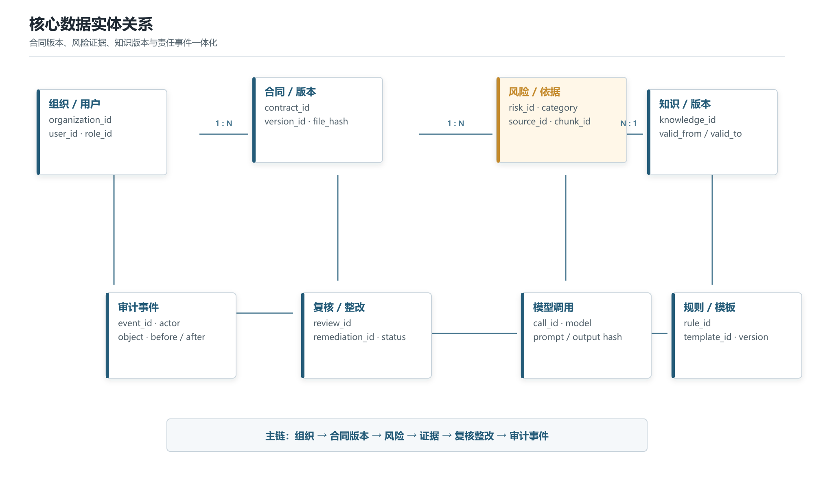
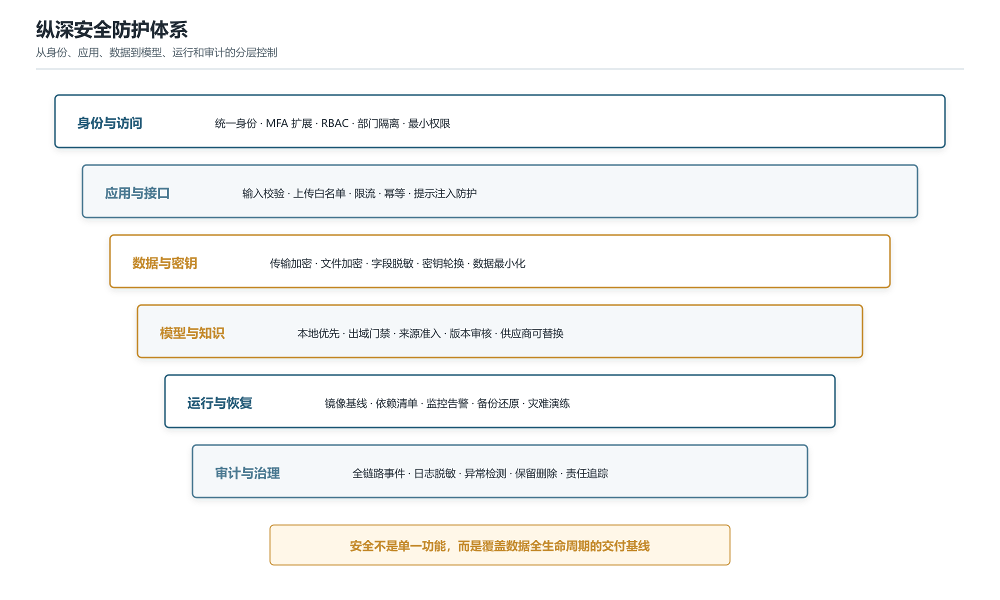

# 第十一章 数据库、权限与数据安全设计

## 11.1 设计原则

数据设计遵循业务对象稳定、历史不可覆盖、敏感最小暴露和全程可追溯。合同文件、解析结果、模型输出、人工结论与报表指标分别建模，通过合同版本和风险标识关联。安全设计覆盖采集、传输、存储、使用、共享、备份和销毁全过程，落实数据分类分级要求。[S05]

## 11.2 核心实体

| 实体 | 主键与关键字段 | 主要关系 | 索引建议 | 生命周期 | 敏感等级 |
|---|---|---|---|---|---|
| 用户与组织 | `user_id`、账号、角色、部门、状态 | 用户属于组织与部门，关联操作记录 | 账号唯一、组织部门组合 | 入职创建、变更留痕、离职禁用 | 中 |
| 合同 | `contract_id`、名称、类型、部门、经办角色 | 一份合同拥有多个不可变版本 | 部门、类型、创建时间 | 创建至保留期届满 | 高 |
| 合同版本 | `version_id`、文件哈希、存储对象、版本号、状态 | 属于合同，关联字段、风险和任务 | 合同+版本唯一、哈希 | 只增不改，依法清理 | 极高 |
| 合同字段 | `element_id`、字段名、标准值、原值、位置、置信度 | 属于合同版本，具备修正历史 | 版本+字段名、标准值 | 随版本归档 | 高 |
| 风险 | `risk_id`、分类、等级、事实、原文、位置、置信度 | 属于版本，关联依据、复核与整改 | 版本、等级、分类、状态 | 原始结果保留，状态通过事件变化 | 高 |
| 风险依据 | `risk_basis_id`、风险、知识切片、采用状态 | 风险与知识切片多对多 | 风险、切片、版本 | 随风险长期保留 | 中 |
| 知识文档与切片 | `knowledge_id`、来源、版本、有效期、正文哈希 | 文档拥有切片和替换链 | 来源+版本、哈希、适用范围 | 草稿、发布、失效、保留历史 | 中至高 |
| 整改 | `rectification_id`、风险、责任角色、期限、状态 | 关联风险、新版本与处置记录 | 状态、期限、责任部门 | 创建至关闭，历史保留 | 高 |
| 规则与模板 | `rule_id`、维度、等级、版本、状态 | 关联发布人与测试用例 | 维度、合同类型、状态 | 草稿、发布、停用 | 中 |
| 审计日志 | `audit_id`、主体、动作、对象、结果、时间、追踪号 | 关联用户与业务对象 | 时间、主体、动作、对象 | 防篡改保留，按策略归档 | 高 |
| 模型调用 | `call_id`、合同版本、Agent、模型、模板版本、耗时 | 关联任务与风险批次 | 版本、Agent、时间 | 脱敏后按审计策略保留 | 高 |
| 基础字典 | `lookup_id`、类别、值、排序、状态 | 被合同类型、部门等引用 | 类别+值唯一 | 版本化变更，不物理覆盖引用值 | 低 |

关系数据库使用外键、唯一约束、检查约束和事务维护一致性。金额采用定点数并带币种，时间采用带时区时间戳，枚举值由受控字典或数据库约束管理。大文本与向量不塞入单一业务行，避免影响高频查询。

## 11.3 历史与事件模型

合同版本、模型原始输出和知识版本不可被后续结果覆盖。人工复核、等级调整、忽略、整改和关闭使用事件或处置记录保存前后值、操作者、时间、理由和附件。业务表可以保留便于查询的最新状态，但状态必须能够由事件链还原。

删除采用分类策略：错误上传且未进入审查的文件可按授权删除；进入审查或形成决策依据的数据按合同档案和审计策略保留；个人信息删除请求需要评估法定义务和业务留存依据。物理删除同时清理对象、派生文本、向量、缓存和临时导出，并记录不可逆操作证据。

## 11.4 身份认证与访问控制

身份认证支持企业统一身份协议和受控本地账户。令牌设置签发者、受众、有效期和唯一标识，服务端固定允许算法并校验撤销状态。密码使用现代自适应哈希，连续失败触发速率限制或锁定；高权限和导出操作可启用多因素认证。

RBAC 定义业务人员、法务主管、财务主管、系统管理员和管理层的功能权限，并叠加组织、部门、合同密级、本人关系和临时授权形成数据范围。授权必须在接口和查询层执行，不能只隐藏前端菜单。临时授权包含目的、审批人、范围和过期时间。

| 操作 | 业务人员 | 法务主管 | 财务主管 | 系统管理员 | 管理层 |
|---|---|---|---|---|---|
| 上传本部门合同 | 允许 | 允许 | 按授权 | 运维授权时允许 | 不默认允许 |
| 查看完整法律风险原文 | 本部门且按字段策略 | 授权范围允许 | 仅相关风险 | 不因管理员身份默认允许 | 按审批钻取 |
| 复核法律风险 | 不允许 | 允许 | 协同意见 | 不允许 | 不允许 |
| 复核财务风险 | 不允许 | 协同意见 | 允许 | 不允许 | 不允许 |
| 发布正式知识 | 不允许 | 法律类审核 | 财务制度审核 | 执行发布但不代替内容审核 | 不允许 |
| 查看聚合报表 | 本部门 | 授权范围 | 授权范围 | 运行报表 | 允许 |
| 管理用户与配置 | 不允许 | 不允许 | 不允许 | 允许 | 不允许 |

## 11.5 文件与字段保护

传输统一使用 TLS，内部服务通信根据风险采用双向 TLS。合同原文件在写入对象存储前由应用加密，密钥托管在 KMS 或等效密钥服务，数据密钥与主密钥分离，支持轮换、禁用和审计。数据库敏感字段可采用列加密或令牌化，备份使用独立密钥加密。

脱敏按角色、目的和场景执行：列表可隐藏联系人与账户，管理层默认只看聚合值，业务人员查看风险原文时按职责显示必要片段，导出文件可移除非必要列。脱敏在服务端完成并标记，数据库保留原始值与访问审计，避免不可逆脱敏破坏专业复核。

## 11.6 模型数据边界

本地模型与离线 Embedding 优先部署在智能计算区，默认禁止公网访问。发送给模型的内容经过权限校验、最小上下文裁剪和必要脱敏，模型适配器不记录完整提示与回答到普通日志。使用外部模型需要独立的数据保护评估、合同约束、字段白名单和用户授权策略。

合同文本、用户输入和使用记录按个人信息与商业秘密要求保护。[S02][S06] 模型供应商、模型版本、提示模板、知识版本、调用时间、耗时和结果批次进入脱敏调用记录。训练或微调数据需另行审批，不因用户使用系统而默认获得二次训练授权。

## 11.7 审计追踪

审计记录覆盖登录、失败认证、上传、下载、查看敏感原文、审查、复核、等级变更、忽略、整改、知识发布、权限变更、模型配置、导出、备份和删除。记录主体、动作、对象、结果、来源地址、时间、追踪号和必要摘要，不记录密码、令牌、密钥或非必要全文。

高价值审计日志采用追加写、防篡改存储或哈希链，并与普通应用日志分离。查询审计日志本身也记录。告警场景包括连续越权、异常批量下载、非工作时间高权限访问、密钥错误、知识异常发布和大量模型失败。

## 11.8 备份、恢复与删除

关系数据库执行全量与增量备份，对象存储启用版本或不可变策略，知识索引可由源数据重建。备份定期验证可读性并进行恢复演练，恢复点目标和恢复时间目标按部署等级定义。恢复后校验合同版本、风险、整改、审计序列和对象哈希一致性。

临时上传、解析缓存和导出文件设置短保留期自动清理；正式合同、风险与审计按企业档案制度保留。清理任务先生成清单并校验作用域，批量删除需双人审批，删除后输出对象数量、范围和结果证据。

## 11.9 供应链与运行安全

依赖、容器镜像和模型文件锁定版本并校验来源与哈希，构建产物生成软件物料清单。高危漏洞评估影响后再升级，不能在交付环境自动拉取未知最新版本。密钥、许可证和 API Token 通过秘密管理注入，不写入代码、镜像或文档。

生产环境禁用调试模式和默认密钥，收紧 CORS、上传大小与管理端口。服务账号最小权限运行，容器只读文件系统与资源限额按组件配置。安全事件具备发现、隔离、取证、恢复和复盘流程。

## 11.10 安全验收

验收覆盖认证绕过、水平与垂直越权、部门隔离、对象直接引用、恶意文件、明文落盘、日志泄密、密钥缺失、导出越权、模型提示注入、知识污染、备份恢复和删除完整性。任何仅在前端限制、普通日志出现合同全文或默认生产密钥可用，均判定为 P1 安全失败。
