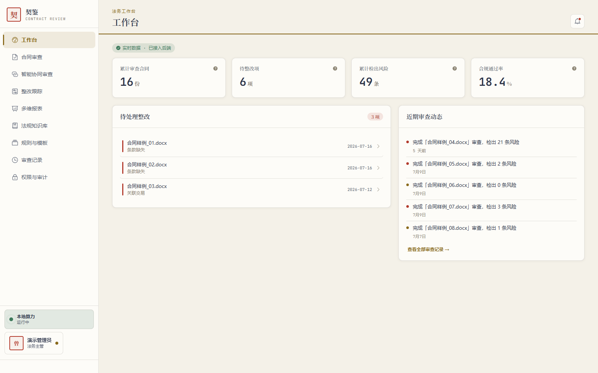
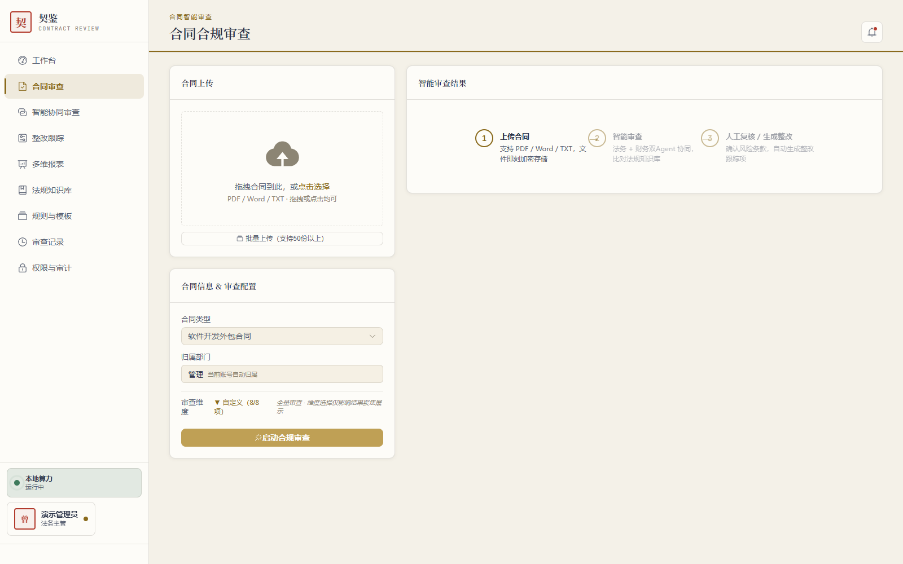
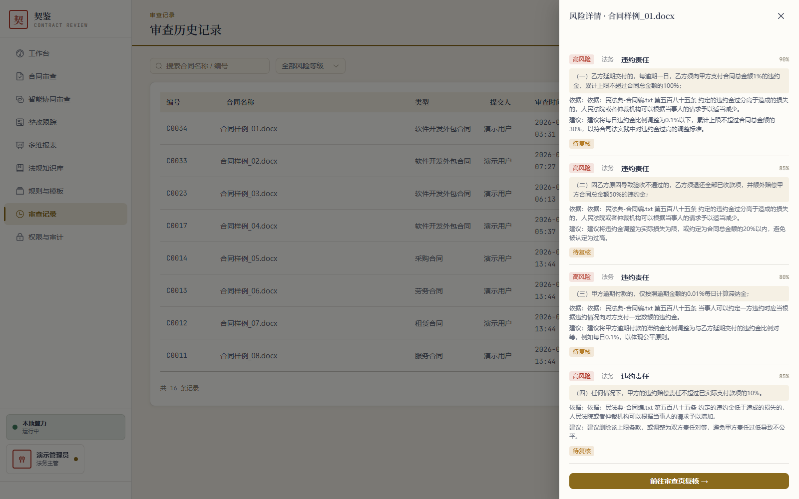
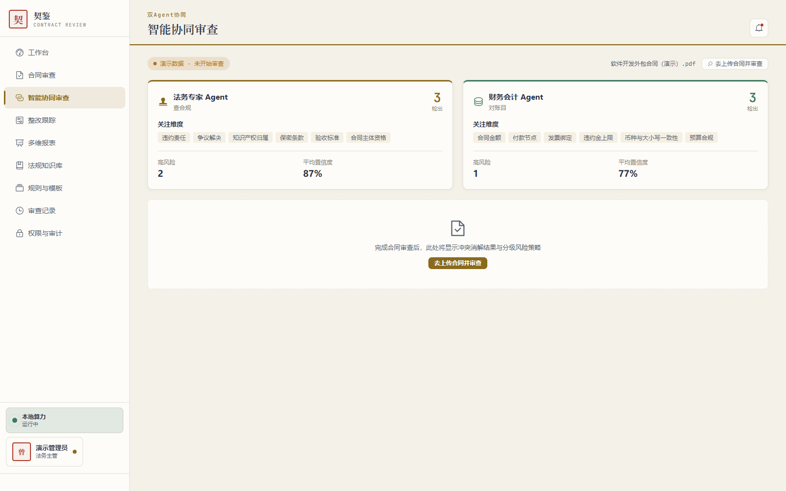
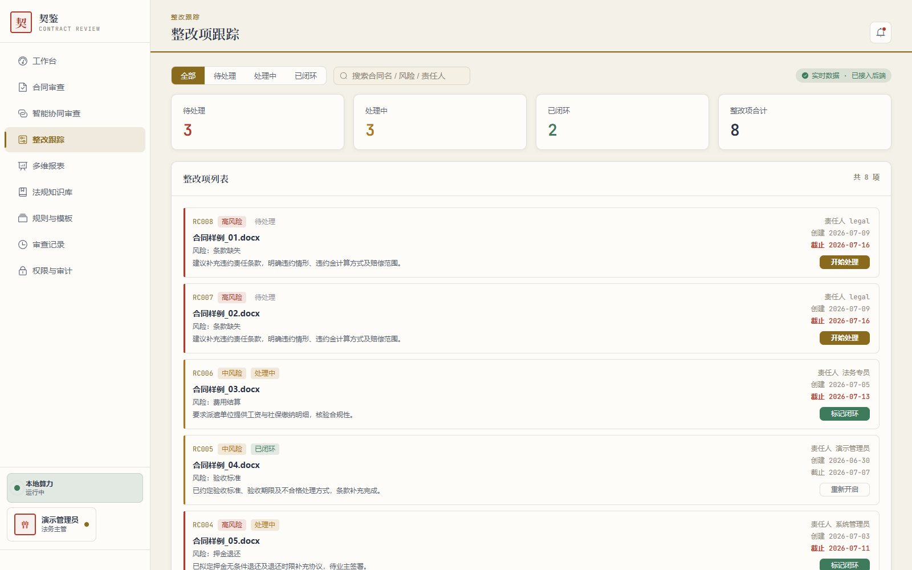
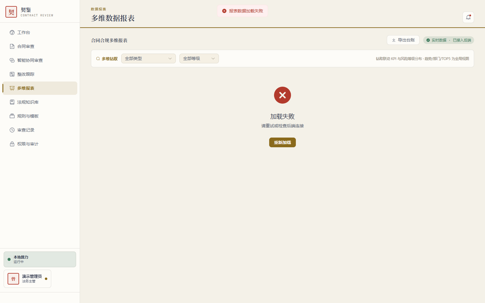
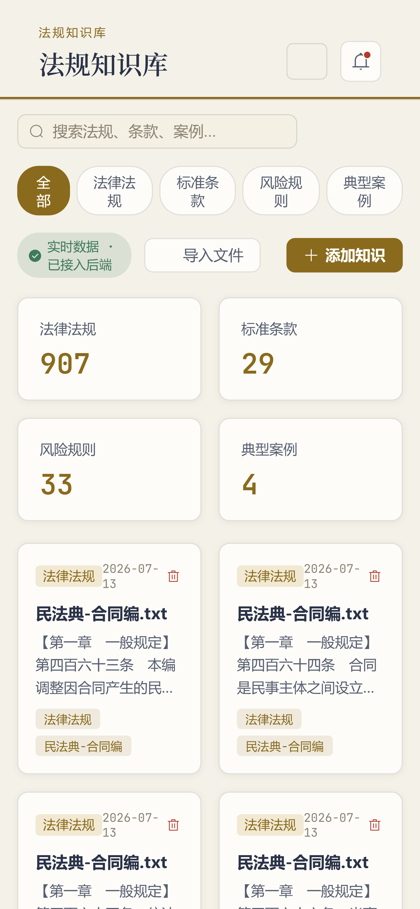
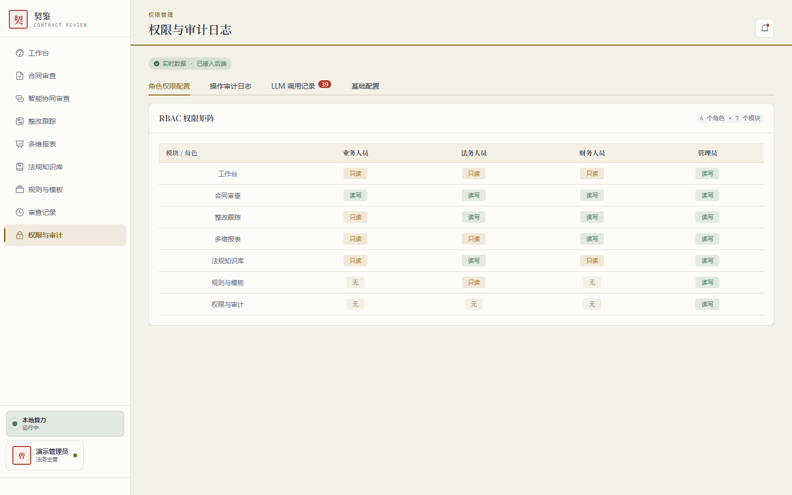

# 第十二章 前端交互与关键页面设计

## 12.1 设计目标

交互设计服务于高频、严谨和可追踪的专业作业。界面应让用户迅速判断任务处于哪个阶段、最重要的风险在哪里、结论依据是什么、下一步由谁处理。视觉采用克制的蓝灰体系，高风险使用红色、提醒使用琥珀色、完成使用绿色，但颜色不作为唯一信息载体。

## 12.2 信息架构

| 一级入口 | 核心对象 | 主要任务 | 默认角色 |
|---|---|---|---|
| 工作台 | 待办、近期合同、风险与整改摘要 | 进入高优任务、查看个人和部门态势 | 全部角色，内容按角色变化 |
| 合同审查 | 批次、合同版本、字段与风险 | 上传、查看进度、复核和发起整改 | 业务、法务、财务 |
| 协同分析 | Agent 结果、冲突与联合风险 | 对比专业意见、处理冲突 | 法务、财务 |
| 整改 | 整改任务、期限、责任和证据 | 认领、处理、提交新版本、复核关闭 | 业务、法务、财务 |
| 报表 | 指标、趋势、明细和导出 | 筛选、钻取、分析和下载 | 主管、管理层 |
| 知识库 | 文档、切片、版本和发布状态 | 导入、审核、发布、替换和失效 | 授权知识角色 |
| 历史 | 合同、审查批次和处置记录 | 检索、比较、查看证据链 | 授权用户 |
| 规则 | 审查规则与合同模板 | 配置、测试、发布和停用 | 管理员与专业审核角色 |
| 系统管理 | 用户、角色、字典、模型和日志 | 配置、监控、审计和告警 | 系统管理员 |

导航按权限过滤，但服务端仍是授权决策来源。页面标题使用业务语言，不展示无助于决策的模型内部步骤。专业术语首次出现时通过字段说明或上下文解释，不用长篇操作教程占据工作区。

以下界面图用于表达目标交互、信息层级与状态规则，统一作为设计示意，不作为实施状态证明。

## 12.3 工作台

工作台按角色呈现稳定布局。法务主管优先看到待复核高风险、冲突和整改超期；财务主管优先看到金额、付款、税务和结算事项；业务人员看到本人提交任务与待整改；系统管理员看到服务健康、任务积压和安全告警；管理层看到聚合趋势与重大事项。

指标卡必须能钻取到相同口径的明细列表，悬停或信息按钮显示统计口径与时间范围。无数据时展示空状态和可执行入口，不使用固定数值。加载时保留稳定骨架，避免卡片尺寸跳动。

## 12.4 合同审查工作区

审查页采用“任务设置—处理进度—风险复核”连续工作流。上传区支持拖拽和文件选择，文件进入队列后逐项显示名称、类型、大小、校验、阶段和失败原因。批量提交后允许离开页面，返回时从服务端恢复状态。

结果区提供审查摘要、关键字段和风险列表。风险列表按等级、专业、分类、状态和置信度筛选，高风险默认置顶。点击风险打开固定宽度详情区，呈现完整原文、位置、事实说明、依据版本、Agent 意见、建议、置信度解释和人工动作。原文与依据支持跳回文档位置，不能只显示截断摘要。

## 12.5 协同与整改

协同分析页以“差异和决策”为中心，不展示装饰性的 Agent 工作动画。对同一原文的法务、财务意见并列呈现，冲突类型、共同事实和待决问题清晰标注。处理动作包含选择结论、合并为复合风险、补充背景和提交联合复核，必须记录理由。

整改页按待处理、处理中、待复核、已关闭组织，支持责任、期限、等级和部门筛选。卡片或表格显示合同、风险、建议、责任角色、剩余时间和版本。提交新版本时明确说明将触发的差异分析和再审范围；关闭前展示必要证据检查清单。

## 12.6 报表与知识库

报表页使用固定筛选区和可钻取图表，图表提供文本摘要、图例和数据表替代视图。筛选条件在图表与导出间保持一致，导出前显示范围、字段和敏感信息提示。大数据量导出显示后台任务状态，不让浏览器长期阻塞。

知识库列表突出来源、类别、版本、有效期、适用范围和发布状态。导入过程分为文件校验、元数据填写、解析预览、审核发布，不将“上传成功”等同于“正式生效”。版本详情展示替换关系和受影响范围；失效知识保留历史引用但不能进入新的正式依据。

## 12.7 状态设计

| 状态 | 设计规则 | 示例动作 |
|---|---|---|
| 正常 | 主任务与关键结果优先，次要配置收纳 | 查看风险、确认、发起整改 |
| 加载 | 使用稳定骨架或阶段进度，保留页面结构 | 显示解析、抽取、审查当前阶段 |
| 空 | 说明对象为空并提供符合权限的下一步 | “暂无待复核风险”，进入合同审查 |
| 错误 | 说明发生环节、影响范围和恢复方式 | 单文件重试、重新连接、联系管理员 |
| 权限不足 | 不泄露对象是否存在，说明申请路径 | 返回授权入口或工作台 |
| 批量部分失败 | 成功与失败分组，支持失败项批量重试 | 下载失败清单、移除或补件 |
| 降级 | 明确未执行的能力和结果限制 | “向量检索不可用，已使用关键词检索” |
| 冲突 | 同时保留不同意见，不用单一颜色掩盖 | 查看差异、补充事实、联合复核 |

错误提示不得暴露密钥、服务器路径或堆栈。所有可重试操作需防止重复提交；按钮在请求中保持稳定尺寸、显示忙碌状态并禁用重复点击。

## 12.8 关键组件规则

风险等级使用图标、文字和颜色共同表达；置信度显示数值、档位和限制原因，不使用没有口径的进度条。操作按钮采用明确动词，常用图标配工具提示。表格支持键盘导航、排序、筛选和列宽控制；长原文允许展开或侧栏查看，不把重要文本永久截断。

确认、忽略、下调等级、关闭风险、发布知识、变更权限和导出敏感数据属于高影响操作。确认对话框说明对象、影响和必要理由，危险动作与普通动作视觉区分。成功提示简短，结果同时反映在页面状态中，不能只依赖瞬时消息。

## 12.9 响应式设计

1440px 为主要专业工作区：侧栏、主内容和详情抽屉保持稳定，表格允许列配置。2560px 不无限拉宽正文，使用最大内容宽度和更宽的数据表区域，避免文字行过长。390px 以查看待办、上传进度、风险摘要和整改操作为主，复杂表格转换为分组列表，详情抽屉改为全屏层。

固定格式元素使用稳定尺寸和响应式约束：图表设最小高度，工具栏允许换行，图标按钮保持触控面积，风险等级与数量不因内容变化移动。所有视口均不得出现页面级非预期横向滚动，长合同编号和 URL 使用安全换行。

## 12.10 无障碍要求

所有交互可通过键盘完成，焦点顺序与视觉顺序一致，模态框打开后焦点进入、关闭后回到触发元素。图标按钮具有可读名称，表单控件关联标签和错误说明，异步结果使用适当的可访问状态通知。文字和背景满足 WCAG AA 对比度目标，焦点样式清晰可见。

触控目标建议不小于 44×44px；不能仅用颜色表达等级、成功或失败；图表提供文本摘要和数据表；动画尊重减少动态效果偏好。中文长文本、英文标识和连续数字均应在容器内换行或截断并提供完整值查看方式。

## 12.11 交互验收

界面验收覆盖登录、工作台、合同审查、风险复核、协同分析、整改、报表、知识库和权限管理。每类页面至少检查正常、加载、空和错误状态；全局检查权限不足、批量部分失败和降级状态。分别在 390px、1440px、2560px 验证布局、文本、触控、键盘、焦点、对比度和横向溢出，并保存截图与自动化结果作为证据。
