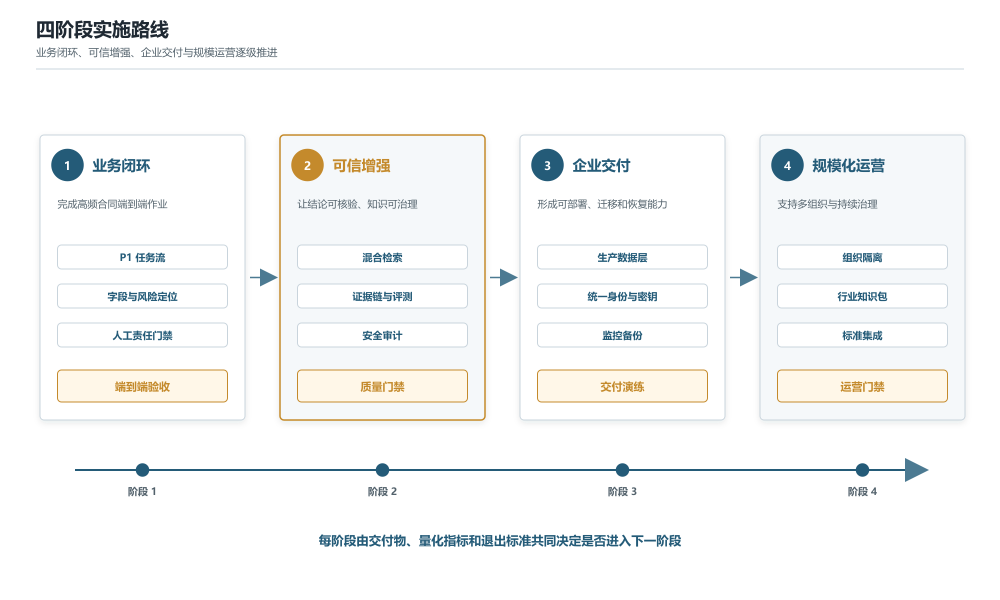

# 第十三章 项目实施计划、资源配置与难点管理

## 13.1 实施原则

项目采用阶段化交付与指标门禁。每个阶段只在前一阶段的数据契约、质量基线和风险措施满足退出标准后扩大范围。实施顺序遵循“先闭环、再可信、后交付、再规模化”，避免同时扩张合同类型、模型、组织和外部集成导致问题无法定位。

## 13.2 团队角色

| 角色 | 主要职责 | 关键产出 |
|---|---|---|
| 项目负责人 | 范围、里程碑、资源、风险与跨方协调 | 项目计划、决策记录、阶段验收 |
| 产品经理 | 用户任务、业务规则、优先级和验收口径 | 需求基线、流程、指标字典 |
| 法务专家 | 法律知识、审查规则、风险分档和专业验收 | 法源清单、规则样本、复核标准 |
| 财务专家 | 金额、税务、付款和结算规则 | 财务规则、字段口径、专业样本 |
| 前端工程师 | 信息架构、任务交互、状态与可访问性 | 页面、组件、前端自动化测试 |
| 后端工程师 | 业务服务、数据、权限、任务和接口 | API、数据迁移、审计与集成 |
| 算法工程师 | 解析、抽取、Agent、RAG 和评测 | 模型适配、检索、评测报告 |
| 测试工程师 | 测试设计、数据集、自动化和缺陷管理 | 测试用例、结果、验收证据 |
| 运维安全工程师 | 部署、监控、密钥、备份和安全验证 | 部署包、运维手册、安全记录 |
| 文档与展示角色 | 方案、用户文档、演示叙事与材料一致性 | 详细方案、操作说明、演示材料 |

职责可由同一成员兼任，但专业审核和高风险决策保持职责分离。团队信息只以角色表达，项目资料不写个人姓名。

## 13.3 第一阶段：业务闭环

**目标：** 建立合同接入、解析、抽取、双 Agent 审查、人工复核、整改和基础台账的端到端链路。

**范围：** 覆盖代表性合同类型和 P1 功能；建立用户、合同版本、字段、风险、整改和审计核心模型；完成基础权限与文件保护。

**角色与资源：** 项目负责人协调范围；产品、法务、财务冻结业务对象和样本；前后端实现主流程；算法完成解析与审查基线；测试建立可重复数据集。需要开发环境、本地模型算力、关系数据库和受控文件存储。

**依赖：** 赛题指标解释、合同类型优先级、字段字典、风险分类、样本授权与本地算力环境。

**里程碑：** 需求基线评审、数据契约评审、单份闭环、批量闭环、P1 验收。

**交付物：** 需求与流程说明、核心 API、数据库基线、前端任务流、解析与审查能力、基础测试报告和演示脚本。

**退出标准：** 主流程在正常与关键异常场景下可完成；批量单文件失败隔离；高风险必须人工处理；字段和风险具有原文证据；P1 缺陷关闭或具备批准的规避方案。

## 13.4 第二阶段：可信增强

**目标：** 提升依据可靠性、知识治理、模型可评测性和安全审计能力。

**范围：** 混合检索、适用性过滤、知识版本替换、逐风险证据链、Agent 冲突处理、模型评测、合同版本再审、字段脱敏和审计告警。

**角色与资源：** 法务与财务审核知识元数据和评测标注；算法建设 BM25、向量、RRF 与校准；后端完善版本与事务；测试开展 AI、RAG、安全和可靠性测试；安全角色审阅模型数据边界。

**依赖：** 稳定风险契约、来源清晰的知识材料、冻结验证集、评测工具和安全分级策略。

**里程碑：** 知识准入评审、混合检索基线、证据链闭环、模型评测门禁、安全审查。

**交付物：** 知识治理规范、检索服务、模型评测结果、版本影响分析、安全配置基线和审计方案。

**退出标准：** 正式依据通过来源与适用性检查；失效知识被拦截；无可靠来源正确降级；模型切换使用相同评测口径；越权、日志泄密和模型提示注入等 P1 安全项通过。

## 13.5 第三阶段：企业交付

**目标：** 将系统形成可安装、可迁移、可监控、可恢复的私有化交付能力。

**范围：** PostgreSQL 迁移、对象存储、异步任务、反向代理、统一身份、密钥管理、备份恢复、监控告警、容量测试与安装升级。

**角色与资源：** 后端与运维完成迁移和部署；安全角色配置网络、密钥与账号；测试执行性能、可靠性和恢复演练；产品与客户侧角色确认组织、权限和接口映射。需要目标服务器、隔离网络、存储、备份和监控设施。

**依赖：** 目标环境清单、网络与安全要求、身份协议、数据迁移范围、容量估算和外部系统接口人。

**里程碑：** 环境评审、部署演练、数据迁移演练、身份与接口联调、恢复演练、试运行验收。

**交付物：** 安装包、配置模板、数据库迁移、接口文档、运维手册、备份恢复方案、安全检查记录和培训材料。

**退出标准：** 全新安装与升级可重复执行；迁移前后数据校验一致；备份可恢复；关键告警可触达；性能达到目标环境 SLA；默认密钥、调试模式和非必要公网访问均被移除。

## 13.6 第四阶段：规模化运营

**目标：** 支撑多组织、行业知识扩展、持续评测和企业系统生态。

**范围：** 多组织隔离、配置继承、行业知识包、模型评测平台、运营指标、OA/ERP/电子签约集成和持续发布机制。

**角色与资源：** 产品定义标准化与配置边界；专业角色维护行业知识；研发建设租户、配置与集成能力；测试维护回归与模型基准；运维建立发布、容量和成本治理。

**依赖：** 企业交付模板稳定、数据治理制度成熟、组织隔离模型评审通过、外部系统契约稳定。

**里程碑：** 多组织基线、首个行业知识包、持续评测门禁、标准集成适配器、运营复盘机制。

**交付物：** 组织隔离方案、知识包规范、评测平台、集成适配器、发布策略和运营看板。

**退出标准：** 组织间数据与知识隔离通过测试；知识包可安装、升级与回滚；模型或规则变更必须经过基准评测；外部接口故障不破坏核心业务数据。

## 13.7 阶段总览

| 阶段 | 核心目标 | 关键门禁 | 主要证据 |
|---|---|---|---|
| 业务闭环 | 能完成合同风险作业 | P1 流程、字段证据、人工责任 | 端到端用例、业务数据与日志 |
| 可信增强 | 结论可核验、知识可治理 | 引用、适用性、降级与安全 | AI/RAG 评测、安全测试 |
| 企业交付 | 可部署、迁移、恢复和运维 | 安装、迁移、性能、备份恢复 | 部署记录、演练报告、监控 |
| 规模运营 | 可复制、隔离和持续演进 | 多组织、知识包、持续评测 | 隔离测试、发布门禁、运营指标 |

## 13.8 难点管理

| 难点 | 早期信号 | 处理策略 | 责任角色 |
|---|---|---|---|
| 合同样本代表性不足 | 指标在单一模板很高、换类型骤降 | 按类型、难度和风险分层，保留盲测集 | 产品、专业、测试 |
| 专业标注不一致 | 法务或财务对同一风险分歧高 | 制定标注指南，双人标注与仲裁 | 专业角色、测试 |
| 模型输出波动 | JSON 失败、同样本结果不稳定 | 固定参数、契约校验、回归评测和降级 | 算法、后端 |
| 知识失效或污染 | 来源不明、版本混用、召回异常 | 准入审核、有效期、替换链和发布事务 | 专业、管理员 |
| 私有化环境差异 | 驱动、算力、网络和存储不一致 | 环境清单、预检脚本、容量基线与演练 | 运维、算法 |
| 范围持续扩张 | P1 未稳定即增加行业和集成 | 变更评审，按阶段门禁控制 | 项目负责人、产品 |

## 13.9 项目治理

需求、架构、数据、模型、知识和测试使用统一版本基线。重大决策记录背景、选项、影响和批准角色；范围变更同时更新需求、接口、迁移和测试。每个里程碑评审未解决风险、指标趋势、缺陷分布和下一阶段依赖，未达到退出标准时优先修复根因，不以演示绕过门禁。
