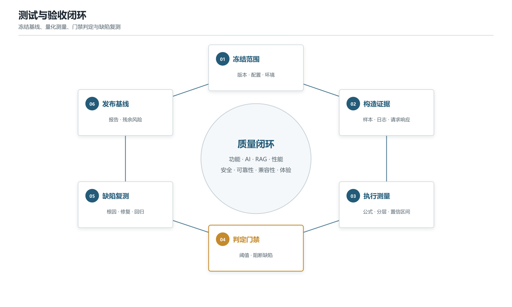

# 第十四章 测试方案与验收体系

## 14.1 测试目标与原则

测试用于证明系统在明确样本、环境和口径下满足功能、AI 效果、RAG、性能、安全、可靠性、兼容性和体验要求。详细方案定义方法与阈值，正式结果由独立测试报告记录。所有 AI 指标同时报告总体与分层结果，测试集冻结并与训练、调参数据隔离。

## 14.2 测试分层

| 层级 | 测试对象 | 主要方法 | 证据形式 |
|---|---|---|---|
| 单元 | 规则、解析函数、权限决策、状态转换 | 自动化输入输出与边界值 | 测试日志、覆盖率、失败样本 |
| 组件 | 解析器、模型适配、检索、存储、导出 | 固定夹具、故障注入、契约测试 | 组件报告、结构化结果 |
| 集成 | API、数据库、队列、模型、对象存储 | 真实依赖或等价隔离环境 | 请求响应、事务与追踪记录 |
| 端到端 | 用户核心任务 | 浏览器自动化和业务数据校验 | 截图、视频、下载文件、审计日志 |
| 验收 | 赛题指标与企业门槛 | 冻结环境、盲测样本、专业复核 | 签署的测试报告与问题清单 |

## 14.3 测试数据集

数据集按合同类型、来源格式、页数、扫描质量、条款复杂度、风险等级和专业维度分层。包含正常、缺失、矛盾、模糊、跨条款、跨附件、对抗文本和无风险对照。个人信息和商业秘密经授权、脱敏或合成处理，合成样本明确标记，不与真实业务分布混淆。

标注对象包括字段标准值、原文位置、风险事实、风险类别、等级、适用依据和人工结论。关键样本由法务或财务双人独立标注，分歧经过仲裁并记录。验证集用于阈值校准，盲测集只用于正式验收。

## 14.4 功能测试

功能测试覆盖登录、上传、预检、解析、抽取、审查、复核、冲突、整改、知识、报表、导出、历史、规则和系统管理。每项 P1 需求至少验证正常、异常、权限和幂等路径。

| 场景 | 核心判定 |
|---|---|
| 单份与批量上传 | 文件状态独立、重复提交幂等、刷新可恢复 |
| 解析与抽取 | 位置可回溯、低质量输入被拦截、字段修正留痕 |
| 双 Agent 审查 | 职责分工、共享上下文、冲突保留和降级明确 |
| 复核整改 | 状态转换合法，高风险忽略与关闭有理由和证据 |
| 知识发布 | 审核、有效期、替换链、事务回滚和缓存失效正确 |
| 报表导出 | 指标与明细一致、筛选继承、权限与水印有效 |

P1 用例通过率要求为 100%，P2 用例通过率不低于 95%；任何导致数据泄露、历史覆盖、错误自动关闭高风险或主流程不可用的缺陷均阻断验收。

## 14.5 要素抽取指标

字段级精确率 `Precision = TP / (TP + FP)`，召回率 `Recall = TP / (TP + FN)`，`F1 = 2 × Precision × Recall / (Precision + Recall)`。文本字段采用标准化后完全匹配和可解释的宽松匹配双口径，金额、日期和比例按标准值匹配，原文位置单独计算。

| 指标 | 目标阈值 | 判定规则 | 证据 |
|---|---:|---|---|
| 关键要素宏平均 F1 | ≥ 90% | 对字段分别计算后等权平均 | 字段级混淆表与错误清单 |
| 核心字段召回率 | ≥ 95% | 主体、金额、期限、付款节点分别报告 | 分字段结果 |
| 任一核心字段 F1 | ≥ 85% | 防止总体平均掩盖短板 | 最低字段结果 |
| 原文定位准确率 | ≥ 95% | 位置指向包含标准答案的页/段/单元格 | 定位比对记录 |
| 原生文档字符覆盖率 | ≥ 98% | 抽取有效字符/标准有效字符 | 解析差异报告 |
| 清晰扫描件 OCR 字符准确率 | ≥ 95% | 正确字符/标准字符 | OCR 对齐报告 |

## 14.6 风险识别与证据指标

风险级匹配由风险类别、事实对象和原文位置共同确定，不能仅按文字相似判断。高风险优先控制漏检，同时限制误报。

| 指标 | 目标阈值 | 判定规则 |
|---|---:|---|
| 高风险召回率 | ≥ 90% | 正确识别高风险/标准高风险 |
| 全部风险精确率 | ≥ 80% | 正确风险/系统输出风险 |
| 风险分类准确率 | ≥ 85% | 分类正确的匹配风险/匹配风险 |
| 原文引用正确率 | ≥ 95% | 引用真实存在且支持风险事实 |
| 建议可执行率 | ≥ 85% | 专业人员判定建议明确且与风险对应 |
| 高风险人工队列命中率 | 100% | 所有高风险均要求人工动作 |

若同一标准风险被拆成多条，按去重规则只计一次 TP，多余项计 FP；若一条输出混合多个标准风险，需按事实拆分评估。不同专业标注分歧不直接算模型错误，先进入仲裁。

## 14.7 RAG 指标

`Recall@K` 衡量前 K 个候选是否覆盖标准依据，`MRR = mean(1 / rank)` 衡量首个相关依据排名。引用真实性要求来源与内容可核验，适用性要求法域、合同类型、组织和有效期正确。

| 指标 | 目标阈值 | 失败判定 |
|---|---:|---|
| Recall@5 | ≥ 90% | 标准依据未进入前五候选 |
| MRR | ≥ 0.75 | 相关依据排名持续靠后 |
| 引用真实性 | 100% | 来源或条文不存在即阻断 |
| 适用性准确率 | ≥ 95% | 失效、错误法域或错误组织依据被采用 |
| 失效知识拦截率 | 100% | 失效知识进入新审查正式依据 |
| 无依据降级正确率 | 100% | 无可靠来源仍输出确定性法条或高置信度 |

## 14.8 性能与容量测试

性能环境冻结 CPU、内存、存储、模型、并发、文件集和网络。报告 P50、P95、最大值、吞吐和失败率，不只报告平均值。预热与冷启动分别测量。

| 指标 | 目标阈值 | 测量方式 |
|---|---:|---|
| 普通 API P95 | ≤ 1s | 不含长任务的授权查询与写操作 |
| 单份标准合同首轮结果 P95 | ≤ 180s | 从提交成功到风险清单可查看 |
| 批量处理能力 | 满足赛题批量要求 | 固定合同集，单文件失败隔离 |
| 任务成功率 | ≥ 98% | 有效任务成功数/有效任务总数 |
| 大文件处理 | 不发生进程崩溃或内存失控 | 分页/流式处理与资源监控 |
| OpenClaw 对照 | 核心延迟或吞吐改善达到赛题目标，质量下降受限 | 同样本、同口径、同并发对比 |

对照测试必须记录硬件、模型量化、上下文长度、批大小和质量指标，避免把不同配置的结果直接比较。

## 14.9 安全测试

安全测试覆盖认证、会话、RBAC、部门隔离、对象直接引用、文件上传、加密、脱敏、日志、密钥、接口签名、提示注入、知识污染、依赖与镜像。使用自动扫描与人工验证结合，任何高危漏洞、跨部门读取、明文合同落盘、生产默认密钥或日志泄露令牌均阻断验收。

证据包括请求响应、数据库与对象检查、日志片段、配置扫描、依赖清单和修复复测。测试账号和数据使用独立环境，不对生产数据执行破坏性安全测试。

## 14.10 可靠性测试

通过故障注入验证模型、Embedding、队列、数据库、对象存储和外部系统不可用。检查有限重试、幂等、降级标记、单文件隔离、事务回滚、积压恢复和审计完整性。备份恢复需要在隔离环境实际还原，并比较合同版本、风险、整改、审计序列和文件哈希。

核心数据 RPO 与 RTO 由企业部署等级确定；比赛交付至少证明备份可读、恢复流程可执行、恢复后数据一致。任何故障导致历史结果被覆盖或显示错误“审查通过”，均阻断验收。

## 14.11 兼容性与体验测试

兼容性覆盖主流 Chromium 浏览器和企业指定浏览器，文档覆盖 PDF、DOCX、TXT 及扫描扩展。界面在 390px、1440px、2560px 检查布局、文本、触控和横向溢出。体验测试覆盖正常、加载、空、错误、权限不足、批量部分失败和降级状态。

键盘可达率目标 100%，焦点可见且顺序正确；关键文字与背景达到 WCAG AA 对比度目标；图标按钮有可访问名称；触控目标不小于设计门槛。自动化检查不能替代人工使用核心任务。

## 14.12 验收判定与报告

正式验收前冻结版本、配置、数据集和环境。单项指标达到阈值且无阻断缺陷才判定通过；阈值附近结果报告置信区间和样本分层，不通过指标不得用另一项平均值抵消。测试报告记录方法、环境、样本版本、结果、失败案例、缺陷、复测与残余风险，确保结果可复现。
