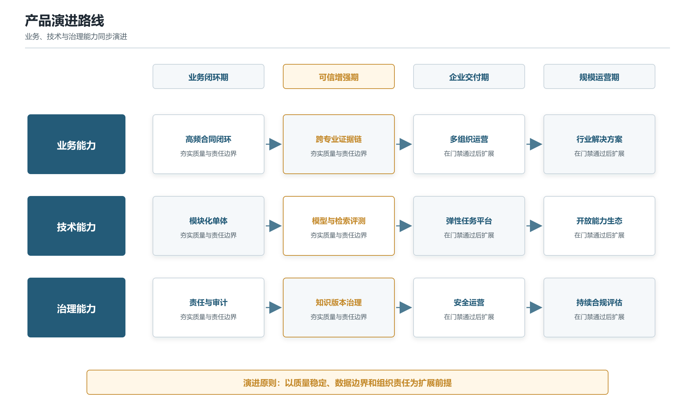

# 第十六章 项目价值、商业模式与发展规划

## 16.1 企业效率价值

系统把文件预检、正文解析、字段摘录、规则核对、依据查找和台账更新组织为自动化流水线，让专业人员把时间集中在交易背景、重大风险和谈判决策。价值通过同口径前后对比验证：单位合同人工处理时间、批量积压时长、重复录入次数、整改往返次数和报表生成时间。

效率提升不以取消人工复核为前提。高风险和不确定事项仍由人处理，系统主要减少重复步骤并提高材料准备质量。

## 16.2 风险控制价值

法务与财务双 Agent 将跨专业风险显式化，逐风险证据链使结论能够回到原文、依据和版本，整改闭环把审查意见转化为责任任务。风险价值通过高风险召回、签署前发现比例、重复风险趋势、整改超期和审计还原时间评估，不以“零风险”作不现实承诺。

## 16.3 管理与数据价值

合同字段、风险、整改和履约节点形成统一数据模型，使管理层能够按部门、合同类型、相对方、金额、时间和状态分析。数据价值体现在口径统一、字段复用、明细可钻取和决策可追溯。未经确认字段带质量标记，避免为追求报表完整而制造错误数据。

## 16.4 社会价值

可信合同智能化有助于降低规范审查工具的使用门槛，提高企业合规意识和合同条款透明度。私有化、最小权限和人工责任机制能够为法律专业场景应用 AI 提供可复用实践。项目同时重视无障碍、隐私和避免算法替代专业责任，防止效率工具扩大信息不对称。

## 16.5 商业价值与产品化路径

商业模式围绕可验证能力组合，而非依赖流量或广告。产品可形成私有化软件许可与实施、年度维护与升级、行业知识包、模型与检索评测服务、接口集成和专业治理服务。收费边界应与交付范围、服务等级、算力资源和知识维护责任对应。

| 产品化单元 | 客户获得的能力 | 交付边界 | 验证方式 |
|---|---|---|---|
| 核心审查平台 | 接入、解析、审查、复核、整改与报表 | 标准合同类型与基础组织模型 | P1 功能与效果验收 |
| 企业安全部署 | 本地模型、身份、加密、审计与备份 | 目标环境与安全基线 | 安装、迁移、恢复和安全测试 |
| 行业知识包 | 特定合同、制度、规则与模板 | 明确法域、版本、适用范围和维护周期 | 专业审核与 RAG 评测 |
| 系统集成 | OA、ERP、电子签约和消息协同 | 版本化接口与字段映射 | 联调、幂等和故障恢复 |
| 持续评测服务 | 模型、知识、提示和规则变更门禁 | 冻结数据集与报告口径 | 周期评测和回归证据 |

商业论证以试点转化、活跃使用、任务完成、专业采纳、知识更新和续约意愿等真实指标为依据，不编造收入、客户数量或市场份额。

## 16.6 产品演进路线

### 16.6.1 业务闭环期

聚焦高频合同和 P1 流程，形成从上传到整改关闭的稳定链路。核心判断是用户能否完成任务、字段与风险能否回到原文、批量失败能否隔离。

### 16.6.2 可信增强期

完善混合检索、知识版本、证据链、模型评测和安全审计。核心判断是引用是否真实适用、无依据是否正确降级、模型和规则变更是否通过门禁。

### 16.6.3 企业交付期

完善 PostgreSQL、对象存储、异步任务、统一身份、密钥、监控和备份恢复，形成可安装、可升级和可运维的交付包。核心判断是目标环境中能否稳定运行与恢复。

### 16.6.4 规模运营期

扩展多组织、行业知识包、评测平台和标准集成。核心判断是组织隔离、配置复用、知识升级和持续运营是否可控，而不是无边界增加功能。

## 16.7 演进决策门槛

| 决策 | 进入条件 | 暂缓条件 |
|---|---|---|
| 扩展新合同类型 | 核心类型质量稳定，新增样本与专业负责人明确 | 标注不足或高风险召回不稳定 |
| 切换或增加模型 | 使用同一盲测集评测，数据边界通过审查 | 仅凭演示效果或供应商宣传 |
| 引入外部模型 | 专项数据评估、合同与技术控制到位 | 合同原文可能未经授权出域 |
| 拆分服务 | 监控证明容量或团队边界需要 | 仅为架构形式而增加复杂度 |
| 推广多组织 | 权限与数据隔离通过独立测试 | 组织模型和知识边界不清 |

## 16.8 价值闭环

产品价值由“使用—复核—整改—反馈—治理—再评测”形成闭环。用户处理结果进入受控质量分析，专业角色据此修订规则与知识，算法角色在冻结数据集上验证改动，发布门禁确保改进不引入回归。该闭环使系统从一次性演示转化为可持续维护的企业能力。
