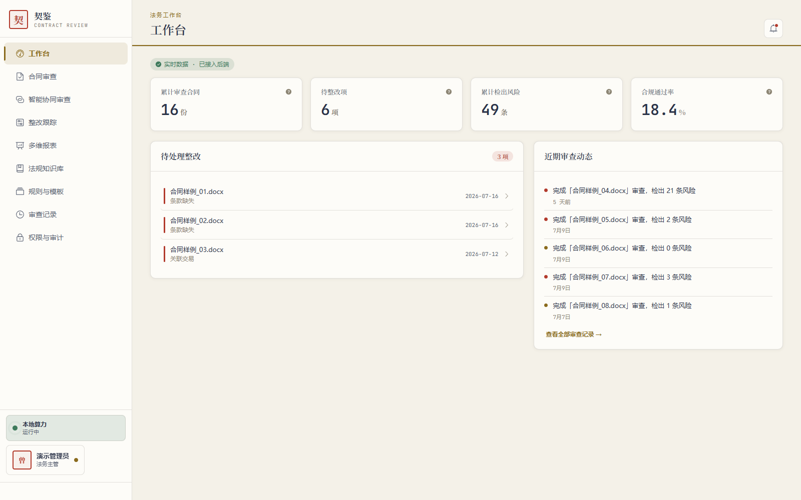
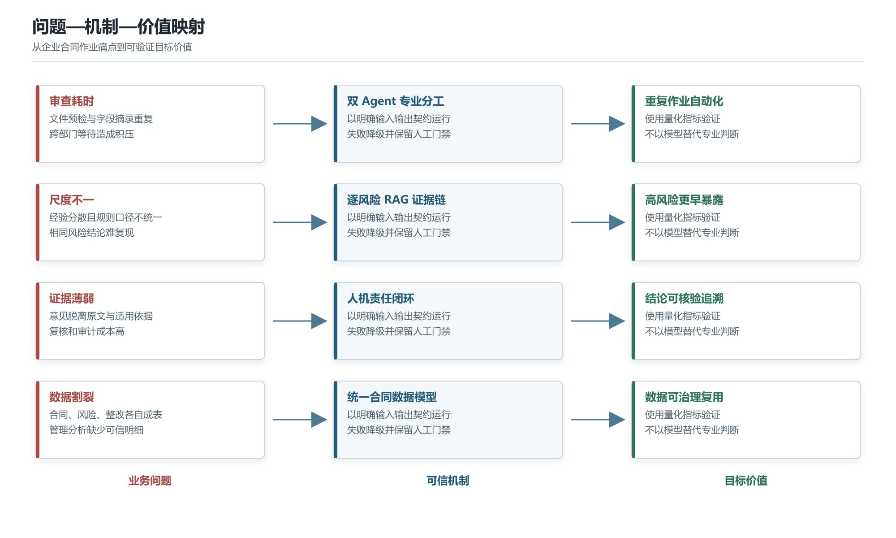
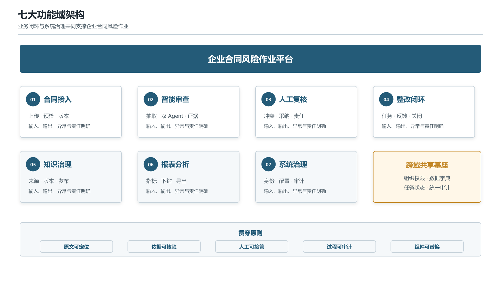
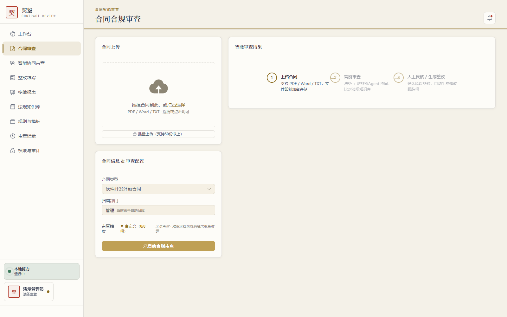
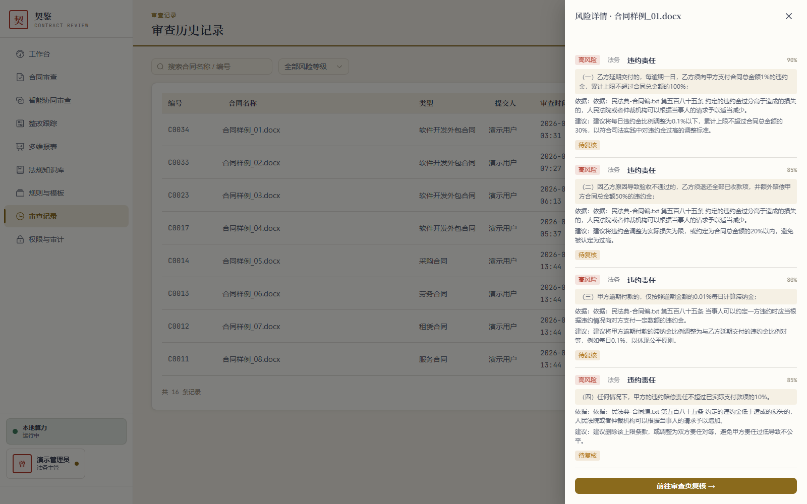
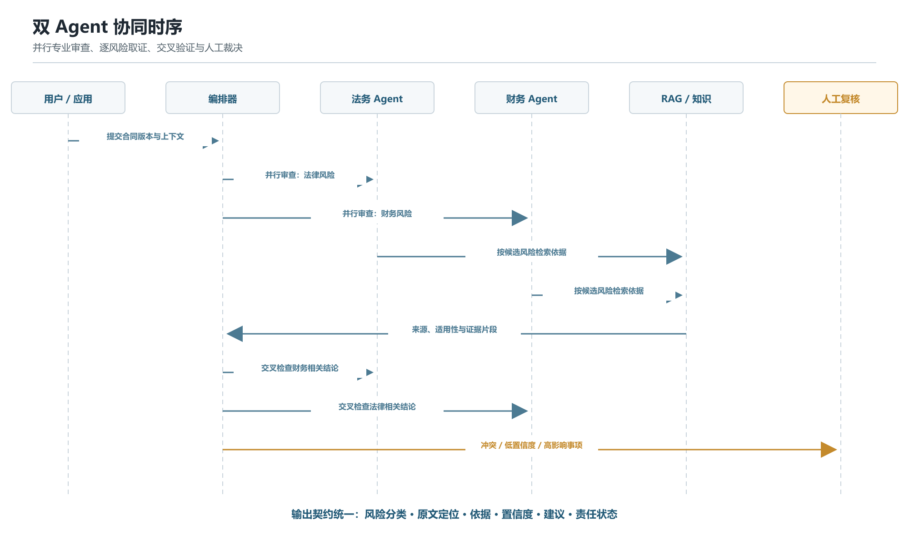
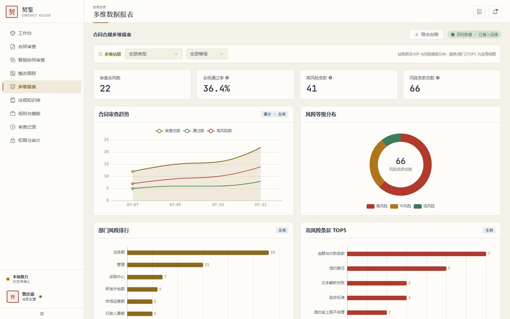
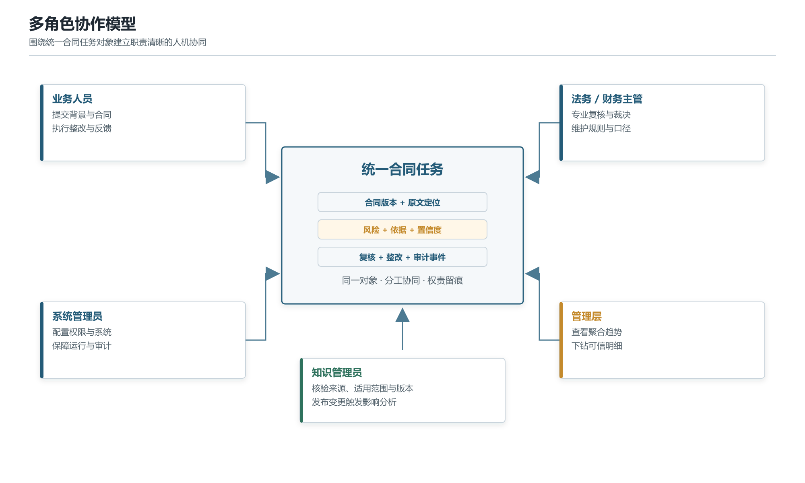

# PAGE: 契鉴
@eyebrow 2026“数字马力杯”第十三届浙江省大学生服务外包创新应用大赛
@subtitle 企业合同合规智能审查系统
@doctype 项目概要介绍
@meta 赛题编号 A03｜企业级合同合规审查与多维报表生成
@meta 法务与财务双 Agent｜风险证据｜人工复核｜整改与报表
@date 2026 年 9 月

# PAGE: 为什么做“契鉴”
> 合同审查真正耗时的，是跨专业判断和意见交接。

一份合同往往同时涉及权利义务、违约责任、金额、税率、付款和验收。法务、财务与业务人员各自批注后，风险原文、依据和修改结果容易散落在多个版本里；签署后，审查意见也很少自然转成整改记录与管理数据。

“契鉴”从这些交接点入手。系统把合同版本、风险、依据、复核意见和整改状态关联起来，让审查人员少做重复搜索，让管理者能够从统计数字回到具体合同。模型负责辅助阅读，人负责最终决定。

# PAGE: “契鉴”是什么
> 一套把合同文件变成可复核风险记录的本地化作业系统。

合同上传后，系统完成加密存储、解析、要素提取和专业审查。法务 Agent 与财务 Agent 分别检查各自范围，RAG 为每条风险查找可能适用的法规或制度；审查人员核对原文和依据后确认、忽略或发起整改。

合同要素、风险等级和处置状态进入多维报表。所有查询继续执行角色与部门权限。系统不自动签署或修改合同，输出属于辅助审查意见。

# PAGE: 一份合同如何完成审查
> 每一步都有状态，失败也有明确出口。

经办人选择合同和审查维度；后端校验格式、大小、权限与文件内容。解析器提取正文、表格和位置，扫描件需要时触发 OCR。通过质量检查后，规则与双 Agent 生成风险候选，知识检索补充依据。

审查人员在风险详情中核对完整上下文，决定是否采纳。确认的问题可以生成整改项，修改稿形成新版本并等待复审。损坏文件、低质量文本、模型超时和权限不足不会被包装成“未发现风险”。

# PAGE: 风险如何被发现和解释
> 风险记录必须回答：原文在哪、问题是什么、依据是什么、谁确认过。

明确的金额、日期和字段矛盾先由规则检查；需要理解上下文的问题交给 Agent。每条候选风险独立检索知识，并检查来源、有效期与适用范围。模型说明与法规原文分开保存，避免把生成内容当成正式依据。

没有可靠来源、原文质量低、置信度不足或两个 Agent 意见冲突时，系统转入人工复核。审查人员可以补充依据、调整等级或标记误报，操作时间和理由都会保留。

# PAGE: 系统如何协同判断
> 双 Agent 的作用是保留专业差异，不是互相投票。

法务 Agent 检查主体、效力、权利义务、违约、保密和争议解决；财务 Agent 检查金额、税率、发票、付款、验收和结算。两者共享必要的合同片段与字段，但使用不同任务和规则范围。

同一原文可能同时产生法律与财务风险。系统合并重复项，保留互补意见；等级或建议矛盾时标记冲突，由授权人员选择、合并或补充交易背景。一个 Agent 失败时，另一方与规则结果仍可查看。

# PAGE: 批量任务与多维报表
> 单份审查形成记录，批量任务和报表复用同一套记录。

批量任务保存批次和每个文件的状态，支持数量上限、异步处理、幂等提交、失败隔离和失败项重试。页面刷新后从服务端恢复进度，某个异常文件不会抹掉已成功结果。一次 50 份以上的真实吞吐仍需用 50 个有效文件加 2 个异常文件实测。

多维报表汇总审查合同数、风险等级、时间趋势、部门排行和高风险条款，并支持合同要素台账与 Excel 导出。下图来自本轮真实本地接口和演示数据库，数字用于说明交互，不代表生产规模或客户收益。

# PAGE: 谁来使用
> 同一份合同，不同角色看到与职责相符的工作面。

业务经办人提交合同、补充交易背景并处理整改；法务核对法律风险和依据；财务确认价税、付款与结算条件；部门负责人决定风险处置；管理者查看趋势与积压；管理员维护账号、角色、字典和日志。

权限由后端同时检查角色和部门，前端隐藏菜单只是界面处理。业务人员不能通过修改地址读取其他部门合同，越权请求返回 403。管理者查看聚合报表，也不因此获得所有合同原文权限。

# PAGE: 当前成果与验证边界
> 做到什么、还缺什么，分开说明。

| 证据状态 | 当前结论 | 后续工作 |
|---|---|---|
| 已验证 | 上传至报表主路径、双 Agent、风险原文与依据、人工复核、整改、多维报表、部门隔离和前端主要状态已有源码与测试证据 | 在交付环境复测配置、容量和组织权限 |
| 已实现，待真实环境验证 | 50+2 批量机制、扫描件 OCR、要素准确率工具、PostgreSQL 迁移和 Compose 编排已经具备 | 使用冻结合同、扫描真值集、PostgreSQL 16 和 Docker 目标机出具报告 |
| 依赖外部条件 | OpenClaw 与 GPU 的性能和能耗尚无真实结论 | 固定模型、提示词、数据集和并发，采集两套设备运行与功率时序 |

2026 年 9 月 3 日本地质量门禁结果为：评测 59 通过；后端 208 通过、1 跳过；前端 13 通过、6 个服务型用例按约定跳过；类型检查和生产构建通过。跳过项不计作通过。

“契鉴”已经具备可运行、可追溯的合同审查主路径。重大合同、证据不足和模型冲突仍由授权人员结合完整材料判断。
