# PAGE: 契鉴
@eyebrow 2026“数字马力杯”第十三届浙江省大学生服务外包创新应用大赛
@subtitle 企业合同合规智能审查系统
@doctype 项目概要介绍
@meta 赛题编号 A03｜企业级合同合规审查与多维报表生成
@meta 面向法务、财务、业务与管理者的可信审查工作台
@date 2026 年 8 月

# PAGE: 前言
> 从“读完一份合同”走向“管理一条风险闭环”

合同连接采购、销售、交付、结算与争议处理。传统审查依赖逐页阅读、人工摘录和跨部门沟通，常见问题不是缺少某个模型，而是专业意见分散、依据难以核验、整改责任难以追踪、合同数据难以沉淀。

**契鉴**面向大型企业、事业单位和政府部门，将合同接入、智能审查、人工复核、整改闭环、知识治理和经营分析组织为同一套可信作业流程。系统以 AI 辅助专业判断，不替代法务或财务作最终决策。

- **能处理：** 支持 PDF、DOCX、TXT 及扫描件的接入、解析与质量检查。
- **能判断：** 法务专家 Agent 与财务会计 Agent 分工审查并交叉验证。
- **能解释：** 每条风险回到合同原文、适用依据、置信度和知识版本。
- **能闭环：** 复核、分派、整改、再审、关闭与审计记录贯通。
- **能管理：** 合同字段、风险和整改状态进入统一台账与多维报表。

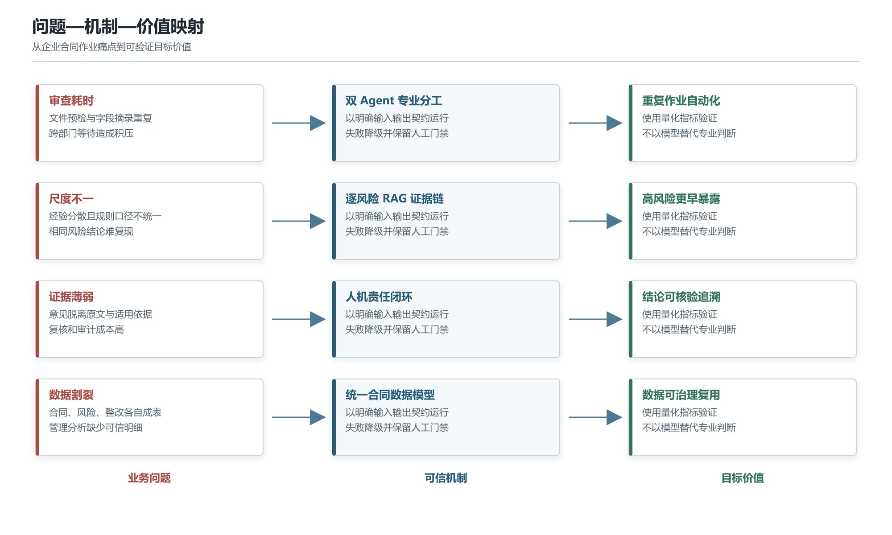

# PAGE: 项目创意
> 创新不在于多调用一个模型，而在于把专业判断变成可核验、可协作、可追责的业务对象。

| 核心创意 | 专业设计 | 业务价值 |
|---|---|---|
| 可解释双 Agent 协同 | 法务与财务 Agent 分工审查，共享必要上下文；冲突不投票覆盖，而是保留双方意见并升级人工 | 发现跨条款、跨专业风险，避免单一视角遗漏 |
| 逐风险证据链 | 以“风险分类 + 合同原文”逐条检索，正式依据经过来源、适用范围和有效期检查 | 结论可定位、引用可验证、版本可追溯 |
| 人机责任闭环 | 高风险、低置信度、无可靠来源和 Agent 冲突自动进入人工队列 | 明确 AI 辅助边界，让专业人员掌握最终决策权 |
| 企业安全部署 | 文件加密、字段脱敏、部门隔离、RBAC、审计日志与本地 Embedding 协同 | 合同原文和知识资产默认留在企业安全域 |

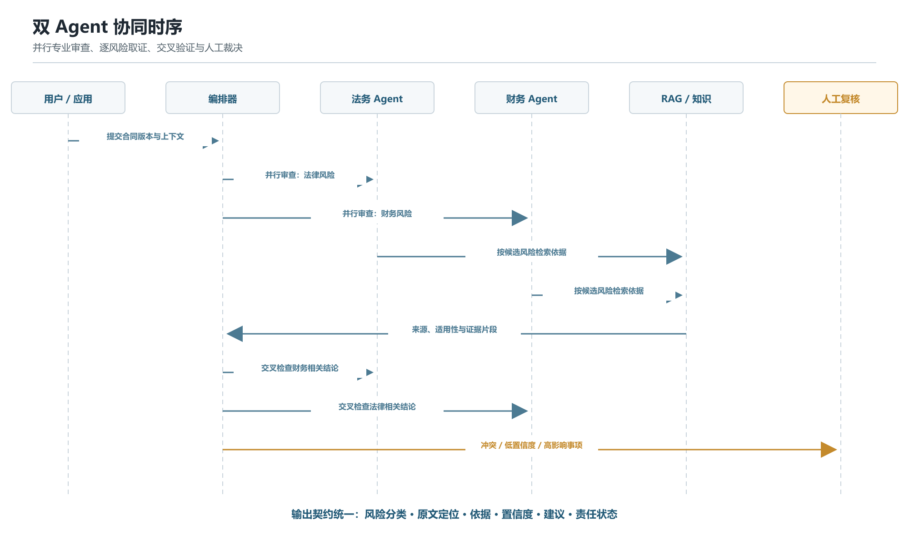

# PAGE: 系统总体方案
> 一条业务闭环、两个专业 Agent、三类可信约束、七个功能域

契鉴以合同版本为主线、风险条目为协作对象、知识版本为依据边界、审计事件为追溯载体。所有功能围绕统一标识关联，避免文件、风险、整改和报表成为彼此割裂的数据孤岛。

| 设计主轴 | 内容 |
|---|---|
| 一条业务闭环 | 接入 → 解析 → 审查 → 复核 → 整改 → 归档 → 分析 |
| 两个专业 Agent | 法务专家 Agent、财务会计 Agent |
| 三类可信约束 | 确定性规则、知识证据、人工责任 |
| 七个功能域 | 合同接入、智能审查、人工复核、整改闭环、知识治理、报表分析、系统治理 |

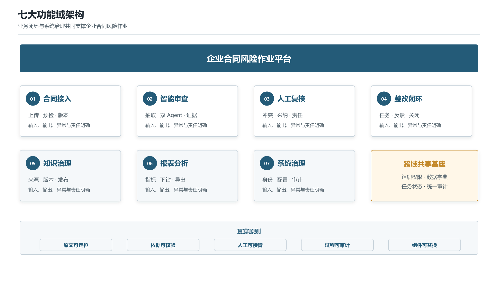

# PAGE: 功能简介
> 围绕真实作业任务组织功能，而不是围绕技术名词堆叠页面。

| 功能域 | 核心能力 | 主要输出 |
|---|---|---|
| 合同接入 | 文件预检、加密存储、单份与批量任务、版本关联 | 合同版本、解析任务、质量状态 |
| 智能审查 | 文档解析、要素抽取、规则校验、双 Agent、RAG 检索 | 结构化字段、候选风险、审查摘要 |
| 人工复核 | 原文定位、依据核验、风险确认、忽略说明、冲突处理 | 复核结论、责任角色、操作记录 |
| 整改跟踪 | 分派、处理、版本更新、再审与关闭 | 整改任务、新版本、关闭证据 |
| 法规知识库 | 导入、切片、元数据、版本、有效期和适用范围治理 | 可检索知识、版本关系、影响范围 |
| 多维报表 | 台账、风险分布、部门排行、筛选、钻取和 Excel 导出 | 经营看板、明细台账、导出文件 |
| 权限与审计 | 四角色 RBAC、部门隔离、字段脱敏、操作与模型日志 | 权限矩阵、审计事件、调用记录 |

系统当前前端模拟开关全部关闭，主要业务页面使用真实 API 数据；登录、审查、协同、整改、报表、知识、历史、规则和管理模块已形成前后端联动。

# PAGE: 核心业务流程
> 每一步都留下状态、证据和责任，不让审查意见停留在一次性报告中。

1. **提交与预检：** 用户上传合同并确认合同类型、审查维度；系统校验格式、大小、重复性和基础安全条件。
2. **解析与质量门：** 提取正文、表格和位置映射；扫描件调用 OCR，低置信度或短文本进入人工复核。
3. **专业审查：** 法务 Agent 判断权利义务与法律风险，财务 Agent 核验金额、税率、付款和结算约束。
4. **检索与取证：** RAG 围绕每条候选风险检索适用知识，过滤错误法域、合同类型和失效版本。
5. **合并与分级：** 协同层去重、识别互补或冲突意见，统一输出风险等级、原文、依据和建议。
6. **人工复核与整改：** 授权人员确认、忽略或发起整改；高风险忽略和关闭必须说明理由或证据。
7. **归档与分析：** 文件、字段、风险、依据、人工动作和整改结果共同归档，并进入权限一致的报表。

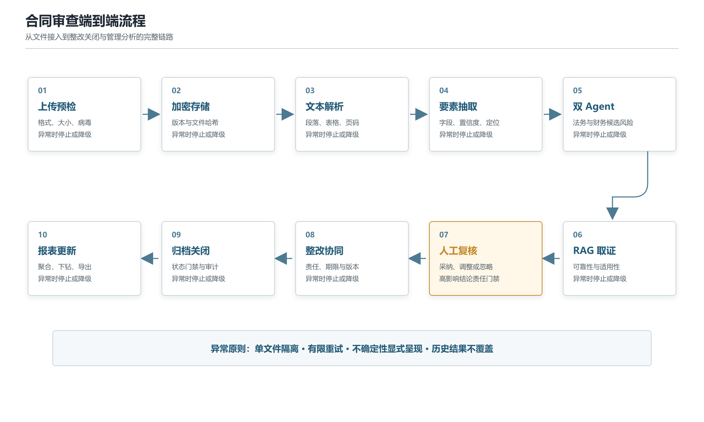

# PAGE: 技术架构与开发环境
> 模块化交付、稳定契约、可替换模型，优先保证企业场景的可维护性。

| 层级 | 技术与组件 | 职责 |
|---|---|---|
| 交互层 | Vue 3、TypeScript、Element Plus、ECharts、Pinia | 工作台、审查复核、整改、知识、报表和管理界面 |
| 应用层 | FastAPI、SQLAlchemy、Pydantic、JWT/RBAC | API、业务状态、权限校验、审计和数据契约 |
| 智能层 | LLM Adapter、法务/财务 Agent、规则引擎 | 语义审查、专业协同、冲突识别和结构化输出 |
| 检索与解析 | 本地 BGE Embedding、BM25、RRF、RapidOCR | 混合检索、适用性过滤、文档解析与质量评估 |
| 任务与数据 | Celery、Redis、SQLite/PostgreSQL、Alembic | 异步批次、租约重试、持久化和可回滚迁移 |
| 部署与安全 | Nginx、容器编排、加密存储、脱敏与日志 | 私有化部署、信任边界、最小权限和运行追踪 |

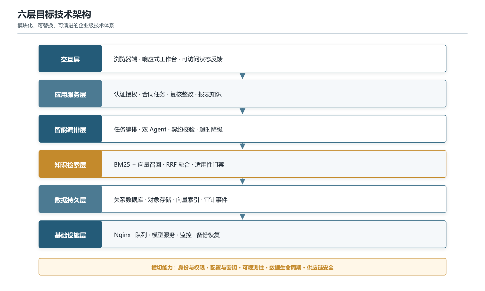

# PAGE: 应用对象与典型场景
> 同一份合同、统一的数据边界、不同角色的专业工作面。

| 角色 | 典型任务 | 系统支持 |
|---|---|---|
| 法务主管 | 审查主体、权利义务、违约、保密、知识产权和争议解决 | 法务 Agent、法规依据、冲突复核、高风险处置 |
| 财务主管 | 核验金额、税率、发票、付款节点、结算条件和资金风险 | 财务 Agent、跨条款校验、金额与付款风险提示 |
| 业务经办人 | 提交合同、补充交易背景、处理整改、跟踪状态 | 引导式上传、整改任务、进度反馈、字段级脱敏 |
| 管理者与管理员 | 观察风险分布、部门绩效、知识质量和系统运行 | 多维报表、权限矩阵、审计日志、模型调用记录 |

典型场景包括采购合同签署前审查、销售合同责任边界核验、服务合同付款与验收联动检查、批量历史合同风险盘点，以及企业制度或法规更新后的知识治理。

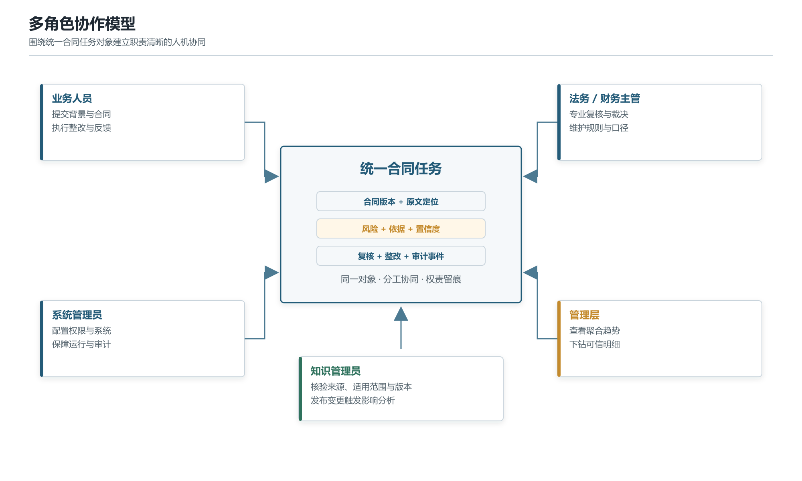

# PAGE: 项目优势与安全体系
> 可信合同智能化必须同时回答“结果能否相信”和“数据是否安全”。

- **证据先于结论：** 每条风险同时展示合同原文、来源依据、修改建议、置信度和复核状态。
- **无依据正确降级：** 检索失败或来源不可靠时，系统限制置信度并提示人工补充，不让内置规则冒充法律条文。
- **数据最小暴露：** 合同上传即加密落盘，业务角色按部门过滤，敏感姓名和风险原文按角色脱敏。
- **全过程留痕：** 登录、上传、审查、复核、整改和模型调用均形成可查询记录，保留时间、角色、版本和 IP。
- **模型与知识可治理：** LLM 通过适配层切换；知识记录来源、条文号、版本、有效期、适用合同和向量模型信息。
- **私有化可演进：** 本地 Embedding 强制离线，生产架构支持 PostgreSQL、Redis、Worker 和本地模型服务。

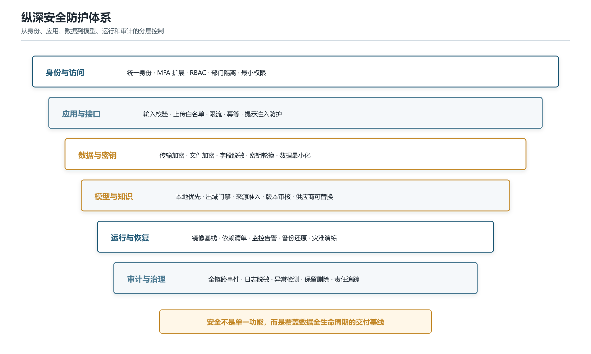

# PAGE: 验证情况与责任边界
> 只呈现可复核证据，不把设计目标、演示数据或环境假设写成既成事实。

| 验证对象 | 最近稳定证据 | 结论 |
|---|---|---|
| 后端自动化测试 | 125 passed，1 skipped，6 warnings | 零失败；跳过项为环境相关集成条件 |
| 前端自动化测试 | 11 passed，3 skipped | 三项 E2E 在未配置运行地址时按设计跳过 |
| 工程质量 | TypeScript 类型检查退出 0；Vite 构建退出 0 | 生产构建成功转换 2348 个模块 |
| 应用结构 | FastAPI 导入实测：13 张数据库表（ORM）、40 条 /api/ 路由 | 稳定口径已与 README、进度记录统一 |
| RAG 演示库 | 本机历史验证 973 条知识，向量均为 512 维 | 数据库不随源码分发，新环境需重新初始化 |

## 外部验收边界

- 冻结扫描件的 OCR 字符准确率仍为**待实测**，真实引擎冒烟不能替代准确率结论。
- 52 份冻结文件批量吞吐、Compose 目标环境、Linux 进程回收路径仍需外部验收环境复核。
- OpenClaw/GPU 对照机和功率数据未提供，不生成模拟性能或节能结论。
- 系统输出属于辅助审查意见，不构成法律裁决；重大交易与争议事项由授权人员结合完整证据决定。

# PAGE: 结语与发展方向
> 契鉴把一次模型回答转化为可持续治理的企业合同风险能力。

契鉴已经形成从合同上传、智能审查、证据核验到人工复核、整改跟踪和多维分析的核心闭环。项目的价值不只是缩短阅读时间，更在于统一跨部门审查尺度、保留每项判断依据、推动风险真正关闭，并将非结构化合同沉淀为可治理的数据资产。

后续演进坚持“证据成熟后再扩展”的原则：

- **业务闭环期：** 稳定高频合同和 P1 流程，持续验证任务完成率与风险闭环质量。
- **可信增强期：** 完善冻结样本评测、知识版本门禁、无依据降级和安全审计。
- **企业交付期：** 在目标环境完成 PostgreSQL、对象存储、异步任务、统一身份、备份恢复和私有模型验收。
- **规模运营期：** 基于真实容量和组织边界扩展行业知识包、多组织治理和标准系统集成。

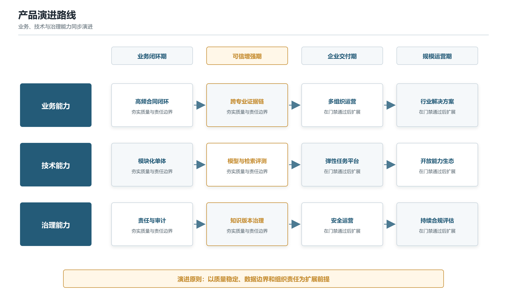

# PAGE: 系统关键界面展示
> 真实业务界面覆盖管理工作台、合同审查、风险证据复核和整改闭环。

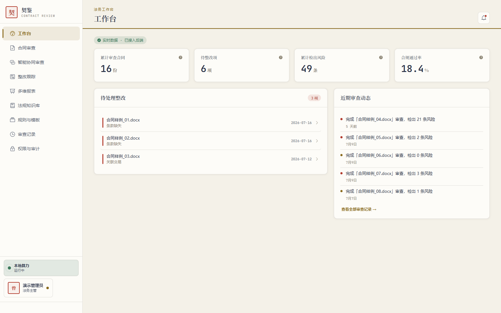
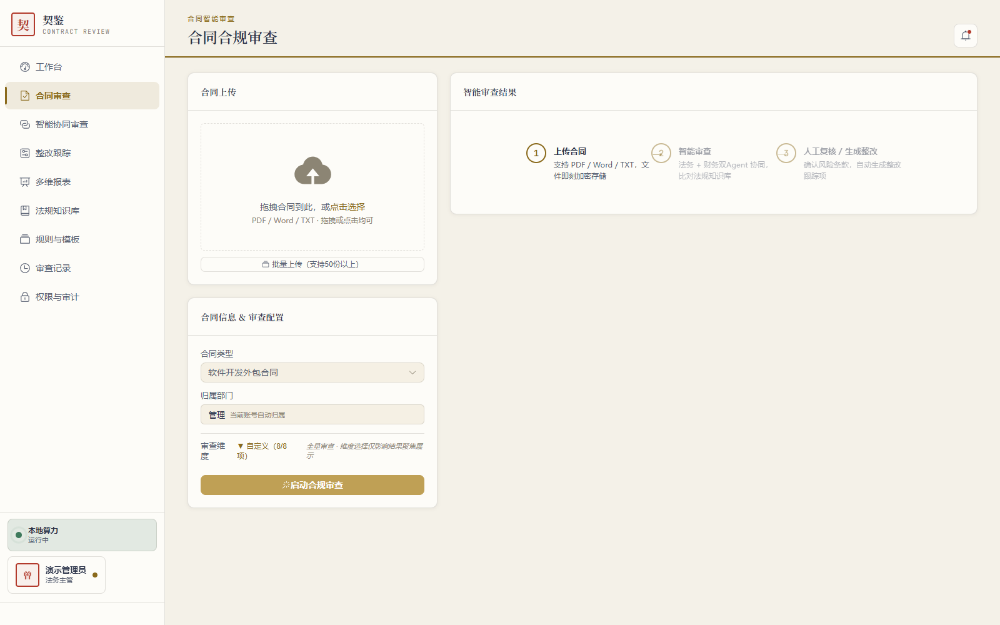
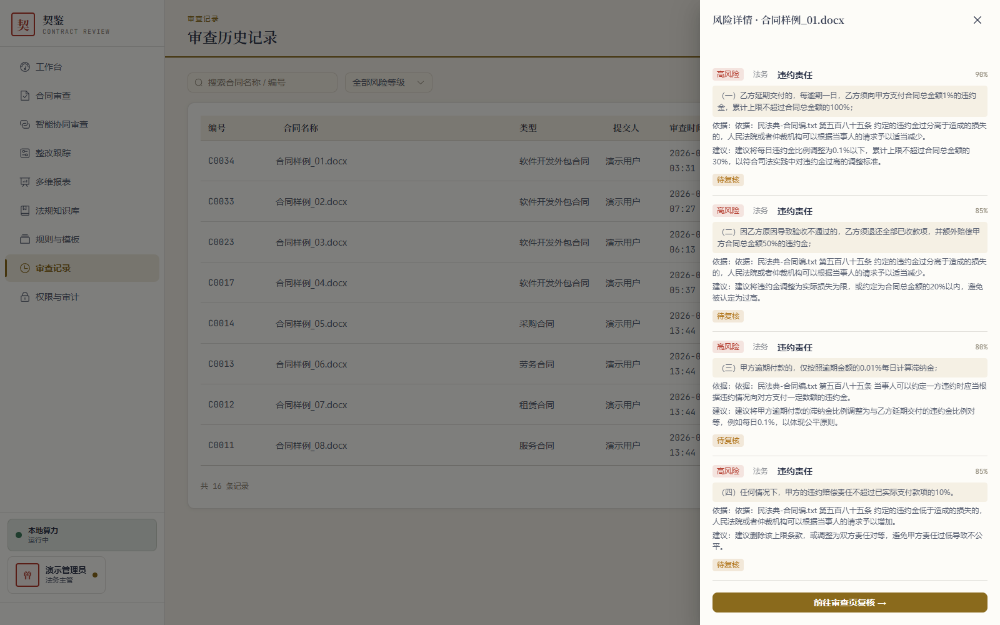
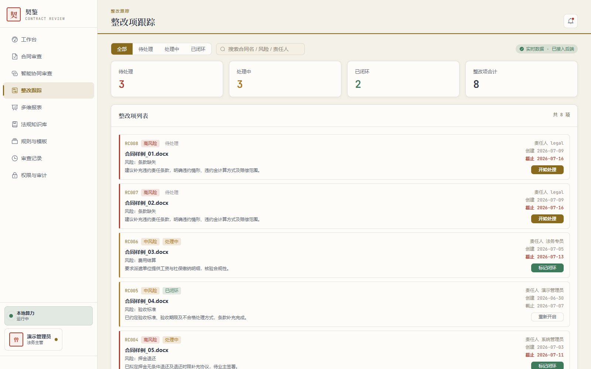

契鉴｜让每一项合同风险都有原文、有依据、有责任、有闭环。
