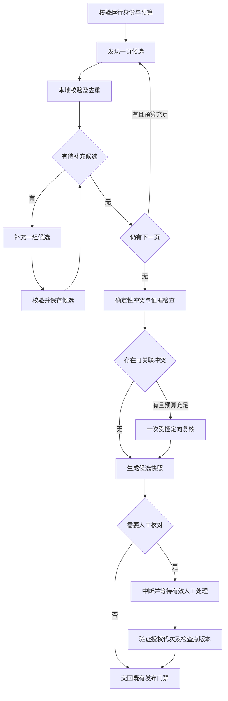

# 契鉴局部 LangGraph 试点设计

日期：2026-11-01。状态：用户已批准；独立回放原型及基础修复已实现，正式图集成与真实 A/B 尚未实施。验收见 docs/engineering-hardening/langgraph-pilot-acceptance.md。

## 目标与范围

用独立原型验证：相同受控输入下，细分发现/补充节点是否改善进度可见性和失败恢复，条件复核是否保持有界，以及人工中断恢复是否遵守现有权限与代次规则。

本试点不接管生产任务，不修改正式 API、业务库 schema 或前端，不替代 Celery，不改变证据可信度规则，不连接 LangSmith 云服务。原型中的状态、授权与发布使用隔离测试仓库；只有后续集成测试通过，才能声称业务集成完成。

当前基线及三种方案的比较见 `docs/engineering-hardening/langgraph-evaluation.md`。选择“先基础修复，再局部试点”，不全量迁移。

## 职责

| 组件 | 职责 |
|---|---|
| 既有任务调度 | 排队、租约、取消、进程启动；仍使用原生产实现 |
| 既有业务数据库 | 合同归属、任务代次、执行权、审批和最终结果的唯一权威 |
| 图执行器 | 局部节点顺序、条件路由、检查点和人工中断；只输出候选结果 |
| 模型适配器 | 保留现有出站策略、超时、结构化校验和审查调用预算 |
| 发布桥接层 | 集成阶段在事务内检查 generation/execution_token，调用既有质量门禁发布 |

SQLite 图检查点是工作流缓存，不能作为人工批准记录或最终结果来源。未来接入 PostgreSQL 属于单独任务。

## 节点粒度与流程

任一节点出现预算不足、时限到达或不可恢复输出错误：保存已验证部分与准确机器码，进入“需要复核”候选终态，不继续新模型调用。身份失效或执行权丢失：拒绝继续及发布。存储失败：停止推进，不把未落盘结果标记完成。

“发现一页”和“补充一组”均是可独立恢复的节点。第一版为单窗口、单角色的顺序子图；双角色仍由现有外层负责。扩展并发属于后续评估，避免把并行收益混入框架对比。

补充组大小首轮保持 1，以和旧链路口径一致；批量开关另做独立实验，不能将其收益计为 LangGraph 的收益。无冲突时定向复核调用数为 0；有冲突时该子图最多 1 次；不明结果交人工，不增加新一轮自由辩论。二次证据复核保留原有门禁及预算，不能被该一次定向复核替代。

## 状态与身份

图状态保存：contract_id、audit_job_id、generation、run_fingerprint、contract_hash、knowledge_revision、role、window_id、page_cursor、已验证候选引用、待补充候选 ID、已提交调用 ID、剩余预算、deadline、issue codes、节点事件序号、人工中断 ID。

图 thread_id 由上述任务身份生成，不能使用用户提供的合同 ID 直接查找跨任务检查点。execution_token 每次运行从业务仓库读取并校验，不把旧 token 当作可恢复凭据。模型、提示词、规则、知识修订或合同正文发生变化时，run_fingerprint 改变，旧检查点拒绝复用。

合成原型可落盘候选正文；生产方案必须先明确加密、保留期限和访问隔离，不能直接复制本地明文 SQLite 做生产部署。报告与事件只保留计数、机器码和哈希，不包含合同内容或密钥。

## 事件、预算和恢复

节点进入、成功提交、失败及人工中断产生事件，字段包含 run identity、node、sequence、event_type、已完成计数和更新时间。百分比仅由已完成工作映射；未知总数时显示阶段与数量，不按经过时间制造完成度。模型等待期间展示最后活动时间与运行心跳，不能把心跳当新节点完成。

每个模型请求在发出前原子预留预算并记录调用 ID，成功或失败后结算；预算跨恢复持久化，不因重启归零。deadline 持久化为 UTC 绝对时间，恢复时转换为本进程剩余时长，不能复用旧进程的 monotonic 值，也不能因人工等待自动刷新时限。

节点成功检查点提交后，重启不得重跑该节点。若外部模型已响应但检查点尚未提交就崩溃，供应商没有幂等支持时仍可能重复计费：不能承诺外部调用恰好一次。调用账本中预留未结算的项保持占用；通过 request_id 查明可复用响应后提交，否则保留未知状态并交人工或受控重试，不能静默释放预算。

图缓存与业务发布不能假设跨两个数据库原子提交。最终候选快照包含内容哈希；业务发布在现有事务中校验代次与执行权，并按 job/generation/snapshot_hash 幂等应用。发布成功但图未确认时，恢复先读取业务发布记录，避免重复写入或重复审批。

## 人工处理

图中断不等于审批完成。原型仅验证隔离的授权仓库；正式集成时由服务端校验当前登录用户、合同权限、岗位权限、中断 ID、代次及任务状态，人工决策持久化后才允许 resume。

模型不得伪造人工决定。用户拒绝、材料不足或授权失效时保持待核/拒绝状态，不升级为已核验。不在图内写入自动批准。人工处理超过 deadline 后只允许已有证据和发布校验；新的模型复查必须创建明确的新任务和预算。

## 验收矩阵

| 优先级 | 场景 | 必须满足 |
|---|---|---|
| P1 | 无冲突 | 不新增定向复核调用 |
| P1 | 存在冲突及持续分歧 | 仅一次定向复核；持续分歧保留人工待核 |
| P1 | 调用/保守 token/时限耗尽 | 不发新调用，机器码准确，恢复不重置预算 |
| P1 | 节点已提交后进程重启 | 跳过已完成节点；保留候选和进度序号 |
| P1 | 外部响应后、检查点提交前崩溃 | 未知调用可追踪；不宣称恰好一次，不无界重试 |
| P1 | 新代次、正文或知识版本变化 | 旧图拒绝恢复及发布 |
| P1 | execution_token 被取代 | 旧执行者不再调用模型或写入结果 |
| P1 | 人工中断/合法恢复/重复恢复 | 权限、决策持久化、幂等均有效 |
| P1 | 错合同、跨权限、伪造或过期中断 | 拒绝读取与恢复，不发生发布 |
| P1 | 发布后图确认前崩溃 | 查业务快照，重复恢复不重复发布 |
| P2 | 检查点写入失败、非法 JSON、截断 | 明确失败原因；不推进假完成；已验证部分保留 |
| P2 | 禁用试点 | 原有调用路径和结果结构可独立运行 |

先用确定性回放验证流程与恢复，这不证明模型质量。之后在相同样本、模型、预算、角色、批量设置及知识快照下做真实 A/B，分别报告每单耗时、调用数、覆盖、待核比例、错误类型与恢复重复调用数。不得用两份合成样本计算有代表性的 P95 或宣称法律准确率提升。

## 实施顺序与晋级条件

1. 先修准确预算机器码，补真实阶段反馈，单独评估已有批量补充和首审预算预留；这些基础问题无需等待图框架。
2. 经安装确认后，在独立虚拟环境按已审计版本哈希锁安装 LangGraph 和 SQLite 检查点依赖；运行 pip check，禁用外部追踪。
3. 实现隔离子图、持久化调用账本、进度事件与回放测试，不改生产入口。
4. 验收矩阵通过后做受控真实 A/B。只有证明恢复优势、无额外无冲突调用、覆盖不降低且耗时没有稳定退化，才评审正式集成。
5. 正式集成另行修改代码、加入默认关闭的开关，运行完整质量门禁并实测正常、失败和回退路径。当前设计审批不代表生产部署授权。

安装来源、40 包公开漏洞记录见评估报告；独立环境安装与测试见验收记录。演示可表述“独立原型已验证进程重启恢复”，不能表述“正式审查链路已接入 LangGraph”或“已证明准确率和性能提升”。
